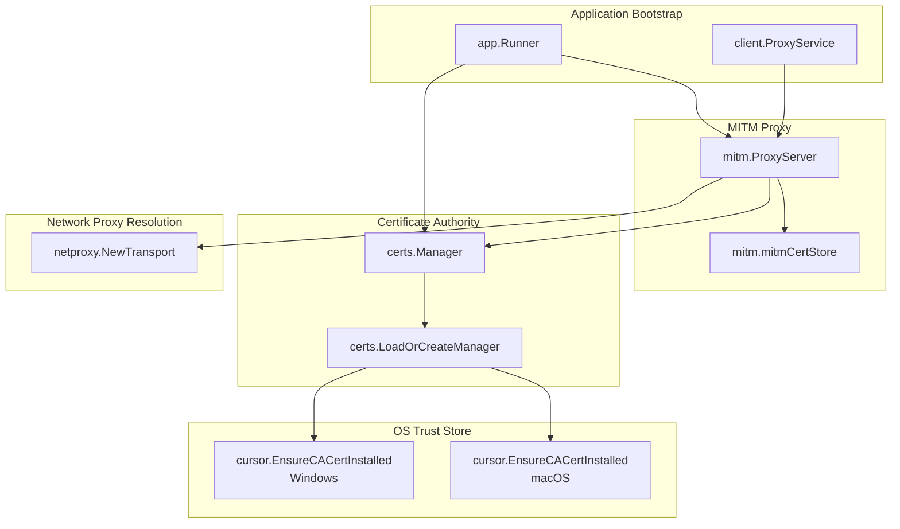
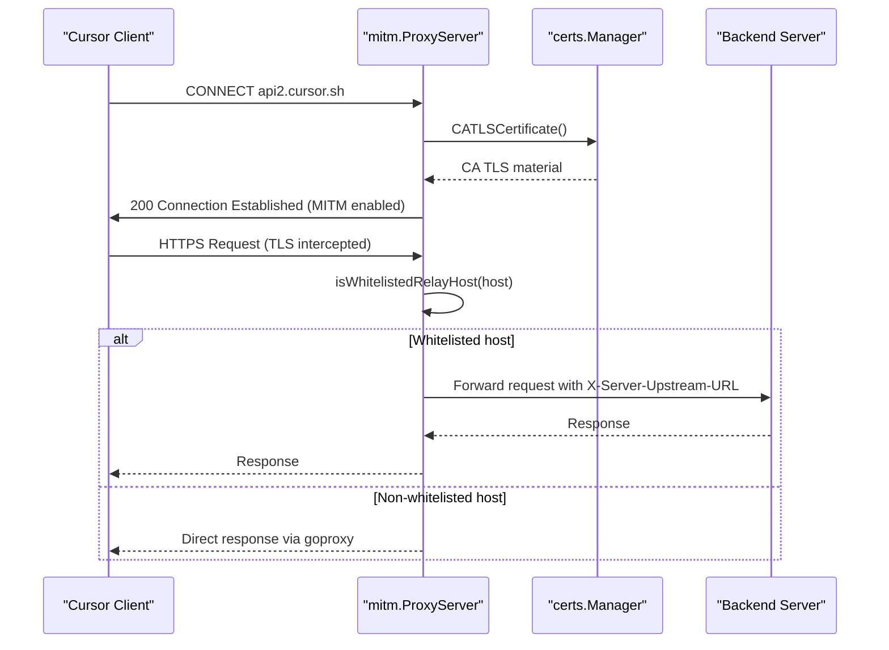
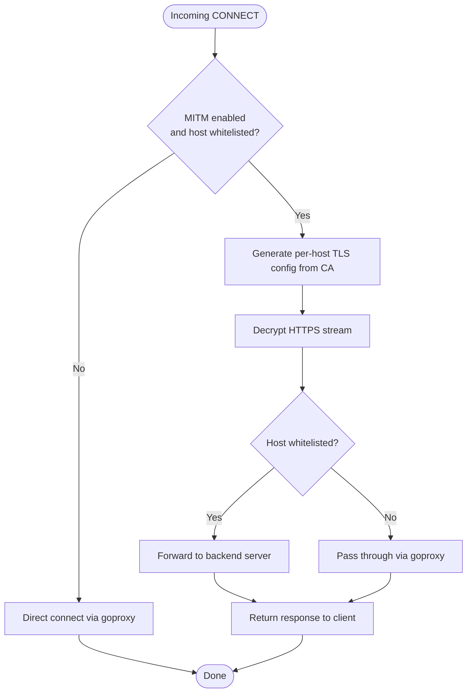
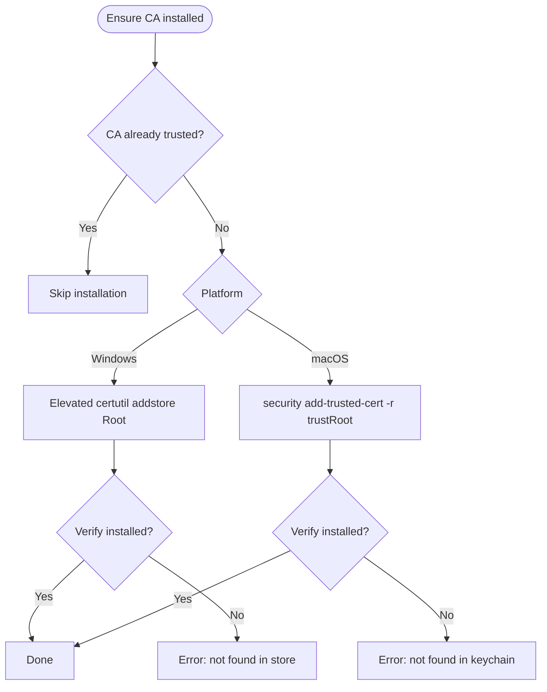
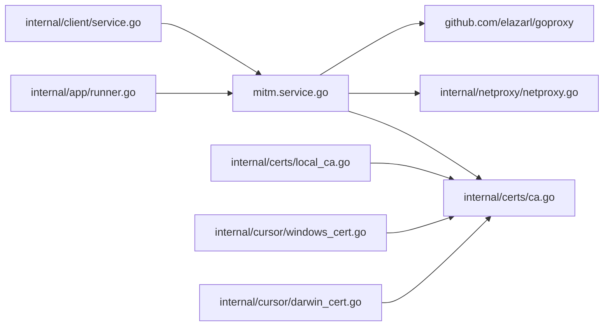

# MITM Proxy Service

<cite>
**Referenced Files in This Document**
- [service.go](file://internal/mitm/service.go)
- [local_relay_bridge.go](file://internal/mitm/local_relay_bridge.go)
- [doc.go](file://internal/mitm/doc.go)
- [ca.go](file://internal/certs/ca.go)
- [local_ca.go](file://internal/certs/local_ca.go)
- [netproxy.go](file://internal/netproxy/netproxy.go)
- [windows_cert.go](file://internal/cursor/windows_cert.go)
- [darwin_cert.go](file://internal/cursor/darwin_cert.go)
- [runner.go](file://internal/app/runner.go)
- [lifecycle.go](file://internal/client/lifecycle.go)
- [service.go](file://internal/client/service.go)
- [main.go](file://cmd/cursor-proxy-debugger/main.go)
</cite>

## Table of Contents
1. [Introduction](#introduction)
2. [Project Structure](#project-structure)
3. [Core Components](#core-components)
4. [Architecture Overview](#architecture-overview)
5. [Detailed Component Analysis](#detailed-component-analysis)
6. [Dependency Analysis](#dependency-analysis)
7. [Performance Considerations](#performance-considerations)
8. [Troubleshooting Guide](#troubleshooting-guide)
9. [Conclusion](#conclusion)

## Introduction
This document explains the MITM (Man-in-the-Middle) proxy service used to intercept HTTPS traffic for Cursor. It covers how the proxy establishes TLS interception, manages a local certificate authority, routes whitelisted requests to an internal backend server, and forwards other requests directly. It also documents certificate generation and installation across operating systems, request filtering behavior, logging mechanisms, security considerations, and operational guidance such as configuration options, performance tuning, and monitoring.

## Project Structure
The MITM functionality is implemented primarily under `internal/mitm`, with supporting components for CA management under `internal/certs`, system-level network proxy resolution under `internal/netproxy`, and OS-specific certificate trust store integration under `internal/cursor`. The application bootstrap wires these pieces together in `internal/app/runner.go`, while lifecycle control is exposed through `internal/client/lifecycle.go` and `internal/client/service.go`. A standalone debugging proxy exists under `cmd/cursor-proxy-debugger/main.go`.

**Diagram sources**
- [runner.go:120-138](file://internal/app/runner.go#L120-L138)
- [service.go:180-206](file://internal/mitm/service.go#L180-L206)
- [ca.go:23-59](file://internal/certs/ca.go#L23-L59)
- [local_ca.go:22-56](file://internal/certs/local_ca.go#L22-L56)
- [windows_cert.go:175-189](file://internal/cursor/windows_cert.go#L175-L189)
- [darwin_cert.go:119-132](file://internal/cursor/darwin_cert.go#L119-L132)
- [netproxy.go:49-59](file://internal/netproxy/netproxy.go#L49-L59)

**Section sources**
- [runner.go:120-138](file://internal/app/runner.go#L120-L138)
- [service.go:180-206](file://internal/mitm/service.go#L180-L206)

## Core Components
- MITM Proxy Server: Implements HTTP CONNECT interception, per-host dynamic certificate issuance, request routing, CORS preflight handling, and upstream forwarding.
- Certificate Manager: Loads or generates an installation-specific CA, validates CA material, and issues per-host leaf certificates.
- Local CA Persistence: Generates, persists, and secures CA files; detects legacy shared CA and regenerates when needed.
- Network Proxy Resolver: Provides environment/system-aware outbound proxy resolution for upstream connections.
- OS Trust Store Integration: Installs or removes trusted root certificates on Windows and macOS.
- Application Bootstrap and Lifecycle: Initializes services, starts/stops the proxy, and applies Cursor settings.

**Section sources**
- [service.go:32-57](file://internal/mitm/service.go#L32-L57)
- [ca.go:23-59](file://internal/certs/ca.go#L23-L59)
- [local_ca.go:22-56](file://internal/certs/local_ca.go#L22-L56)
- [netproxy.go:49-59](file://internal/netproxy/netproxy.go#L49-L59)
- [windows_cert.go:175-189](file://internal/cursor/windows_cert.go#L175-L189)
- [darwin_cert.go:119-132](file://internal/cursor/darwin_cert.go#L119-L132)
- [runner.go:120-138](file://internal/app/runner.go#L120-L138)
- [lifecycle.go:55-128](file://internal/client/lifecycle.go#L55-L128)

## Architecture Overview
The MITM proxy listens for HTTP CONNECT requests. For whitelisted hosts, it performs TLS interception using dynamically generated leaf certificates signed by the local CA. After decryption, requests to whitelisted Relay hosts are forwarded to the internal backend server; all other requests are passed through via goproxy’s direct upstream path. Outbound connections use a transport that respects environment and system proxy settings.

**Diagram sources**
- [service.go:388-449](file://internal/mitm/service.go#L388-L449)
- [ca.go:69-79](file://internal/certs/ca.go#L69-L79)

**Section sources**
- [service.go:360-449](file://internal/mitm/service.go#L360-L449)

## Detailed Component Analysis

### MITM Proxy Server
Responsibilities:
- ListenAndServe/Start/Stop lifecycle management.
- Configure goproxy with custom logger, connection error handler, and transport.
- Enable MITM only for whitelisted relay hosts.
- Route whitelisted requests to the backend server with original URL preservation.
- Handle local CORS preflight requests for whitelisted hosts.
- Remove hop-by-hop headers and sanitize logs.

Key behaviors:
- Base URL parsing and runtime updates.
- Rate-limited logging to avoid log storms.
- Per-host certificate caching to reduce RSA/x509 operations.
- Strict validation of base URL scheme and host.

**Diagram sources**
- [service.go:388-449](file://internal/mitm/service.go#L388-L449)
- [service.go:453-488](file://internal/mitm/service.go#L453-L488)

Configuration and routing details:
- Whitelist logic includes specific API hosts and any `.cursor.sh` suffix.
- Original request URL is preserved and injected into the backend request header.
- Hop-by-hop headers are removed before forwarding.
- CORS preflight responses are served locally for whitelisted hosts.

Operational controls:
- Start/Stop with graceful shutdown.
- Snapshot exposes listen address, base URL, and running state.
- Error handlers filter noisy TLS handshake messages and expected client disconnects.

**Section sources**
- [service.go:180-206](file://internal/mitm/service.go#L180-L206)
- [service.go:238-249](file://internal/mitm/service.go#L238-L249)
- [service.go:251-328](file://internal/mitm/service.go#L251-L328)
- [service.go:360-449](file://internal/mitm/service.go#L360-L449)
- [service.go:453-488](file://internal/mitm/service.go#L453-L488)
- [service.go:635-658](file://internal/mitm/service.go#L635-L658)
- [service.go:660-688](file://internal/mitm/service.go#L660-L688)
- [service.go:690-735](file://internal/mitm/service.go#L690-L735)
- [service.go:737-791](file://internal/mitm/service.go#L737-L791)

### Certificate Manager and Local CA
Responsibilities:
- Load or generate an installation-specific CA.
- Validate CA certificate and private key compatibility.
- Issue per-host leaf certificates with appropriate constraints.
- Persist CA files securely and detect legacy shared CA.

Key behaviors:
- NewManagerFromPEM constructs a Manager from PEM data.
- CATLSCertificate returns TLS-compatible CA material.
- CertificateForServerName creates per-host leaf certificates cached by hostname.
- LoadOrCreateManager handles first-run generation, file permissions, and legacy CA replacement.
- generateCA produces a self-signed CA with signing capabilities and a long validity period.

Security considerations:
- Private key file permissions restricted to owner-only access.
- Atomic file writes for CA persistence.
- Legacy shared CA detection and regeneration to mitigate compromise risks.

**Section sources**
- [ca.go:23-59](file://internal/certs/ca.go#L23-L59)
- [ca.go:69-79](file://internal/certs/ca.go#L69-L79)
- [ca.go:81-154](file://internal/certs/ca.go#L81-L154)
- [ca.go:178-237](file://internal/certs/ca.go#L178-L237)
- [local_ca.go:22-56](file://internal/certs/local_ca.go#L22-L56)
- [local_ca.go:71-95](file://internal/certs/local_ca.go#L71-L95)
- [local_ca.go:97-134](file://internal/certs/local_ca.go#L97-L134)
- [local_ca.go:136-165](file://internal/certs/local_ca.go#L136-L165)
- [local_ca.go:167-178](file://internal/certs/local_ca.go#L167-L178)

### OS-Specific Certificate Trust Installation
Responsibilities:
- Install the local CA into the system trust store so clients accept MITM-signed certificates.
- Remove legacy shared CA if present.

Windows:
- Uses certutil.exe via elevated PowerShell to add/remove certificates in LocalMachine\Root.
- Detects user cancellation of elevation.
- Verifies installation success.

macOS:
- Uses security CLI to add trusted root to login.keychain-db.
- Removes legacy shared CA if found.
- Verifies installation success.

**Diagram sources**
- [windows_cert.go:149-173](file://internal/cursor/windows_cert.go#L149-L173)
- [darwin_cert.go:87-117](file://internal/cursor/darwin_cert.go#L87-L117)

**Section sources**
- [windows_cert.go:48-81](file://internal/cursor/windows_cert.go#L48-L81)
- [windows_cert.go:83-104](file://internal/cursor/windows_cert.go#L83-L104)
- [windows_cert.go:110-147](file://internal/cursor/windows_cert.go#L110-L147)
- [windows_cert.go:149-189](file://internal/cursor/windows_cert.go#L149-L189)
- [darwin_cert.go:35-55](file://internal/cursor/darwin_cert.go#L35-L55)
- [darwin_cert.go:57-85](file://internal/cursor/darwin_cert.go#L57-L85)
- [darwin_cert.go:87-132](file://internal/cursor/darwin_cert.go#L87-L132)

### Network Proxy Resolution
Responsibilities:
- Provide environment/system-aware proxy resolution for outbound connections.
- Cache resolver snapshots and close idle connections when configuration changes.
- Normalize and sanitize proxy descriptions without leaking credentials.

Key behaviors:
- InstallDefaultTransport replaces default HTTP transport with proxy-aware transport.
- ProxyForRequest resolves proxy based on environment variables and system settings.
- Bypass rules support wildcards, simple hostnames, and PAC ignore flags.

**Section sources**
- [netproxy.go:31-59](file://internal/netproxy/netproxy.go#L31-L59)
- [netproxy.go:61-67](file://internal/netproxy/netproxy.go#L61-L67)
- [netproxy.go:120-146](file://internal/netproxy/netproxy.go#L120-L146)
- [netproxy.go:160-193](file://internal/netproxy/netproxy.go#L160-L193)
- [netproxy.go:229-246](file://internal/netproxy/netproxy.go#L229-L246)
- [netproxy.go:368-430](file://internal/netproxy/netproxy.go#L368-L430)

### Application Bootstrap and Lifecycle
Responsibilities:
- Initialize logger, install default transport, ensure app data directory.
- Load or create CA manager and log CA info.
- Create MITM proxy server and bridge services.
- Auto-start proxy service and manage UI/tray interactions.
- Expose start/stop lifecycle methods that coordinate proxy and backend services.

Key behaviors:
- Default backend base URL and proxy listen address are configured at startup.
- ProxyService ensures backend host readiness and updates proxy base URL dynamically.
- Stop sequence gracefully shuts down proxy, clears Cursor settings, and stops embedded backend.

**Section sources**
- [runner.go:120-138](file://internal/app/runner.go#L120-L138)
- [runner.go:423-439](file://internal/app/runner.go#L423-L439)
- [lifecycle.go:55-128](file://internal/client/lifecycle.go#L55-L128)
- [lifecycle.go:130-170](file://internal/client/lifecycle.go#L130-L170)
- [service.go:122-150](file://internal/client/service.go#L122-L150)

### Standalone Debugger Proxy
A separate debugging proxy can be launched to capture and inspect Cursor protocol exchanges. It generates an in-memory CA and serves a web UI for inspection.

**Section sources**
- [main.go:18-52](file://cmd/cursor-proxy-debugger/main.go#L18-L52)

## Dependency Analysis
The MITM proxy depends on:
- certs.Manager for CA material and per-host certificate generation.
- netproxy.NewTransport for outbound proxy resolution.
- goproxy for HTTP CONNECT interception and request/response handling.
- OS-specific cursor package for trust store operations.

**Diagram sources**
- [service.go:3-25](file://internal/mitm/service.go#L3-L25)
- [ca.go:1-21](file://internal/certs/ca.go#L1-L21)
- [netproxy.go:1-17](file://internal/netproxy/netproxy.go#L1-L17)
- [runner.go:18-36](file://internal/app/runner.go#L18-L36)
- [service.go:122-150](file://internal/client/service.go#L122-L150)
- [local_ca.go:1-18](file://internal/certs/local_ca.go#L1-L18)
- [windows_cert.go:1-16](file://internal/cursor/windows_cert.go#L1-L16)
- [darwin_cert.go:1-14](file://internal/cursor/darwin_cert.go#L1-L14)

**Section sources**
- [service.go:3-25](file://internal/mitm/service.go#L3-L25)
- [runner.go:18-36](file://internal/app/runner.go#L18-L36)

## Performance Considerations
- Transport tuning: Both the proxy’s upstream client and goproxy transport set timeouts, keep-alive, and HTTP/2 preferences to balance latency and resource usage.
- Certificate caching: Per-host leaf certificates are cached to avoid repeated RSA/x509 operations.
- Log rate limiting: Repeated proxy logs are suppressed within a time window to prevent log storms.
- Connection pooling: Idle connection limits and timeouts are configured to manage memory and socket usage.
- System proxy snapshot caching: Outbound proxy resolution is cached briefly to reduce overhead.

Recommendations:
- Monitor upstream client metrics and adjust MaxIdleConns and timeouts based on workload.
- Use selective logging for high-volume environments.
- Ensure CA file I/O is on fast storage to minimize startup delays.

**Section sources**
- [service.go:192-202](file://internal/mitm/service.go#L192-L202)
- [service.go:367-375](file://internal/mitm/service.go#L367-L375)
- [service.go:82-88](file://internal/mitm/service.go#L82-L88)
- [service.go:102-171](file://internal/mitm/service.go#L102-L171)
- [netproxy.go:320-334](file://internal/netproxy/netproxy.go#L320-L334)

## Troubleshooting Guide
Common SSL/TLS issues and resolutions:
- Handshake mismatch logs: The proxy filters “first record does not look like a TLS handshake” messages; verify that the client is connecting via HTTP CONNECT and that the CA is trusted.
- Client disconnect errors: Expected disconnects like broken pipe or reset by peer are filtered; investigate client-side termination or network interruptions.
- CA not trusted: Ensure the local CA is installed into the system trust store. On Windows, check LocalMachine\Root; on macOS, check login.keychain-db.
- Legacy shared CA: If present, remove it to avoid conflicts; the code attempts automatic removal and verification.
- Proxy not starting: Check listen address conflicts and ensure the proxy is not already running.
- Backend unreachable: Verify the backend host health and that the proxy’s base URL points to the correct internal endpoint.

Operational checks:
- Use Snapshot to confirm proxy listen address, base URL, and running state.
- Inspect netproxy status to understand whether environment or system proxies are active.
- Review logs for CA loading, installation steps, and proxy lifecycle events.

**Section sources**
- [service.go:737-791](file://internal/mitm/service.go#L737-L791)
- [service.go:323-338](file://internal/mitm/service.go#L323-L338)
- [windows_cert.go:83-104](file://internal/cursor/windows_cert.go#L83-L104)
- [darwin_cert.go:57-85](file://internal/cursor/darwin_cert.go#L57-L85)
- [lifecycle.go:55-128](file://internal/client/lifecycle.go#L55-L128)
- [netproxy.go:69-106](file://internal/netproxy/netproxy.go#L69-L106)

## Conclusion
The MITM proxy service provides robust HTTPS interception for Cursor by leveraging a local CA, per-host certificate generation, and careful request routing. It integrates with system proxy settings, supports cross-platform certificate trust establishment, and includes safeguards against noisy logs and legacy CA conflicts. Proper configuration of whitelist rules, transport parameters, and CA installation ensures reliable operation across different environments. Monitoring snapshot states and reviewing filtered logs will help diagnose common SSL/TLS and networking issues.