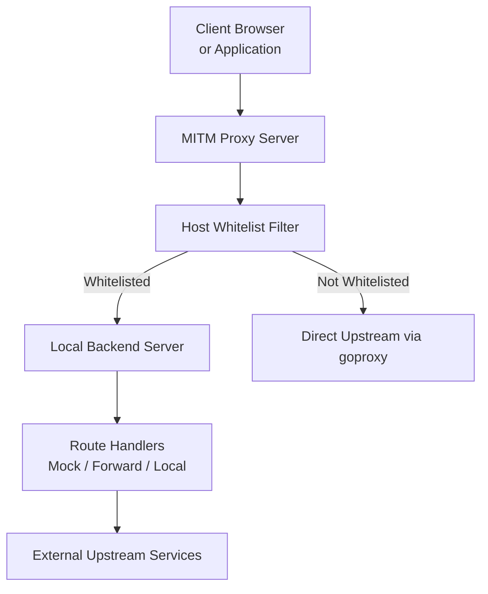
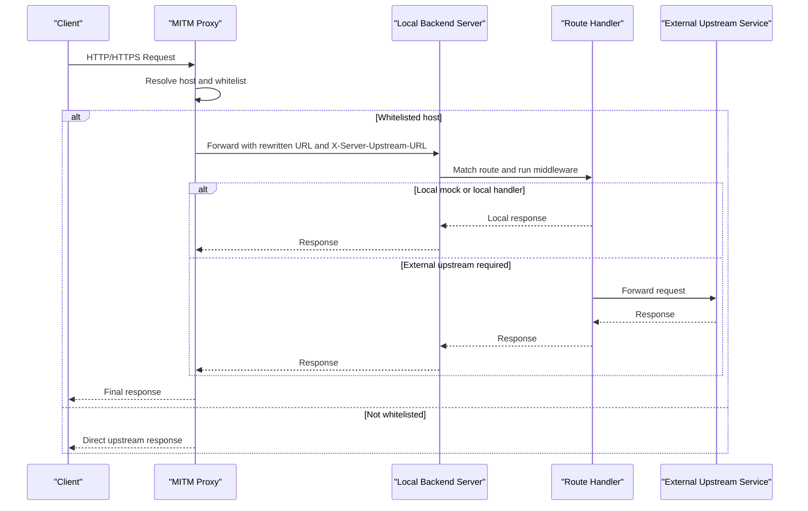
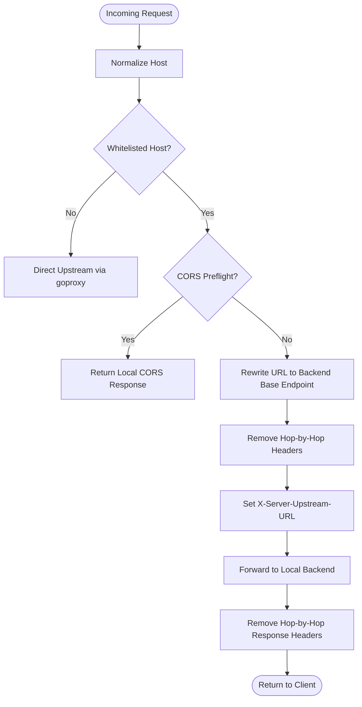
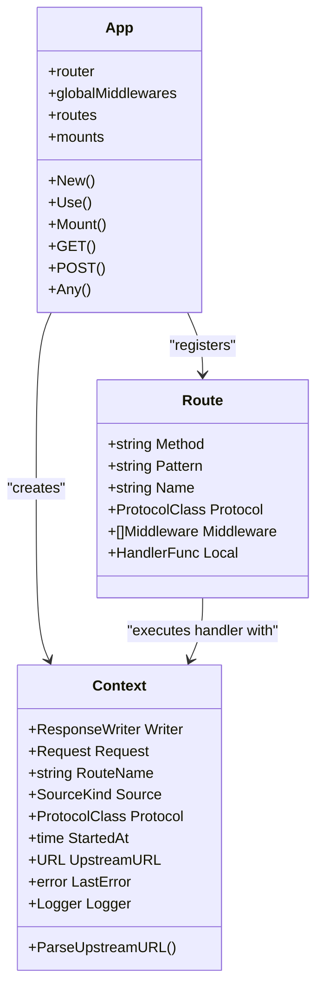
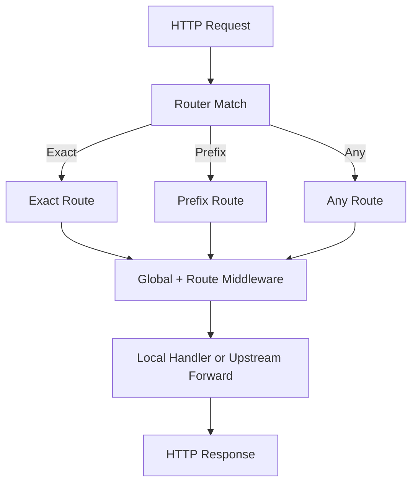
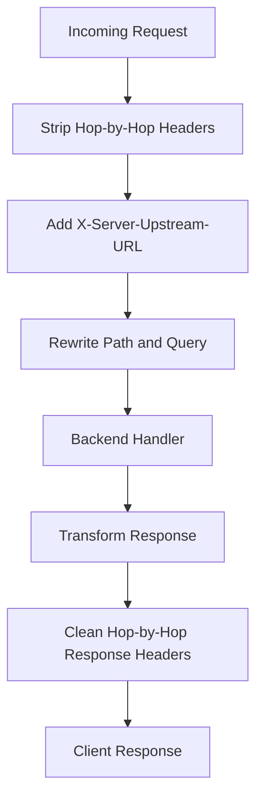
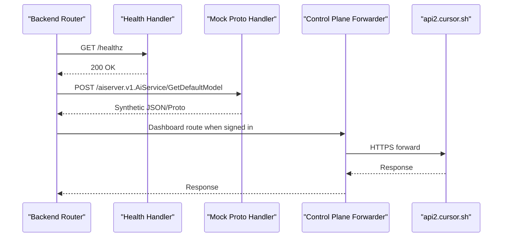
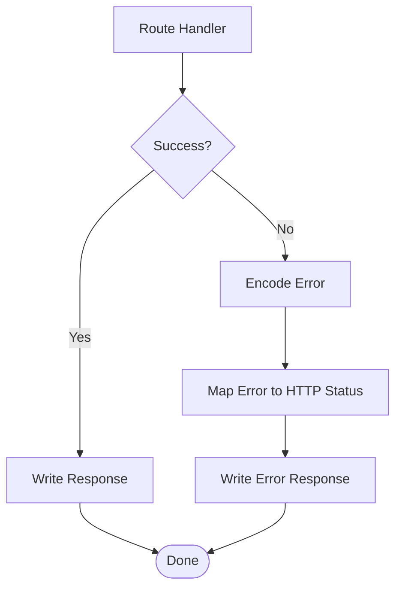
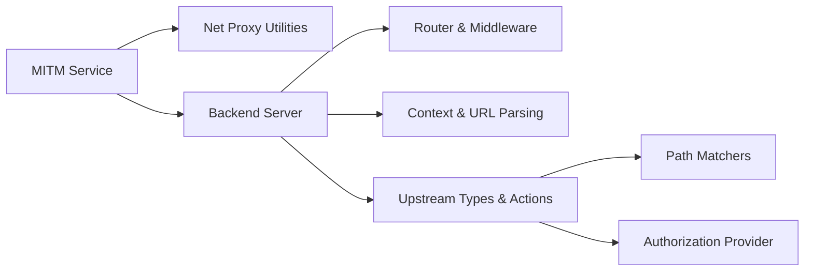

# Traffic Filtering and Routing

<cite>
**Referenced Files in This Document**   
- [route.go](file://internal/backend/server/route.go)
- [middleware.go](file://internal/backend/server/middleware.go)
- [context.go](file://internal/backend/server/context.go)
- [url.go](file://internal/backend/server/url.go)
- [response_writer.go](file://internal/backend/server/response_writer.go)
- [errors.go](file://internal/backend/server/errors.go)
- [host.go](file://internal/backend/host.go)
- [service.go](file://internal/mitm/service.go)
- [types.go](file://internal/backend/server/upstream/types.go)
- [action.go](file://internal/backend/server/upstream/action.go)
- [client.go](file://internal/backend/server/upstream/client.go)
- [netproxy.go](file://internal/netproxy/netproxy.go)
</cite>

## Table of Contents
1. [Introduction](#introduction)
2. [Project Structure](#project-structure)
3. [Core Components](#core-components)
4. [Architecture Overview](#architecture-overview)
5. [Detailed Component Analysis](#detailed-component-analysis)
6. [Dependency Analysis](#dependency-analysis)
7. [Performance Considerations](#performance-considerations)
8. [Troubleshooting Guide](#troubleshooting-guide)
9. [Conclusion](#conclusion)
10. [Appendices](#appendices)

## Introduction
This document explains the traffic filtering and routing system that intercepts incoming requests, applies rule-based filters, transforms headers and URLs, and forwards them to appropriate backend handlers or upstream services. The system has two major layers:

- **MITM proxy layer**: Intercepts browser or client traffic, optionally performs TLS interception, applies host-based filtering, handles CORS preflight locally, and forwards whitelisted requests to the local backend server.
- **Backend HTTP server layer**: Provides a structured router with middleware, protocol-aware routes, mock responses, authenticated forwarding, and fallback behavior for failed routes.

The design separates concerns between request interception, URL rewriting, header manipulation, route matching, handler execution, and error handling. It is suitable for high-throughput scenarios because it uses connection pooling, HTTP/2 support, rate-limited logging, and explicit hop-by-hop header removal.

## Project Structure
The relevant code lives under three main areas:

| Area | Responsibility | Key Files |
|---|---|---|
| MITM proxy | Intercept, filter by host, rewrite URLs, forward to backend | `internal/mitm/service.go` |
| Backend server | Router, middleware, context, response tracking, error encoding | `internal/backend/server/*` |
| Upstream helpers | Route models, matchers, mock actions, authorization forwarding | `internal/backend/server/upstream/*` |
| Network proxy utilities | System proxy resolution, bypass rules, host matching | `internal/netproxy/netproxy.go` |

**Diagram sources**
- [service.go:426-449](file://internal/mitm/service.go#L426-L449)
- [host.go:296-317](file://internal/backend/host.go#L296-L317)
- [route.go:131-156](file://internal/backend/server/route.go#L131-L156)

**Section sources**
- [service.go:32-57](file://internal/mitm/service.go#L32-L57)
- [host.go:28-42](file://internal/backend/host.go#L28-L42)
- [route.go:13-27](file://internal/backend/server/route.go#L13-L27)

## Core Components
The traffic pipeline consists of these core components:

| Component | Purpose | Important Fields / Methods |
|---|---|---|
| `ProxyServer` | Manages the MITM proxy, base URL, TLS interception, and forwarding | `UpdateBaseURL`, `Start`, `Stop`, `forwardToServer` |
| `App` | Builds the backend HTTP router using chi | `New`, `Use`, `Mount`, `GET`, `POST`, `Any` |
| `Route` | Declares method, pattern, name, protocol, middleware, and local handler | `Method`, `Pattern`, `Name`, `Protocol`, `Middleware`, `Local` |
| `Context` | Carries request, writer, upstream URL, source kind, protocol, timing, and last error | `ParseUpstreamURL`, `Writer`, `Request`, `UpstreamURL` |
| `Matcher` | Matches request paths for upstream-compatible routes | `Match(path) bool` |
| `ForwardOptions` | Allows body override and header patching during forwarding | `BodyOverride`, `PatchHeaders` |

Key behaviors:

- Host-based filtering determines whether a request goes to the local backend or is directly forwarded.
- URL rewriting preserves path, raw path, and query when forwarding from MITM to backend.
- Header injection/removal removes hop-by-hop headers and adds an internal upstream URL header.
- Middleware provides recovery, context parsing, and standardized error encoding.
- Routes can return local mock responses or forward to external upstream services.

**Section sources**
- [service.go:32-57](file://internal/mitm/service.go#L32-L57)
- [route.go:13-27](file://internal/backend/server/route.go#L13-L27)
- [context.go:28-50](file://internal/backend/server/context.go#L28-L50)
- [types.go:67-98](file://internal/backend/server/upstream/types.go#L67-L98)

## Architecture Overview
The end-to-end flow starts at the MITM proxy and ends at either a local handler or an external upstream service.

**Diagram sources**
- [service.go:426-449](file://internal/mitm/service.go#L426-L449)
- [service.go:453-487](file://internal/mitm/service.go#L453-L487)
- [route.go:140-156](file://internal/backend/server/route.go#L140-L156)
- [host.go:895-932](file://internal/backend/host.go#L895-L932)

## Detailed Component Analysis

### MITM Proxy Filtering and Forwarding
The MITM proxy decides how to handle each request based on the target host.

#### Host Whitelist Rules
- Requests to `api2.cursor.sh`, `api3.cursor.sh`, and any host ending with `.cursor.sh` are considered whitelisted.
- Non-whitelisted hosts are passed through goproxy without forwarding to the local backend.
- The host normalization strips brackets for IPv6, splits ports, lowercases values, and supports both bracketed and unbracketed forms.

#### URL Rewriting
When forwarding to the backend:
- The backend base endpoint is used as the destination.
- The incoming request’s path, raw path, and query are copied into the forwarded URL.
- The original absolute URL is stored in the `X-Server-Upstream-URL` header so downstream handlers can reconstruct the real client-facing URL.

#### Header Handling
- Hop-by-hop headers such as `Connection`, `Keep-Alive`, `Transfer-Encoding`, and others are removed before sending to the backend.
- Headers are copied from the incoming request after hop-by-hop cleanup.
- Responses also have hop-by-hop headers removed before being returned to the client.

#### CORS Preflight Handling
For whitelisted hosts, OPTIONS requests with `Origin` and `Access-Control-Request-Method` are handled locally with standard CORS headers instead of being forwarded.

**Diagram sources**
- [service.go:635-658](file://internal/mitm/service.go#L635-L658)
- [service.go:453-487](file://internal/mitm/service.go#L453-L487)
- [service.go:690-735](file://internal/mitm/service.go#L690-L735)

**Section sources**
- [service.go:426-449](file://internal/mitm/service.go#L426-L449)
- [service.go:453-487](file://internal/mitm/service.go#L453-L487)
- [service.go:570-597](file://internal/mitm/service.go#L570-L597)
- [service.go:635-658](file://internal/mitm/service.go#L635-L658)
- [service.go:690-735](file://internal/mitm/service.go#L690-L735)

### Backend Router and Middleware Pipeline
The backend server uses a structured router that composes global middleware, route-specific middleware, and final handlers.

#### Route Declaration
Routes are declared with HTTP methods, patterns, names, protocols, middleware, and local handlers. Supported options include:
- `GET`, `POST`, `Any`
- `HTTP`, `ConnectUnary`, `ConnectStream`
- `With` for per-route middleware
- `Local` for inline handler functions

#### Middleware Chain
Global middleware runs first, followed by route-specific middleware, then the final handler. Built-in middleware includes:
- Recovery middleware to capture panics
- Server context middleware to parse the upstream URL
- Error encoder middleware to normalize errors into HTTP responses

#### Context and Upstream URL Parsing
Each request creates a `Context` containing the writer, request, route metadata, start time, logger, and optional upstream URL. The upstream URL is parsed from the `X-Server-Upstream-URL` header set by the MITM proxy. If absent, the request is treated as native; if present, it is treated as coming from MITM.

**Diagram sources**
- [route.go:13-27](file://internal/backend/server/route.go#L13-L27)
- [route.go:37-51](file://internal/backend/server/route.go#L37-L51)
- [context.go:28-50](file://internal/backend/server/context.go#L28-L50)

**Section sources**
- [route.go:13-27](file://internal/backend/server/route.go#L13-L27)
- [route.go:37-51](file://internal/backend/server/route.go#L37-L51)
- [route.go:131-156](file://internal/backend/server/route.go#L131-L156)
- [middleware.go:13-38](file://internal/backend/server/middleware.go#L13-L38)
- [context.go:28-70](file://internal/backend/server/context.go#L28-L70)

### URL Pattern Matching and Conditional Processing
The backend supports multiple kinds of URL and protocol matching:

| Matching Type | Behavior |
|---|---|
| Exact path | Used by specific endpoints like `/healthz` |
| Prefix path | Used by wildcard routes like `/aiserver.v1.AiService/*` |
| Any method | Used when method does not matter |
| Protocol classification | Distinguishes HTTP, Connect unary, and Connect stream routes |
| Path matcher interface | Used by upstream-compatible routes for exact, prefix, or wildcard matching |

Conditional processing is implemented through:
- Middleware chains that can validate, transform, or short-circuit requests
- Route-level handlers that inspect `Context.UpstreamURL`, headers, method, and content type
- Authorization providers that gate certain dashboard/control-plane routes

**Diagram sources**
- [route.go:131-156](file://internal/backend/server/route.go#L131-L156)
- [types.go:67-84](file://internal/backend/server/upstream/types.go#L67-L84)

**Section sources**
- [route.go:68-93](file://internal/backend/server/route.go#L68-L93)
- [route.go:131-156](file://internal/backend/server/route.go#L131-L156)
- [types.go:67-84](file://internal/backend/server/upstream/types.go#L67-L84)

### Request Modification, Header Injection, and Response Transformation
The system modifies requests and responses at several points:

| Stage | Modification | Reason |
|---|---|---|
| MITM proxy | Removes hop-by-hop headers | Prevents proxy artifacts leaking to backend |
| MITM proxy | Sets `X-Server-Upstream-URL` | Preserves original client URL for downstream logic |
| MITM proxy | Rewrites path/query to backend base endpoint | Routes intercepted traffic to local backend |
| Backend context | Parses upstream URL and sets source kind | Distinguishes native vs MITM-originated requests |
| Backend error encoder | Normalizes errors to HTTP status codes | Provides consistent error responses |
| Backend response writer | Tracks header writes and flushes | Supports streaming and hijacking safely |

Example transformation chain:

**Diagram sources**
- [service.go:453-487](file://internal/mitm/service.go#L453-L487)
- [context.go:53-70](file://internal/backend/server/context.go#L53-L70)
- [middleware.go:40-85](file://internal/backend/server/middleware.go#L40-L85)
- [response_writer.go:14-79](file://internal/backend/server/response_writer.go#L14-L79)

**Section sources**
- [service.go:453-487](file://internal/mitm/service.go#L453-L487)
- [context.go:53-70](file://internal/backend/server/context.go#L53-L70)
- [middleware.go:40-85](file://internal/backend/server/middleware.go#L40-L85)
- [response_writer.go:14-79](file://internal/backend/server/response_writer.go#L14-L79)

### Routing Logic to Backend Handlers and Upstream Services
Routing decisions depend on route registration and runtime context:

- Health checks are handled locally.
- Agent and forwarder procedures are routed to local handlers.
- Mock proto routes generate synthetic responses without network calls.
- Dashboard control-plane routes may be forwarded to `api2.cursor.sh:443` when the user is signed in.
- Unknown or unsupported routes return 404 locally.

**Diagram sources**
- [host.go:303-317](file://internal/backend/host.go#L303-L317)
- [host.go:333-401](file://internal/backend/host.go#L333-L401)
- [host.go:895-932](file://internal/backend/host.go#L895-L932)

**Section sources**
- [host.go:296-317](file://internal/backend/host.go#L296-L317)
- [host.go:333-401](file://internal/backend/host.go#L333-L401)
- [host.go:895-932](file://internal/backend/host.go#L895-L932)

### Error Handling, Retry Mechanisms, and Fallback Configurations
Error handling is layered:

1. **Recovery middleware** captures panics and converts them into errors.
2. **Error encoder middleware** records the last error and writes a standardized HTTP response.
3. **Status mapping** maps known errors to meaningful HTTP codes:
   - Empty upstream URL → `400 Bad Request`
   - Invalid bidi append payload → `400 Bad Request`
   - Invalid system setting → `500 Internal Server Error`
   - Channel not available → `503 Service Unavailable`
   - Other errors → `502 Bad Gateway`

Fallback configurations include:
- Local 404 handlers for unknown dashboard, C++ service, file sync, and network service routes.
- Mock responses for many AI service endpoints when no real upstream is needed.
- Control-plane routes falling back to local 404 when the user is not signed in.

Retry mechanisms are not implemented centrally in the routing layer. Instead, retry behavior belongs to higher-level model adapter or upstream client logic outside this routing subsystem.

**Diagram sources**
- [middleware.go:13-24](file://internal/backend/server/middleware.go#L13-L24)
- [middleware.go:40-85](file://internal/backend/server/middleware.go#L40-L85)
- [errors.go:5](file://internal/backend/server/errors.go#L5)

**Section sources**
- [middleware.go:13-24](file://internal/backend/server/middleware.go#L13-L24)
- [middleware.go:40-85](file://internal/backend/server/middleware.go#L40-L85)
- [errors.go:5](file://internal/backend/server/errors.go#L5)

## Dependency Analysis
The following diagram shows how the main modules depend on each other:

**Diagram sources**
- [service.go:3-25](file://internal/mitm/service.go#L3-L25)
- [host.go:3-24](file://internal/backend/host.go#L3-L24)
- [route.go:3-8](file://internal/backend/server/route.go#L3-L8)
- [types.go:67-98](file://internal/backend/server/upstream/types.go#L67-L98)

Key dependency observations:

- The MITM proxy depends on net proxy utilities for transport configuration but does not directly use the backend router.
- The backend router depends on chi for HTTP routing and composes middleware independently of MITM.
- Upstream types define reusable matchers and route structures used by mock and forwarding actions.
- Authorization provider is an abstraction allowing dashboard routes to forward to external control-plane APIs.

**Section sources**
- [service.go:3-25](file://internal/mitm/service.go#L3-L25)
- [host.go:3-24](file://internal/backend/host.go#L3-L24)
- [route.go:3-8](file://internal/backend/server/route.go#L3-L8)
- [types.go:67-98](file://internal/backend/server/upstream/types.go#L67-L98)

## Performance Considerations
High-throughput scenarios benefit from the following design choices:

| Area | Current Behavior | Recommendation |
|---|---|---|
| Connection pooling | MITM proxy and backend HTTP clients configure idle connections, timeouts, and HTTP/2 | Keep pool sizes aligned with expected concurrency; monitor connection reuse |
| Logging | Rate-limited log limiter suppresses repeated messages | Avoid enabling verbose proxy logging in production |
| Header processing | Hop-by-hop headers are explicitly removed | Keep header filtering minimal and centralized |
| URL parsing | Raw upstream URL is validated once per request | Cache frequently used upstream targets if applicable |
| Streaming | Response writer supports flush and hijack | Use streaming for long-lived Connect streams |
| Proxy resolution | Net proxy snapshot caches resolver state briefly | Refresh snapshots only when environment or system proxy changes |

Caching strategies:

- Certificate caching: MITM certificate store caches generated certificates per hostname to avoid repeated RSA/x509 operations.
- Proxy resolver cache: Net proxy snapshot caches proxy configuration for a short TTL.
- No application-level request/response cache is implemented in the routing layer; caching should be added at the handler or upstream client level if needed.

Load balancing options:

- The current implementation forwards to a single configured backend base endpoint.
- For multi-backend load balancing, introduce a balancer abstraction around upstream forwarding, select among healthy endpoints, and add health checks.
- Consider weighted round-robin, least-connections, or latency-based selection depending on backend characteristics.

[No sources needed since this section provides general guidance]

## Troubleshooting Guide
Common issues and their likely causes:

| Symptom | Likely Cause | Resolution |
|---|---|---|
| 400 Bad Request with invalid raw url | Missing or malformed `X-Server-Upstream-URL` header | Ensure MITM proxy sets the header or backend receives native requests |
| 502 Bad Gateway | Upstream forwarding failed or backend handler panicked | Check proxy logs, upstream availability, and panic recovery |
| 503 Service Unavailable | Channel not available or backend channel missing | Verify backend configuration and channel setup |
| CORS failures | Preflight not handled or origin mismatch | Confirm whitelisted host and local CORS preflight behavior |
| TLS handshake errors | Non-TLS client connected to HTTPS proxy or mismatched CA | Review MITM CA configuration and client trust store |
| Repeated log noise | High-volume proxy logs | Rely on built-in rate limiting and avoid verbose mode |

Debugging steps:

1. Inspect the request host and confirm it matches the whitelist.
2. Verify `X-Server-Upstream-URL` is present when MITM forwarding is expected.
3. Check backend route registration and ensure the pattern matches the request path.
4. Review middleware order and confirm error encoding is active.
5. Validate upstream URL scheme and host when forwarding externally.

**Section sources**
- [service.go:376-386](file://internal/mitm/service.go#L376-L386)
- [service.go:737-759](file://internal/mitm/service.go#L737-L759)
- [middleware.go:61-85](file://internal/backend/server/middleware.go#L61-L85)
- [url.go:9-25](file://internal/backend/server/url.go#L9-L25)

## Conclusion
The traffic filtering and routing system combines a host-based MITM proxy with a structured backend router. Requests are filtered by domain, rewritten to a local backend, and processed through middleware before reaching local handlers, mock responders, or external upstream services. The design emphasizes predictable error handling, header hygiene, and clear separation between interception and routing. For production-scale deployments, operators should tune connection pools, enable selective logging, consider adding request caching where safe, and extend the router with load balancing if multiple upstreams are required.

[No sources needed since this section summarizes without analyzing specific files]

## Appendices

### Common Filtering Rules and Routing Patterns

| Scenario | Rule or Pattern | Expected Behavior |
|---|---|---|
| Block non-whitelisted domains | Host not in whitelist | Direct upstream via goproxy |
| Allow Cursor API domains | Host equals `api2.cursor.sh`, `api3.cursor.sh`, or ends with `.cursor.sh` | Forward to local backend |
| Handle CORS preflight | OPTIONS with Origin and Access-Control-Request-Method | Return local 204 with CORS headers |
| Health check | GET `/healthz` | Return 200 OK locally |
| Mock AI model endpoint | POST to supported AI service path | Return synthetic response |
| Signed-in dashboard route | Dashboard control-plane route with active authorization | Forward to `api2.cursor.sh:443` |
| Unknown dashboard route | Unsupported dashboard path | Return 404 locally |

**Section sources**
- [service.go:635-658](file://internal/mitm/service.go#L635-L658)
- [service.go:690-735](file://internal/mitm/service.go#L690-L735)
- [host.go:303-317](file://internal/backend/host.go#L303-L317)
- [host.go:506-529](file://internal/backend/host.go#L506-L529)
- [host.go:725-754](file://internal/backend/host.go#L725-L754)
- [host.go:895-932](file://internal/backend/host.go#L895-L932)