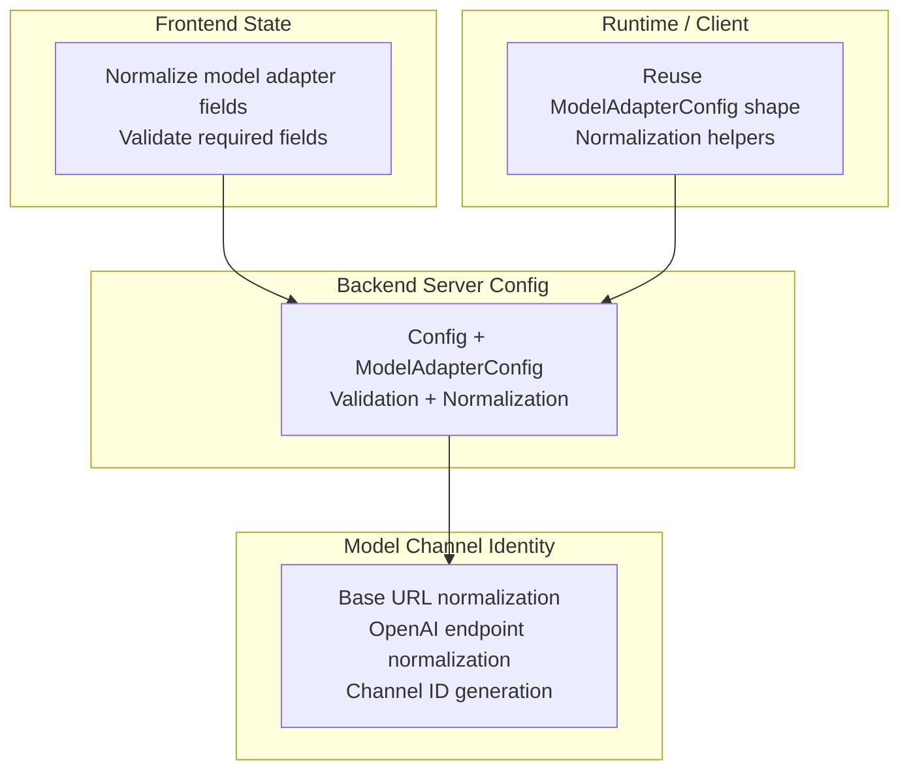
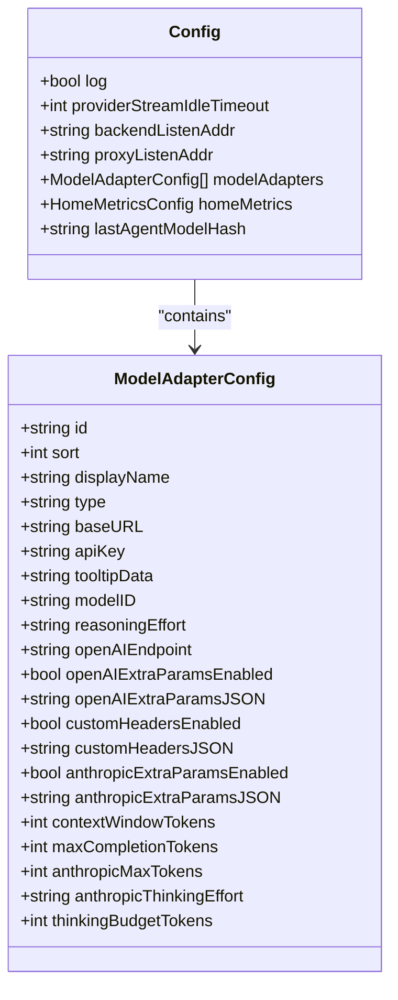
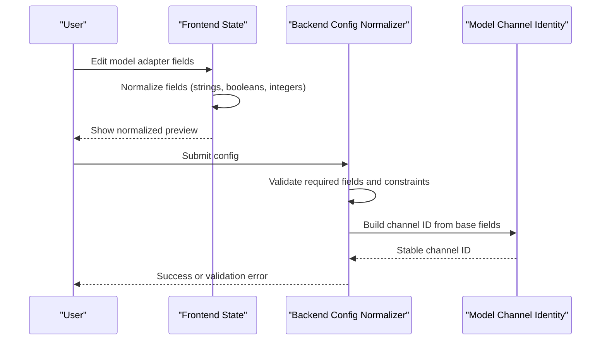
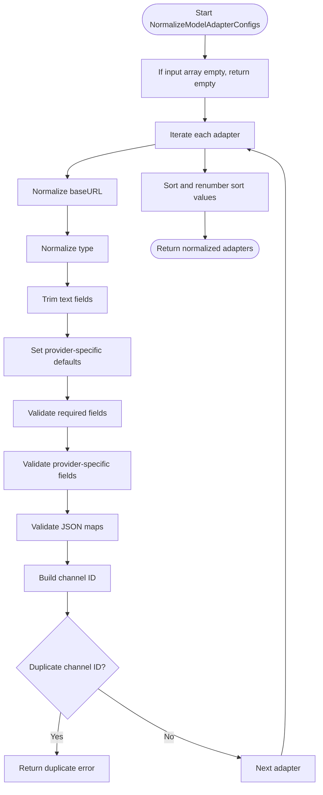
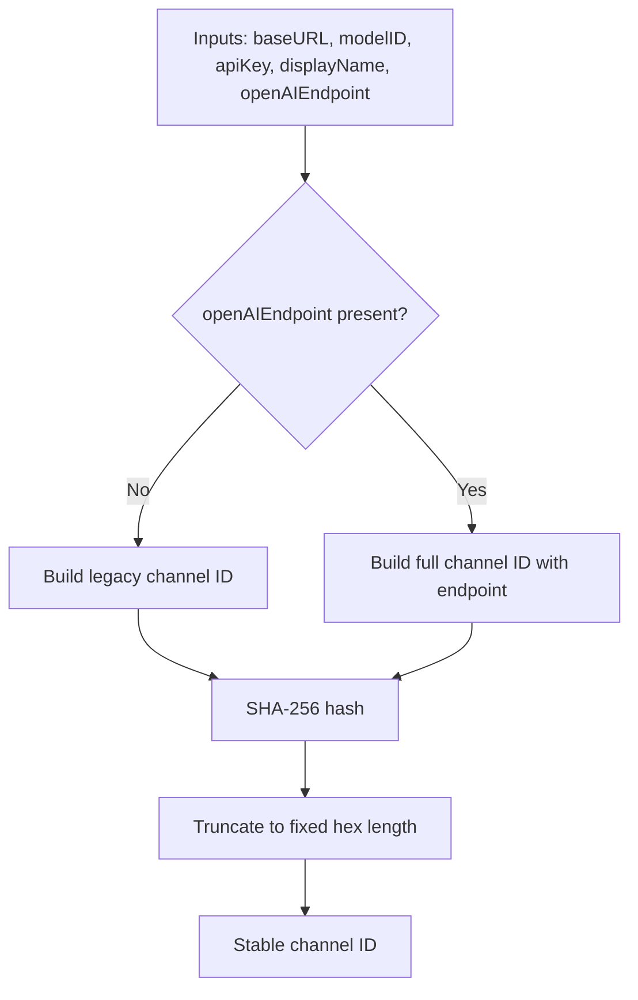
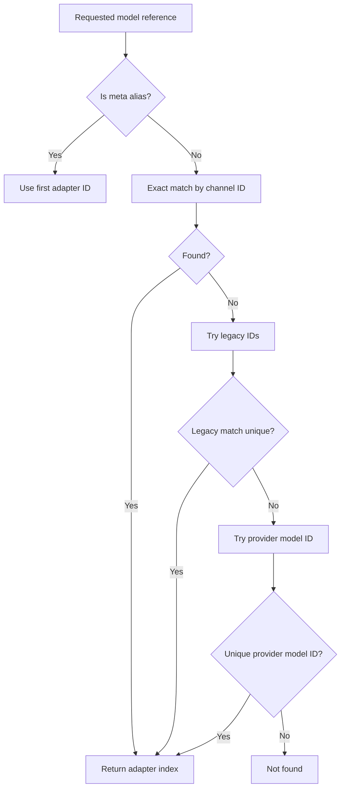
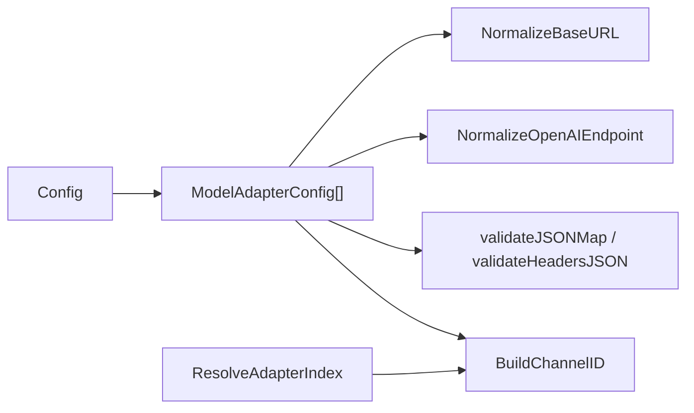

# Model Configuration Schema

<cite>
**Referenced Files in This Document**
- [types.go](file://internal/backend/server/config/types.go)
- [identity.go](file://internal/modelchannel/identity.go)
- [resolve.go](file://internal/modelchannel/resolve.go)
- [appState.js](file://frontend/src/state/appState.js)
- [ModelAdapterModal.vue](file://frontend/src/components/ModelAdapterModal.vue)
- [ModelEditor.vue](file://frontend/src/components/ModelEditor.vue)
- [local_runtime.go](file://internal/runtime/local_runtime.go)
- [config_transfer_test.go](file://internal/client/config_transfer_test.go)
</cite>

## Table of Contents
1. [Introduction](#introduction)
2. [Project Structure](#project-structure)
3. [Core Components](#core-components)
4. [Architecture Overview](#architecture-overview)
5. [Detailed Component Analysis](#detailed-component-analysis)
6. [Dependency Analysis](#dependency-analysis)
7. [Performance Considerations](#performance-considerations)
8. [Troubleshooting Guide](#troubleshooting-guide)
9. [Conclusion](#conclusion)
10. [Appendices](#appendices)

## Introduction
This document describes the model configuration schema used by cursor-byok to define model adapters for OpenAI and Anthropic providers. It explains the YAML structure, data types, validation rules, default values, field dependencies, and migration behavior. It also provides practical configuration examples for basic setup, advanced customization, and environment-specific configurations.

The core configuration is represented as a list of model adapter entries under `modelAdapters`. Each entry defines how the proxy connects to a provider endpoint, which model to call, and how to customize request behavior such as headers, extra parameters, token limits, and reasoning effort.

## Project Structure
The model configuration schema is primarily defined in the backend server configuration layer and validated during normalization. The frontend normalizes and displays user-facing fields, while runtime and client modules reuse similar structures for compatibility.



**Diagram sources**
- [types.go:23-59](file://internal/backend/server/config/types.go#L23-L59)
- [identity.go:19-59](file://internal/modelchannel/identity.go#L19-L59)
- [appState.js:342-422](file://frontend/src/state/appState.js#L342-L422)
- [local_runtime.go:37-63](file://internal/runtime/local_runtime.go#L37-L63)

**Section sources**
- [types.go:23-59](file://internal/backend/server/config/types.go#L23-L59)
- [identity.go:19-59](file://internal/modelchannel/identity.go#L19-L59)
- [appState.js:342-422](file://frontend/src/state/appState.js#L342-L422)
- [local_runtime.go:37-63](file://internal/runtime/local_runtime.go#L37-L63)

## Core Components
The primary configuration object is `ModelAdapterConfig`, which represents one model adapter entry. It is stored inside the top-level `Config` under the `modelAdapters` array.

Key responsibilities:
- Define provider connection details (`baseURL`, `apiKey`).
- Identify the target model (`modelID`) and display name (`displayName`).
- Control provider-specific behavior (`reasoningEffort`, `openAIEndpoint`, `anthropicThinkingEffort`).
- Attach optional custom headers and additional request parameters.
- Configure token-related limits (`contextWindowTokens`, `maxCompletionTokens`, `anthropicMaxTokens`, `thinkingBudgetTokens`).



**Diagram sources**
- [types.go:23-59](file://internal/backend/server/config/types.go#L23-L59)

**Section sources**
- [types.go:23-59](file://internal/backend/server/config/types.go#L23-L59)

## Architecture Overview
The configuration lifecycle involves three main stages:

1. **Input parsing**: YAML or JSON input is loaded into Go structs.
2. **Normalization and validation**: Fields are trimmed, normalized, and validated. Invalid inputs produce errors.
3. **Identity resolution**: A stable channel ID is generated from key fields to detect duplicates and resolve adapters.



**Diagram sources**
- [appState.js:342-422](file://frontend/src/state/appState.js#L342-L422)
- [types.go:71-171](file://internal/backend/server/config/types.go#L71-L171)
- [identity.go:83-101](file://internal/modelchannel/identity.go#L83-L101)

## Detailed Component Analysis

### Top-Level Configuration
The top-level configuration contains global settings and the list of model adapters.

| Field | Type | Required | Default | Description |
|---|---|---:|---|---|
| `log` | boolean | No | `false` | Enable logging. |
| `providerStreamIdleTimeout` | integer | No | `240` seconds | Provider stream idle timeout; clamped to a minimum of `30` seconds. |
| `backendListenAddr` | string | No | `127.0.0.1:18090` | Backend listen address in `host:port` format. |
| `proxyListenAddr` | string | No | `127.0.0.1:18080` | Proxy listen address in `host:port` format. |
| `modelAdapters` | array | No | Empty array | List of model adapter configurations. |
| `homeMetrics.includeCacheWriteInHitRate` | boolean | No | Not set | Home metrics setting. |
| `lastAgentModelHash` | string | No | Empty | Trims whitespace on normalization. |

**Section sources**
- [types.go:51-69](file://internal/backend/server/config/types.go#L51-L69)
- [types.go:71-93](file://internal/backend/server/config/types.go#L71-L93)
- [types.go:250-277](file://internal/backend/server/config/types.go#L250-L277)

### Model Adapter Fields
Each model adapter entry supports the following fields.

| Field | Data Type | Required | Default | Validation Rules & Constraints | Dependencies |
|---|---|---:|---|---|---|
| `id` | string | No | Generated | Read-only after normalization; derived from identity fields. | Derived from `baseURL`, `modelID`, `apiKey`, `displayName`, `openAIEndpoint`. |
| `sort` | integer | No | Auto-assigned | Positive integers assigned after sorting; non-positive values preserve relative order before renumbering. | Used for ordering adapters. |
| `displayName` | string | Yes | None | Must not be empty after trimming. | Required for all adapters. |
| `type` | string | Yes | None | Must be `openai` or `anthropic` after case-insensitive normalization. | Controls provider-specific fields. |
| `baseURL` | string | Yes | None | Must be a valid URL with `http` or `https` scheme and a non-empty host. Trailing slash removed; scheme and host lowercased. | Required for all adapters. |
| `apiKey` | string | Yes | None | Must not be empty after trimming. | Required for all adapters. |
| `tooltipData` | string | Yes | None | Must not be empty after trimming. | Required for all adapters. |
| `modelID` | string | Yes | None | Must not be empty after trimming. | Required for all adapters. |
| `reasoningEffort` | string | Conditional | Empty | For `openai`: allowed values are empty, `low`, `medium`, `high`, `xhigh`, `max`. Lowercased and trimmed. | Only validated when `type == openai`. |
| `openAIEndpoint` | string | Conditional | `/v1/responses` | For `openai`: allowed values are empty (normalized to `/v1/responses`), `/v1/responses`, `/v1/chat/completions`, `/custom`. | Only relevant when `type == openai`. |
| `openAIExtraParamsEnabled` | boolean | No | `false` | Enables additional OpenAI request parameters. | Only meaningful when `type == openai`. |
| `openAIExtraParamsJSON` | string | Conditional | Empty | When enabled, must be a non-empty valid JSON object. Keys/values parsed as map; later cast to string map for headers-like usage. | Only validated when `type == openai` and enabled. |
| `customHeadersEnabled` | boolean | No | `false` | Enables custom headers. | Applies to all adapters. |
| `customHeadersJSON` | string | Conditional | Empty | When enabled, must be a non-empty valid JSON object whose values are strings; header names must not be empty after trimming. | Applies to all adapters. |
| `anthropicExtraParamsEnabled` | boolean | No | `false` | Enables additional Anthropic request parameters. | Only meaningful when `type == anthropic`. |
| `anthropicExtraParamsJSON` | string | Conditional | Empty | When enabled, must be a non-empty valid JSON object. | Only validated when `type == anthropic` and enabled. |
| `contextWindowTokens` | integer | No | `0` | Non-negative; zero means unset. | Token limit hint. |
| `maxCompletionTokens` | integer | No | `0` | Non-negative; zero means unset. | Token limit hint. |
| `anthropicMaxTokens` | integer | No | `0` | Non-negative; zero means unset. | Anthropic-specific token limit hint. |
| `anthropicThinkingEffort` | string | Conditional | `xhigh` if empty for Anthropic | Allowed values: `low`, `medium`, `high`, `xhigh`, `max`. Empty is normalized to `xhigh`. | Only validated when `type == anthropic`. |
| `thinkingBudgetTokens` | integer | No | `0` | Non-negative; zero means unset. | Thinking budget hint. |

#### Field Notes
- `baseURL` normalization rejects invalid URLs, unsupported schemes, and missing hosts.
- `openAIEndpoint` defaults to `/v1/responses` when omitted for OpenAI adapters.
- Custom headers require a JSON object where every value is a string and every key is non-empty.
- Additional request parameters for OpenAI and Anthropic are separate JSON objects controlled by their respective enable flags.
- Token-related fields accept positive integers; zero indicates no explicit override.

**Section sources**
- [types.go:23-45](file://internal/backend/server/config/types.go#L23-L45)
- [types.go:95-171](file://internal/backend/server/config/types.go#L95-L171)
- [types.go:194-224](file://internal/backend/server/config/types.go#L194-L224)
- [types.go:226-248](file://internal/backend/server/config/types.go#L226-L248)
- [identity.go:19-59](file://internal/modelchannel/identity.go#L19-L59)

### Validation Flow
The normalization process enforces required fields, provider-specific constraints, JSON validity, and uniqueness of channels.



**Diagram sources**
- [types.go:95-171](file://internal/backend/server/config/types.go#L95-L171)
- [identity.go:83-101](file://internal/modelchannel/identity.go#L83-L101)

**Section sources**
- [types.go:95-171](file://internal/backend/server/config/types.go#L95-L171)

### Channel Identity and Uniqueness
A channel ID is generated from key identity fields to prevent duplicate adapters and to support resolver lookups.

- Legacy identity: `baseURL`, `modelID`, `apiKey`, `displayName`.
- Current identity: adds `openAIEndpoint` for OpenAI adapters.
- The ID is a truncated SHA-256 hex digest.



**Diagram sources**
- [identity.go:74-101](file://internal/modelchannel/identity.go#L74-L101)

**Section sources**
- [identity.go:74-101](file://internal/modelchannel/identity.go#L74-L101)

### Resolver Behavior
The resolver selects an adapter based on:
- Exact match against the normalized channel ID.
- Legacy ID fallbacks.
- Fallback to provider model ID if unique.

Meta aliases like `fast`, `default`, and `auto` are treated specially and resolved to the first adapter when needed.



**Diagram sources**
- [resolve.go:5-12](file://internal/modelchannel/resolve.go#L5-L12)
- [resolve.go:14-66](file://internal/modelchannel/resolve.go#L14-L66)

**Section sources**
- [resolve.go:5-12](file://internal/modelchannel/resolve.go#L5-L12)
- [resolve.go:14-66](file://internal/modelchannel/resolve.go#L14-L66)

### Frontend Normalization and Display
The frontend normalizes incoming adapter data, mapping various legacy field names to current ones, and validates required fields before submission.

Key behaviors:
- Maps legacy fields like `name`, `url`, `key`, `endpoint`, `max_input_tokens`, `max_tokens`, etc.
- Enforces supported adapter types and required fields.
- Displays token hints and reasoning effort options.

**Section sources**
- [appState.js:342-422](file://frontend/src/state/appState.js#L342-L422)
- [ModelAdapterModal.vue:112-122](file://frontend/src/components/ModelAdapterModal.vue#L112-L122)
- [ModelEditor.vue:131-141](file://frontend/src/components/ModelEditor.vue#L131-L141)

### Runtime Compatibility
The runtime module reuses a similar `ModelAdapterConfig` shape and applies comparable normalization and validation logic, ensuring consistency across components.

**Section sources**
- [local_runtime.go:37-63](file://internal/runtime/local_runtime.go#L37-L63)

## Dependency Analysis
The configuration system has clear boundaries:

- `ModelAdapterConfig` depends on:
  - Base URL normalization.
  - OpenAI endpoint normalization.
  - JSON validation helpers.
  - Channel ID generation.
- Frontend state depends on backend schema conventions but performs its own normalization for UI purposes.
- Resolver depends on channel ID and provider model ID functions.



**Diagram sources**
- [types.go:95-171](file://internal/backend/server/config/types.go#L95-L171)
- [identity.go:19-59](file://internal/modelchannel/identity.go#L19-L59)
- [resolve.go:14-66](file://internal/modelchannel/resolve.go#L14-L66)

**Section sources**
- [types.go:95-171](file://internal/backend/server/config/types.go#L95-L171)
- [identity.go:19-59](file://internal/modelchannel/identity.go#L19-L59)
- [resolve.go:14-66](file://internal/modelchannel/resolve.go#L14-L66)

## Performance Considerations
- Token limit fields (`contextWindowTokens`, `maxCompletionTokens`, `anthropicMaxTokens`, `thinkingBudgetTokens`) should be set conservatively to avoid excessive memory usage and long streaming responses.
- Custom headers and additional request parameters add serialization overhead; only enable what is necessary.
- Duplicate channel detection uses hashing; keep adapter lists reasonable in size to avoid unnecessary comparisons.

[No sources needed since this section provides general guidance]

## Troubleshooting Guide
Common validation errors and their causes:

| Error Category | Cause | Resolution |
|---|---|---|
| Missing required fields | `displayName`, `type`, `apiKey`, `tooltipData`, or `modelID` is empty | Fill all required fields and trim whitespace. |
| Invalid provider type | `type` is not `openai` or `anthropic` | Use lowercase `openai` or `anthropic`. |
| Invalid base URL | Scheme is not `http` or `https`, or host is missing | Provide a valid URL with proper scheme and host. |
| Unsupported reasoning effort | `reasoningEffort` has an invalid value for OpenAI | Use empty, `low`, `medium`, `high`, `xhigh`, or `max`. |
| Invalid OpenAI endpoint | `openAIEndpoint` is not one of the allowed values | Use `/v1/responses`, `/v1/chat/completions`, or `/custom`. |
| Invalid JSON parameters | `openAIExtraParamsJSON` or `anthropicExtraParamsJSON` is malformed | Ensure it is a valid JSON object. |
| Invalid custom headers | `customHeadersJSON` values are not strings or keys are empty | Ensure all header values are strings and keys are non-empty. |
| Duplicate channel | Same combination of identity fields already exists | Change at least one identity-affecting field. |

**Section sources**
- [types.go:133-171](file://internal/backend/server/config/types.go#L133-L171)
- [types.go:194-224](file://internal/backend/server/config/types.go#L194-L224)
- [identity.go:19-59](file://internal/modelchannel/identity.go#L19-L59)

## Conclusion
The model configuration schema provides a robust, validated structure for defining model adapters across OpenAI and Anthropic providers. It enforces required fields, provider-specific constraints, and uniqueness through channel IDs. Users can configure basic connections or extend behavior with custom headers and additional request parameters. Token limits and reasoning effort allow fine-tuning per adapter. The frontend and runtime layers align with the backend schema to ensure consistent behavior.

[No sources needed since this section summarizes without analyzing specific files]

## Appendices

### YAML Structure Format
The configuration file uses YAML with a top-level `modelAdapters` array. Each item corresponds to a `ModelAdapterConfig`.

Recommended structure:
- `modelAdapters`: array of adapter objects.
- Each adapter includes required fields and optional provider-specific fields.
- Text fields are trimmed; numeric fields accept positive integers or zero for unset.

Example structure outline:
```yaml
modelAdapters:
  - displayName: "..."
    type: "openai"
    baseURL: "https://..."
    apiKey: "..."
    tooltipData: "..."
    modelID: "..."
    reasoningEffort: "..."
    openAIEndpoint: "/v1/responses"
    openAIExtraParamsEnabled: false
    openAIExtraParamsJSON: "{}"
    customHeadersEnabled: false
    customHeadersJSON: "{}"
    contextWindowTokens: 0
    maxCompletionTokens: 0
    thinkingBudgetTokens: 0
```

**Section sources**
- [types.go:51-59](file://internal/backend/server/config/types.go#L51-L59)
- [types.go:23-45](file://internal/backend/server/config/types.go#L23-L45)

### Valid Configuration Examples

#### Basic OpenAI Setup
- Purpose: Connect to OpenAI using the default Responses API endpoint.
- Key fields: `type`, `baseURL`, `apiKey`, `modelID`, `displayName`, `tooltipData`.
- Optional: `reasoningEffort`, token limits.

#### Advanced OpenAI Customization
- Purpose: Use Chat Completions endpoint, enable extra parameters, and add custom headers.
- Key fields: `openAIEndpoint`, `openAIExtraParamsEnabled`, `openAIExtraParamsJSON`, `customHeadersEnabled`, `customHeadersJSON`.

#### Basic Anthropic Setup
- Purpose: Connect to Anthropic with thinking effort configured.
- Key fields: `type`, `baseURL`, `apiKey`, `modelID`, `displayName`, `tooltipData`, `anthropicThinkingEffort`.

#### Environment-Specific Configurations
- Purpose: Separate development and production adapters with different base URLs and API keys.
- Strategy: Define multiple adapters under `modelAdapters`; use distinct `displayName` and `modelID` combinations to generate unique channel IDs.

Note: These examples describe structure and intent without including sensitive secrets. Replace placeholder values with actual credentials and endpoints appropriate for your environment.

**Section sources**
- [types.go:95-171](file://internal/backend/server/config/types.go#L95-L171)
- [identity.go:83-101](file://internal/modelchannel/identity.go#L83-L101)

### Migration and Version Compatibility
- Channel identity now includes `openAIEndpoint` for OpenAI adapters, improving uniqueness and routing precision.
- Legacy channel IDs remain supported for backward compatibility.
- Frontend normalization maps several legacy field names to current ones, easing migration from older formats.
- Tests demonstrate migration scenarios where adapter fields are preserved during transfer.

Recommendations:
- Update existing adapters to include `openAIEndpoint` explicitly if you rely on endpoint-specific behavior.
- Keep `displayName` and `modelID` stable to maintain resolver compatibility.
- Review custom headers and extra parameters after migration to ensure they conform to current validation rules.

**Section sources**
- [identity.go:74-101](file://internal/modelchannel/identity.go#L74-L101)
- [appState.js:342-422](file://frontend/src/state/appState.js#L342-L422)
- [config_transfer_test.go:24-68](file://internal/client/config_transfer_test.go#L24-L68)
- [config_transfer_test.go:150-150](file://internal/client/config_transfer_test.go#L150-L150)