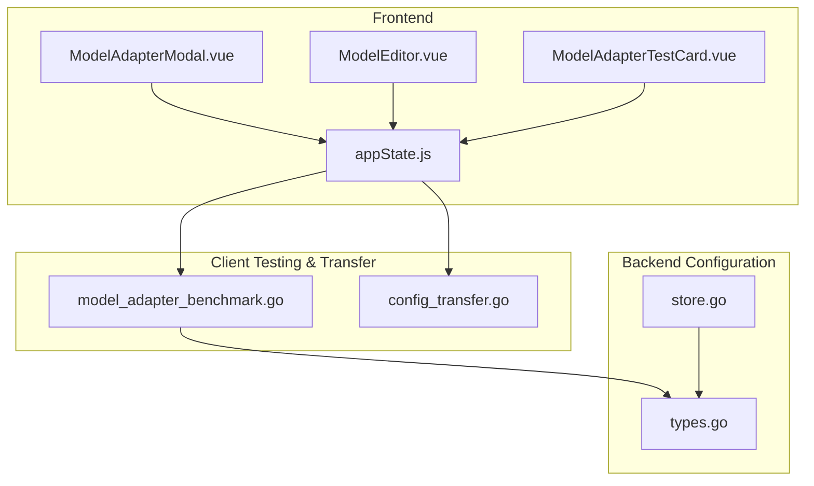
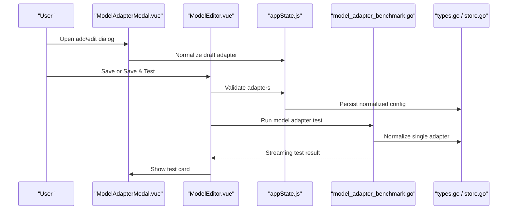
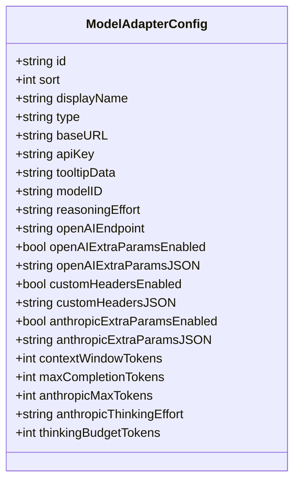
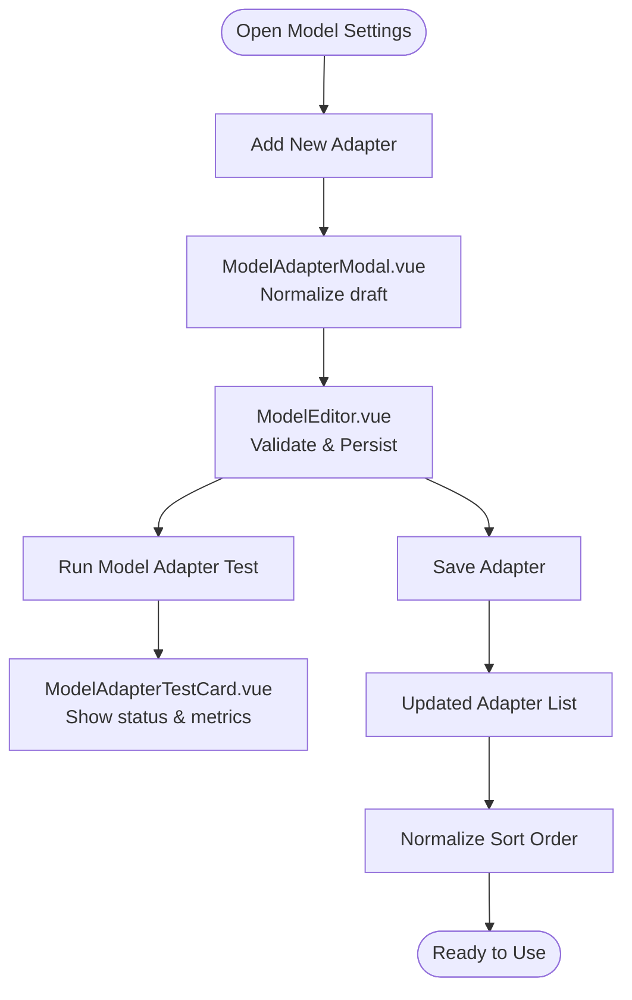
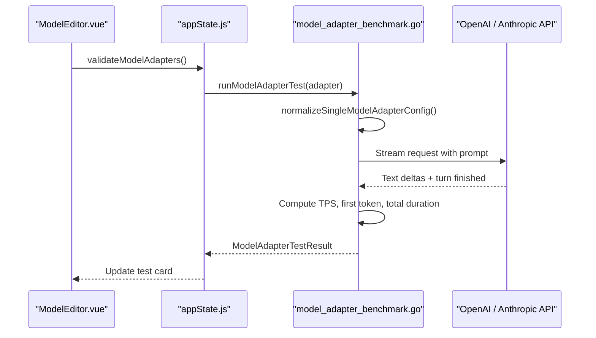
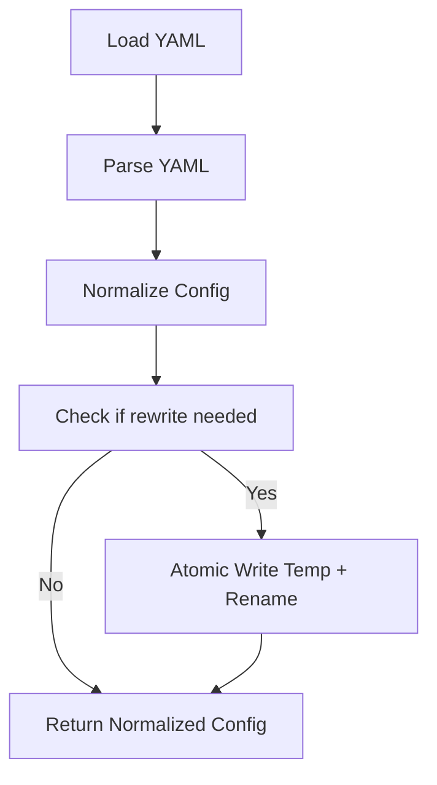
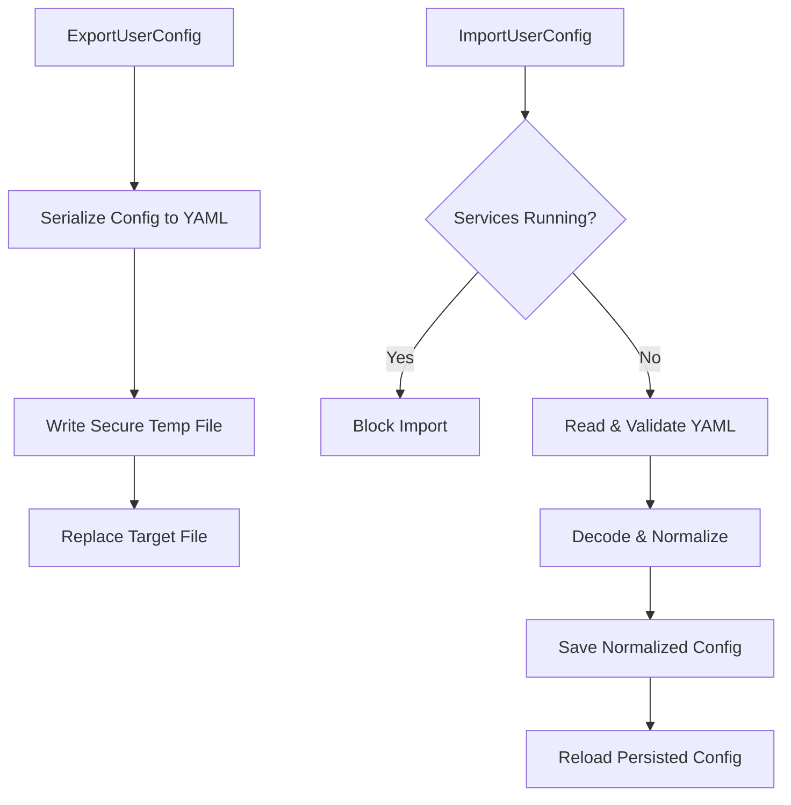
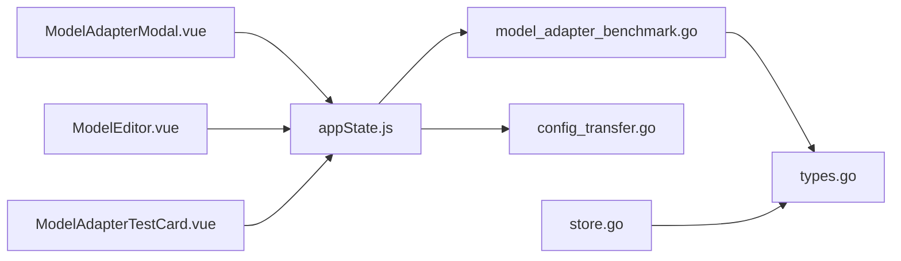

# Model Management

<cite>
**Referenced Files in This Document**
- [README.md](file://README.md)
- [ModelAdapterModal.vue](file://frontend/src/components/ModelAdapterModal.vue)
- [ModelEditor.vue](file://frontend/src/components/ModelEditor.vue)
- [ModelAdapterTestCard.vue](file://frontend/src/components/ModelAdapterTestCard.vue)
- [appState.js](file://frontend/src/state/appState.js)
- [types.go](file://internal/backend/server/config/types.go)
- [store.go](file://internal/backend/server/config/store.go)
- [model_adapter_benchmark.go](file://internal/client/model_adapter_benchmark.go)
- [config_transfer.go](file://internal/client/config_transfer.go)
</cite>

## Table of Contents
1. [Introduction](#introduction)
2. [Project Structure](#project-structure)
3. [Core Components](#core-components)
4. [Architecture Overview](#architecture-overview)
5. [Detailed Component Analysis](#detailed-component-analysis)
6. [Dependency Analysis](#dependency-analysis)
7. [Performance Considerations](#performance-considerations)
8. [Troubleshooting Guide](#troubleshooting-guide)
9. [Conclusion](#conclusion)

## Introduction
This document explains the model management system in cursor-byok. It covers how users configure multiple model adapters for OpenAI and Anthropic API protocols, the configuration schema, UI workflows for adding/editing/duplicating/reordering/batch-testing configurations, validation rules, error handling, storage format, import/export, and environment-specific behavior.

The project is a local gateway that lets Cursor connect to user-configured model APIs while preserving Agent capabilities such as tool calling, Skills, and MCP. Users can choose OpenAI or Anthropic-compatible endpoints, customize credentials, model IDs, context windows, maximum output tokens, reasoning effort, custom headers, and additional request parameters.

**Section sources**
- [README.md:54-80](file://README.md#L54-L80)
- [README.md:82-102](file://README.md#L82-L102)

## Project Structure
The model management feature spans frontend UI components, frontend state logic, backend configuration types and persistence, and client-side testing and configuration transfer utilities.

**Diagram sources**
- [ModelAdapterModal.vue:1-400](file://frontend/src/components/ModelAdapterModal.vue#L1-L400)
- [ModelEditor.vue:1-699](file://frontend/src/components/ModelEditor.vue#L1-L699)
- [ModelAdapterTestCard.vue:1-150](file://frontend/src/components/ModelAdapterTestCard.vue#L1-L150)
- [appState.js:1-800](file://frontend/src/state/appState.js#L1-L800)
- [types.go:1-296](file://internal/backend/server/config/types.go#L1-L296)
- [store.go:1-170](file://internal/backend/server/config/store.go#L1-L170)
- [model_adapter_benchmark.go:1-800](file://internal/client/model_adapter_benchmark.go#L1-L800)
- [config_transfer.go:1-196](file://internal/client/config_transfer.go#L1-L196)

**Section sources**
- [ModelAdapterModal.vue:1-400](file://frontend/src/components/ModelAdapterModal.vue#L1-L400)
- [ModelEditor.vue:1-699](file://frontend/src/components/ModelEditor.vue#L1-L699)
- [ModelAdapterTestCard.vue:1-150](file://frontend/src/components/ModelAdapterTestCard.vue#L1-L150)
- [appState.js:1-800](file://frontend/src/state/appState.js#L1-L800)
- [types.go:1-296](file://internal/backend/server/config/types.go#L1-L296)
- [store.go:1-170](file://internal/backend/server/config/store.go#L1-L170)
- [model_adapter_benchmark.go:1-800](file://internal/client/model_adapter_benchmark.go#L1-L800)
- [config_transfer.go:1-196](file://internal/client/config_transfer.go#L1-L196)

## Core Components
- Model adapter configuration schema: defined by the backend configuration type and normalized by both frontend and backend logic.
- UI editing workflow: modal and editor components provide fields for provider selection, endpoint URL, API key, model ID, context window, maximum output tokens, reasoning effort, custom headers, and extra parameters.
- Test workflow: client-side streaming tests measure first token latency, total duration, output tokens, and raw response.
- Storage: YAML-based configuration with normalization and atomic save semantics.
- Import/Export: full configuration export/import with validation and safety checks.

Key responsibilities:
- Frontend normalizes and validates user input before saving.
- Backend normalizes and validates persisted configuration.
- Client test runner executes provider-specific non-streaming benchmark requests and emits results.
- Store persists normalized configuration to disk.
- Config transfer handles safe import/export.

**Section sources**
- [types.go:23-45](file://internal/backend/server/config/types.go#L23-L45)
- [appState.js:252-396](file://frontend/src/state/appState.js#L252-L396)
- [model_adapter_benchmark.go:76-118](file://internal/client/model_adapter_benchmark.go#L76-L118)
- [store.go:63-136](file://internal/backend/server/config/store.go#L63-L136)
- [config_transfer.go:24-78](file://internal/client/config_transfer.go#L24-L78)

## Architecture Overview
The model management flow connects the UI, state layer, backend configuration, and client test service.

**Diagram sources**
- [ModelAdapterModal.vue:137-176](file://frontend/src/components/ModelAdapterModal.vue#L137-L176)
- [ModelEditor.vue:252-327](file://frontend/src/components/ModelEditor.vue#L252-L327)
- [appState.js:424-493](file://frontend/src/state/appState.js#L424-L493)
- [model_adapter_benchmark.go:413-518](file://internal/client/model_adapter_benchmark.go#L413-L518)
- [types.go:95-172](file://internal/backend/server/config/types.go#L95-L172)
- [store.go:99-136](file://internal/backend/server/config/store.go#L99-L136)

## Detailed Component Analysis

### Model Adapter Configuration Schema
The canonical configuration structure includes:
- Identity and ordering: id, sort
- Display and identity: displayName, tooltipData
- Provider settings: type (openai or anthropic), baseURL, apiKey
- Model identity: modelID
- OpenAI options: reasoningEffort, openAIEndpoint, openAIExtraParamsEnabled, openAIExtraParamsJSON
- Anthropic options: anthropicMaxTokens, anthropicThinkingEffort, anthropicExtraParamsEnabled, anthropicExtraParamsJSON
- Shared runtime limits: contextWindowTokens, maxCompletionTokens, thinkingBudgetTokens
- Customization: customHeadersEnabled, customHeadersJSON

Normalization and validation occur in both frontend and backend:
- Frontend normalizes field names, booleans, positive integers, base URLs, supported enums, and JSON objects.
- Backend enforces required fields, supported values, JSON object constraints, header value types, uniqueness, and sorting.

**Diagram sources**
- [types.go:23-45](file://internal/backend/server/config/types.go#L23-L45)

Validation highlights:
- Required fields: displayName, type, apiKey, tooltipData, modelID.
- Supported types: openai, anthropic.
- OpenAI reasoningEffort must be empty or one of low, medium, high, xhigh, max.
- OpenAI endpoint must be responses, chat/completions, or custom path.
- Extra parameter JSONs must be valid JSON objects.
- Custom headers JSON must map string keys to string values.
- Anthropic thinking effort must be low, medium, high, xhigh, or max.
- Duplicate channel detection based on URL, modelID, apiKey, displayName, and endpoint.

**Section sources**
- [types.go:95-172](file://internal/backend/server/config/types.go#L95-L172)
- [types.go:194-224](file://internal/backend/server/config/types.go#L194-L224)
- [types.go:226-248](file://internal/backend/server/config/types.go#L226-L248)
- [appState.js:334-396](file://frontend/src/state/appState.js#L334-L396)
- [appState.js:424-493](file://frontend/src/state/appState.js#L424-L493)

### UI Workflow: Add, Edit, Duplicate, Reorder, Batch-Test
Add/Edit:
- The modal provides a compact form for quick creation and duplication.
- The editor provides a detailed form with tooltips, presets, and live model list fetching.

Duplicate:
- Duplicating is achieved by opening the modal with an existing adapter as input; the modal normalizes and clones the adapter into a new draft.

Reorder:
- Sorting is handled by the normalize functions in both frontend and backend. Items without explicit sort are placed after items with positive sort values, then re-indexed sequentially.

Batch-test:
- Each adapter can be tested individually from the editor. Results are cached per adapter and request hash, and displayed via the test card component.

**Diagram sources**
- [ModelAdapterModal.vue:137-176](file://frontend/src/components/ModelAdapterModal.vue#L137-L176)
- [ModelEditor.vue:252-327](file://frontend/src/components/ModelEditor.vue#L252-L327)
- [ModelAdapterTestCard.vue:33-149](file://frontend/src/components/ModelAdapterTestCard.vue#L33-L149)
- [appState.js:398-422](file://frontend/src/state/appState.js#L398-L422)

Provider setup examples:
- OpenAI:
  - Set type to openai.
  - Provide baseURL and apiKey.
  - Choose endpoint: /v1/responses, /v1/chat/completions, or custom path.
  - Optionally set reasoningEffort and maxCompletionTokens.
  - Optionally enable openAIExtraParamsJSON to override request body fields.
- Anthropic:
  - Set type to anthropic.
  - Provide baseURL and apiKey.
  - Optionally set anthropicMaxTokens and anthropicThinkingEffort.
  - Optionally enable anthropicExtraParamsJSON to override request body fields.
- Custom headers:
  - Enable customHeadersEnabled and supply a JSON object mapping header names to string values.

Validation messages:
- Missing required fields produce clear errors.
- Invalid JSON objects or header maps produce descriptive errors.
- Unsupported enum values produce specific allowed-value messages.
- Duplicate channels are detected and rejected.

**Section sources**
- [ModelAdapterModal.vue:16-46](file://frontend/src/components/ModelAdapterModal.vue#L16-L46)
- [ModelAdapterModal.vue:125-176](file://frontend/src/components/ModelAdapterModal.vue#L125-L176)
- [ModelEditor.vue:172-211](file://frontend/src/components/ModelEditor.vue#L172-L211)
- [ModelEditor.vue:295-306](file://frontend/src/components/ModelEditor.vue#L295-L306)
- [appState.js:278-291](file://frontend/src/state/appState.js#L278-L291)
- [appState.js:309-332](file://frontend/src/state/appState.js#L309-L332)
- [appState.js:424-493](file://frontend/src/state/appState.js#L424-L493)

### Model Test Flow
The test flow performs a streaming request to the configured provider, captures text deltas, measures timing, estimates output tokens if not provided, and returns a structured result.

**Diagram sources**
- [ModelEditor.vue:308-327](file://frontend/src/components/ModelEditor.vue#L308-L327)
- [model_adapter_benchmark.go:413-518](file://internal/client/model_adapter_benchmark.go#L413-L518)
- [model_adapter_benchmark.go:520-664](file://internal/client/model_adapter_benchmark.go#L520-L664)

Test result fields:
- adapterID, requestHash, status, tokensPerSecond, firstTextTokenMS, totalDurationMS, outputTokens, tokensEstimated, summaryText, error, rawResponse, testedAt.

Statuses:
- idle, running, success, error.

Metrics display:
- Total duration and output tokens when available.
- Stale indicator when configuration changes invalidate previous results.

**Section sources**
- [model_adapter_benchmark.go:76-118](file://internal/client/model_adapter_benchmark.go#L76-L118)
- [model_adapter_benchmark.go:413-518](file://internal/client/model_adapter_benchmark.go#L413-L518)
- [ModelAdapterTestCard.vue:33-149](file://frontend/src/components/ModelAdapterTestCard.vue#L33-L149)

### Configuration Storage Format
Configuration is stored as YAML. On load, the file is parsed, normalized, and optionally rewritten if normalization changed important fields. On save, the normalized configuration is written atomically using a temporary file and rename.

Storage characteristics:
- Default configuration is created if the file does not exist.
- Normalization ensures consistent field values and sorts adapters.
- Atomic write reduces corruption risk.

**Diagram sources**
- [store.go:63-96](file://internal/backend/server/config/store.go#L63-L96)
- [store.go:99-136](file://internal/backend/server/config/store.go#L99-L136)
- [store.go:138-152](file://internal/backend/server/config/store.go#L138-L152)

**Section sources**
- [store.go:63-136](file://internal/backend/server/config/store.go#L63-L136)

### Import/Export Functionality
Export:
- Serializes current configuration to YAML and writes it to a target path with secure permissions.

Import:
- Validates that services are stopped.
- Reads and validates the imported YAML document.
- Decodes and normalizes the configuration.
- Saves and reloads the normalized configuration.

Constraints:
- Maximum file size limit.
- Single YAML document only.
- Unknown fields cause decode errors.
- Import is blocked while backend or proxy is running.

**Diagram sources**
- [config_transfer.go:24-48](file://internal/client/config_transfer.go#L24-L48)
- [config_transfer.go:50-78](file://internal/client/config_transfer.go#L50-L78)
- [config_transfer.go:121-126](file://internal/client/config_transfer.go#L121-L126)
- [config_transfer.go:128-196](file://internal/client/config_transfer.go#L128-L196)

**Section sources**
- [config_transfer.go:24-78](file://internal/client/config_transfer.go#L24-L78)
- [config_transfer.go:80-119](file://internal/client/config_transfer.go#L80-L119)
- [config_transfer.go:121-196](file://internal/client/config_transfer.go#L121-L196)

### Environment-Specific Configurations
Environment-specific behavior is primarily driven by:
- Base URL normalization allowing http and https.
- Endpoint selection for OpenAI providers.
- Anthropic thinking effort defaults.
- Custom headers enabling environment-specific authentication or routing.
- Extra parameters for provider-specific overrides.

Frontend and backend normalization ensure consistent behavior across platforms.

**Section sources**
- [appState.js:128-145](file://frontend/src/state/appState.js#L128-L145)
- [appState.js:278-291](file://frontend/src/state/appState.js#L278-L291)
- [appState.js:334-396](file://frontend/src/state/appState.js#L334-L396)
- [types.go:226-248](file://internal/backend/server/config/types.go#L226-L248)

## Dependency Analysis
The following diagram shows how components depend on each other during model management operations.

**Diagram sources**
- [ModelAdapterModal.vue:1-400](file://frontend/src/components/ModelAdapterModal.vue#L1-L400)
- [ModelEditor.vue:1-699](file://frontend/src/components/ModelEditor.vue#L1-L699)
- [ModelAdapterTestCard.vue:1-150](file://frontend/src/components/ModelAdapterTestCard.vue#L1-L150)
- [appState.js:1-800](file://frontend/src/state/appState.js#L1-L800)
- [model_adapter_benchmark.go:1-800](file://internal/client/model_adapter_benchmark.go#L1-L800)
- [config_transfer.go:1-196](file://internal/client/config_transfer.go#L1-L196)
- [types.go:1-296](file://internal/backend/server/config/types.go#L1-L296)
- [store.go:1-170](file://internal/backend/server/config/store.go#L1-L170)

Coupling and cohesion:
- UI components depend on appState for normalization, validation, and persistence.
- Client test logic depends on backend configuration types for normalization.
- Store depends on types for normalization and validation.
- Config transfer depends on both client and backend configuration logic.

Potential circular dependencies:
- None observed between UI and backend layers; communication occurs through normalized data structures and service calls.

External integration points:
- OpenAI and Anthropic APIs via baseURL and endpoint configuration.
- Local filesystem for YAML configuration storage and import/export.

**Section sources**
- [appState.js:424-493](file://frontend/src/state/appState.js#L424-L493)
- [model_adapter_benchmark.go:165-196](file://internal/client/model_adapter_benchmark.go#L165-L196)
- [types.go:95-172](file://internal/backend/server/config/types.go#L95-L172)
- [store.go:63-136](file://internal/backend/server/config/store.go#L63-L136)

## Performance Considerations
- Streaming test measures time to first token and total duration, providing insight into provider responsiveness.
- Output tokens may be estimated if the provider does not return explicit counts.
- Debounced model list fetching avoids excessive network calls while typing.
- Atomic configuration writes reduce risk of partial saves.
- Pagination limits protect against large model lists during discovery.

Recommendations:
- Prefer providers that return output tokens to avoid estimation overhead.
- Keep contextWindowTokens aligned with provider limits to prevent truncation.
- Use custom headers and extra parameters judiciously to minimize request complexity.

[No sources needed since this section provides general guidance]

## Troubleshooting Guide
Common issues and resolutions:
- Missing required fields: Ensure displayName, type, apiKey, tooltipData, and modelID are set.
- Invalid JSON: Verify extra parameters and custom headers are valid JSON objects with correct value types.
- Unsupported enums: Use allowed values for reasoningEffort and anthropicThinkingEffort.
- Duplicate channels: Adjust baseURL, modelID, apiKey, displayName, or endpoint to make the channel unique.
- Service running during import: Stop backend/proxy before importing full configuration.
- Test failures: Inspect rawResponse and error fields in the test card; verify baseURL, apiKey, and endpoint.

Error handling paths:
- Frontend validation returns user-friendly messages.
- Backend normalization returns structured errors for invalid configurations.
- Client test runner wraps HTTP and provider errors into standardized test results.

**Section sources**
- [appState.js:424-493](file://frontend/src/state/appState.js#L424-L493)
- [types.go:95-172](file://internal/backend/server/config/types.go#L95-L172)
- [model_adapter_benchmark.go:733-800](file://internal/client/model_adapter_benchmark.go#L733-L800)
- [config_transfer.go:121-126](file://internal/client/config_transfer.go#L121-L126)

## Conclusion
cursor-byok’s model management system provides a robust, extensible way to configure multiple OpenAI and Anthropic model adapters. The UI guides users through provider selection, endpoint configuration, credential entry, and optional advanced settings. Validation runs at both frontend and backend layers, ensuring safe and consistent configurations. Tests provide actionable metrics and raw responses to diagnose connectivity and performance. Configuration is stored in YAML with normalization and atomic writes, and import/export supports safe migration and backup.

[No sources needed since this section summarizes without analyzing specific files]