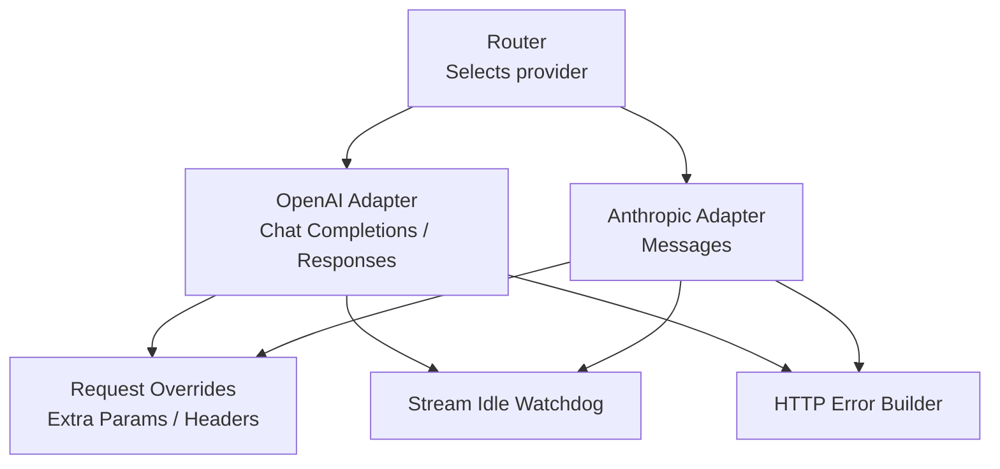
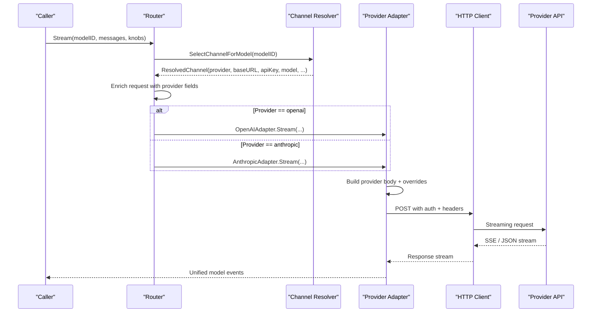
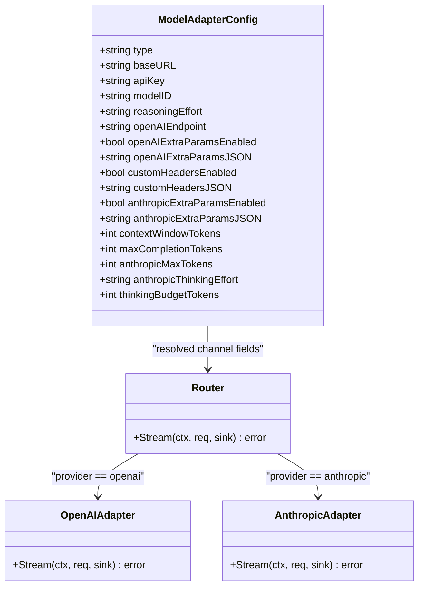

# Provider-Specific Settings

<cite>
**Referenced Files in This Document**
- [router.go](file://internal/backend/agent/model/router.go)
- [openai.go](file://internal/backend/agent/model/openai.go)
- [anthropic.go](file://internal/backend/agent/model/anthropic.go)
- [types.go](file://internal/backend/server/config/types.go)
- [request_override.go](file://internal/backend/agent/model/request_override.go)
- [stream_idle.go](file://internal/backend/agent/model/stream_idle.go)
- [http_error.go](file://internal/backend/agent/model/http_error.go)
- [provider-replay-debugging.md](file://.agents/skills/cursor-client-e2e-debugging/references/provider-replay-debugging.md)
</cite>

## Table of Contents
1. [Introduction](#introduction)
2. [Project Structure](#project-structure)
3. [Core Components](#core-components)
4. [Architecture Overview](#architecture-overview)
5. [Detailed Component Analysis](#detailed-component-analysis)
6. [Dependency Analysis](#dependency-analysis)
7. [Performance Considerations](#performance-considerations)
8. [Troubleshooting Guide](#troubleshooting-guide)
9. [Conclusion](#conclusion)

## Introduction
This document explains provider-specific model adapter settings and configurations for OpenAI and Anthropic. It covers:
- OpenAI endpoint customization, model variants, extra parameters, custom headers, authentication, streaming behavior, prompt caching, and reasoning effort.
- Anthropic thinking mode configuration, adaptive thinking, output config, prompt caching breakpoints, custom headers, authentication compatibility, streaming behavior, and Claude-specific parameters.
- How request/response transformations are applied through the router, adapters, and shared override utilities.
- Troubleshooting guidance for common provider-specific issues, connection problems, and API quota management.

## Project Structure
The provider-specific logic lives under the backend agent model package. The router selects between OpenAI and Anthropic adapters based on resolved channel metadata. Each adapter builds provider requests, applies provider-specific overrides, sends HTTP requests, parses streaming responses, and emits unified model events.

**Diagram sources**
- [router.go:13-35](file://internal/backend/agent/model/router.go#L13-L35)
- [openai.go:21-25](file://internal/backend/agent/model/openai.go#L21-L25)
- [anthropic.go:24-28](file://internal/backend/agent/model/anthropic.go#L24-L28)
- [request_override.go:72-90](file://internal/backend/agent/model/request_override.go#L72-L90)
- [stream_idle.go:16-43](file://internal/backend/agent/model/stream_idle.go#L16-L43)
- [http_error.go:16-41](file://internal/backend/agent/model/http_error.go#L16-L41)

**Section sources**
- [router.go:13-35](file://internal/backend/agent/model/router.go#L13-L35)
- [openai.go:21-25](file://internal/backend/agent/model/openai.go#L21-L25)
- [anthropic.go:24-28](file://internal/backend/agent/model/anthropic.go#L24-L28)

## Core Components
- ModelAdapterConfig: Defines per-channel provider settings including base URL, API key, model ID, reasoning effort, OpenAI endpoint, extra parameters, custom headers, Anthropic max tokens, Anthropic thinking effort, and thinking budget tokens.
- Router: Resolves a runtime channel to provider, base URL, API key, model ID, context window, reasoning effort, OpenAI endpoint, extra parameters, custom headers, Anthropic extra parameters, Anthropic max tokens, Anthropic thinking effort, and stream idle timeout. It then forwards to the correct adapter.
- OpenAI Adapter: Implements streaming for both Chat Completions and Responses endpoints, supports prompt cache keys, reasoning effort, extra parameters, custom headers, and Bearer authentication.
- Anthropic Adapter: Implements streaming for Messages, supports thinking mode, adaptive thinking with output config, ephemeral cache control breakpoints, custom headers, and dual authentication header compatibility.

**Section sources**
- [types.go:23-45](file://internal/backend/server/config/types.go#L23-L45)
- [router.go:37-135](file://internal/backend/agent/model/router.go#L37-L135)
- [openai.go:21-25](file://internal/backend/agent/model/openai.go#L21-L25)
- [anthropic.go:24-28](file://internal/backend/agent/model/anthropic.go#L24-L28)

## Architecture Overview
The request flow is:
1. Client calls Router.Stream with a model identifier and request payload.
2. Router resolves the actual provider channel and enriches the request with provider-specific fields.
3. Router delegates to OpenAI or Anthropic adapter.
4. Adapter constructs provider request body, applies thinking/reasoning overrides, extra parameters, and custom headers.
5. Adapter sends HTTP request with retry and stream idle watchdog.
6. Adapter parses streaming response and emits unified model events.

**Diagram sources**
- [router.go:37-135](file://internal/backend/agent/model/router.go#L37-L135)
- [openai.go:408-441](file://internal/backend/agent/model/openai.go#L408-L441)
- [anthropic.go:209-323](file://internal/backend/agent/model/anthropic.go#L209-L323)

## Detailed Component Analysis

### OpenAI-Specific Settings

#### Endpoint Customization
- Supported endpoint shapes:
  - `/v1/chat/completions`
  - `/v1/responses`
  - Custom path via `openAIEndpoint = "/custom"` when `baseURL` already contains an endpoint suffix.
- Endpoint resolution rules:
  - If `baseURL` ends with `/responses`, it uses the Responses shape.
  - If `baseURL` ends with `/chat/completions`, it uses the Chat Completions shape.
  - If `endpoint` is empty, it defaults to the normalized endpoint derived from `baseURL`.
  - If `baseURL` ends with a version segment like `/v4`, the adapter strips the version prefix from the endpoint before appending it to the base URL.
  - If `endpoint` is `/custom`, the adapter returns `baseURL` if it already has an endpoint suffix; otherwise it appends `/chat/completions`.

Configuration fields:
- `type`: Must be `"openai"`.
- `baseURL`: Base URL of the OpenAI-compatible endpoint.
- `openAIEndpoint`: One of `/v1/responses`, `/v1/chat/completions`, or `/custom`.
- `reasoningEffort`: Optional reasoning strength for OpenAI models.

Behavior:
- When endpoint shape is Responses, the adapter uses the Responses streaming format.
- When endpoint shape is Chat Completions, the adapter uses the Chat Completions streaming format.

**Section sources**
- [openai.go:299-386](file://internal/backend/agent/model/openai.go#L299-L386)
- [openai.go:408-441](file://internal/backend/agent/model/openai.go#L408-L441)
- [types.go:146-147](file://internal/backend/server/config/types.go#L146-L147)

#### Model Variants and Reasoning Effort
- `modelID` identifies the provider model.
- `reasoningEffort` controls OpenAI reasoning effort when enabled.
- For Responses endpoint, reasoning effort is mapped into a reasoning object with effort and summary inclusion.
- For Chat Completions endpoint, reasoning effort is included directly in the request body.

Validation:
- For OpenAI type, `reasoningEffort` must be empty or one of low, medium, high, xhigh, max.

**Section sources**
- [openai.go:947-950](file://internal/backend/agent/model/openai.go#L947-L950)
- [openai.go:470-472](file://internal/backend/agent/model/openai.go#L470-L472)
- [types.go:144-145](file://internal/backend/server/config/types.go#L144-L145)

#### Rate Limiting Parameters
- There is no explicit per-provider rate limit configuration field in `ModelAdapterConfig`.
- Connection-level resilience is provided by:
  - Retry wrapper around provider requests.
  - Stream idle watchdog that cancels long-idle streams after a configurable timeout.
- Global stream idle timeout is configured at the server level and passed down to adapters.

Operational notes:
- Increase `providerStreamIdleTimeout` if providers return slow initial chunks.
- Monitor HTTP status codes and error bodies for 429 or 5xx responses.

**Section sources**
- [types.go:51-59](file://internal/backend/server/config/types.go#L51-L59)
- [stream_idle.go:11-43](file://internal/backend/agent/model/stream_idle.go#L11-L43)
- [openai.go:500-525](file://internal/backend/agent/model/openai.go#L500-L525)
- [anthropic.go:305-330](file://internal/backend/agent/model/anthropic.go#L305-L330)

#### Streaming Behavior
- Both Chat Completions and Responses use Server-Sent Events style streaming.
- Chat Completions:
  - Emits text deltas, reasoning deltas, tool call progress, and turn finished events.
  - Supports `<think>` tag parsing to split reasoning content from regular text.
- Responses:
  - Emits output text deltas, function call arguments, image generation partial data, reasoning summaries, and completion/incompletion events.
  - Tracks usage, cache read/write tokens, and reasoning signature metadata.

Streaming safeguards:
- Stream idle watchdog marks effective content and cancels idle streams.
- Scanner buffers are sized to avoid excessive memory usage.

**Section sources**
- [openai.go:443-905](file://internal/backend/agent/model/openai.go#L443-L905)
- [openai.go:907-1599](file://internal/backend/agent/model/openai.go#L907-L1599)
- [stream_idle.go:29-57](file://internal/backend/agent/model/stream_idle.go#L29-L57)

#### Prompt Caching
- OpenAI prompt cache key support is enabled for models whose name contains "gpt".
- Cache key is derived from conversation ID and prefixed with a namespace.
- Cache key can be overridden by request body override, but only if not already present.

Configuration:
- No explicit UI field for prompt cache key; it is computed from conversation context.

**Section sources**
- [openai.go:183-212](file://internal/backend/agent/model/openai.go#L183-L212)

#### Authentication Methods
- Authorization header uses Bearer token.
- Content-Type is application/json.
- User-Agent is set to a consistent value.

Custom headers:
- `customHeadersEnabled` toggles injection of additional headers.
- `customHeadersJSON` defines a JSON object mapping header names to string values.

**Section sources**
- [openai.go:503-514](file://internal/backend/agent/model/openai.go#L503-L514)
- [request_override.go:72-90](file://internal/backend/agent/model/request_override.go#L72-L90)
- [types.go:36-37](file://internal/backend/server/config/types.go#L36-L37)

#### Request/Response Transformations
- Extra parameters:
  - `openAIExtraParamsEnabled` enables merging a JSON object into the request body.
  - Keys with empty names are skipped.
- Thinking disable:
  - If runtime thinking effort is disabled, adapter forces thinking-related fields off for OpenAI.
- Tool normalization:
  - Tools are normalized for both Chat Completions and Responses formats.
- Image generation:
  - Responses endpoint may auto-add an image generation tool when user input looks like an image request.

**Section sources**
- [request_override.go:52-70](file://internal/backend/agent/model/request_override.go#L52-L70)
- [openai.go:483-488](file://internal/backend/agent/model/openai.go#L483-L488)
- [openai.go:214-242](file://internal/backend/agent/model/openai.go#L214-L242)

### Anthropic-Specific Settings

#### Thinking Mode Configuration
- `anthropicThinkingEffort` controls adaptive thinking effort.
- Valid values include low, medium, high, xhigh, max.
- When runtime thinking effort is disabled, adapter forces `thinking.type = "disabled"` and removes conflicting fields such as `output_config`.
- When enabled, adapter writes `thinking.type = "adaptive"` and `display = "summarized"`, plus `output_config.effort`.

Validation:
- For Anthropic type, `anthropicThinkingEffort` must be one of low, medium, high, xhigh, max.

**Section sources**
- [anthropic.go:1469-1525](file://internal/backend/agent/model/anthropic.go#L1469-L1525)
- [types.go:160-161](file://internal/backend/server/config/types.go#L160-L161)

#### Prompt Caching
- Anthropic prompt caching uses ephemeral cache control markers at strategic positions:
  - Last tool block.
  - Last system block.
  - Last stable message boundary.
  - Last message boundary.
- Breakpoint positions are computed from canonical body hash and frontier path.
- An environment variable `ANTHROPIC_RELOCATE_IMAGES` can force moving images to the last user message, but this is generally discouraged because it breaks KV prompt caching.

Configuration:
- No direct UI field for cache breakpoints; they are computed automatically.
- Stable message count can influence breakpoint selection.

**Section sources**
- [anthropic.go:727-751](file://internal/backend/agent/model/anthropic.go#L727-L751)
- [anthropic.go:860-921](file://internal/backend/agent/model/anthropic.go#L860-L921)
- [anthropic.go:1091-1147](file://internal/backend/agent/model/anthropic.go#L1091-L1147)
- [anthropic.go:160-172](file://internal/backend/agent/model/anthropic.go#L160-L172)

#### Claude-Specific Parameters
- `anthropicMaxTokens` sets the maximum tokens for Anthropic requests.
- `maxCompletionTokens` and `contextWindowTokens` provide context limits used by the router to normalize token constraints.
- `thinkingBudgetTokens` provides a thinking budget hint.

Normalization:
- Router ensures Anthropic max tokens is respected and prefers the smaller of request max tokens and configured Anthropic max tokens.

**Section sources**
- [types.go:40-44](file://internal/backend/server/config/types.go#L40-L44)
- [router.go:83-91](file://internal/backend/agent/model/router.go#L83-L91)

#### Authentication Methods
- Anthropic adapter sets both `x-api-key` and `Authorization: Bearer` headers using a compatible token extraction helper.
- This allows compatibility with providers that expect either header.

Custom headers:
- Same mechanism as OpenAI: `customHeadersEnabled` and `customHeadersJSON`.

**Section sources**
- [anthropic.go:174-193](file://internal/backend/agent/model/anthropic.go#L174-L193)
- [anthropic.go:308-320](file://internal/backend/agent/model/anthropic.go#L308-L320)
- [request_override.go:72-90](file://internal/backend/agent/model/request_override.go#L72-L90)

#### Streaming Behavior
- Anthropic Messages streaming emits:
  - Message start, content block start/delta/stop, message delta, message stop.
  - Text deltas, thinking deltas, tool input deltas, and tool completion events.
- Thinking mode:
  - Extracts reasoning content from `<think>` tags or dedicated thinking deltas.
  - Emits thinking completed events with duration and signature tracking.
- Usage and cache metrics:
  - Tracks input tokens, output tokens, cache creation input tokens, and cache read input tokens.

**Section sources**
- [anthropic.go:209-712](file://internal/backend/agent/model/anthropic.go#L209-L712)

#### Request/Response Transformations
- Extra parameters:
  - `anthropicExtraParamsEnabled` merges a JSON object into the request body.
- System blocks:
  - Includes a billing header system block followed by user-provided system parts.
- Tool normalization:
  - Converts generic tool descriptors into Anthropic-compatible tool schema.
- Message normalization:
  - Transforms internal messages into Anthropic message blocks, handling tool results, images, and thinking blocks.

**Section sources**
- [request_override.go:52-70](file://internal/backend/agent/model/request_override.go#L52-L70)
- [anthropic.go:195-207](file://internal/backend/agent/model/anthropic.go#L195-L207)
- [anthropic.go:240-285](file://internal/backend/agent/model/anthropic.go#L240-L285)
- [anthropic.go:1158-1265](file://internal/backend/agent/model/anthropic.go#L1158-L1265)

## Dependency Analysis
The following diagram shows how configuration flows from server config types into the router and adapters.

**Diagram sources**
- [types.go:23-45](file://internal/backend/server/config/types.go#L23-L45)
- [router.go:13-35](file://internal/backend/agent/model/router.go#L13-L35)
- [openai.go:21-25](file://internal/backend/agent/model/openai.go#L21-L25)
- [anthropic.go:24-28](file://internal/backend/agent/model/anthropic.go#L24-L28)

**Section sources**
- [types.go:23-45](file://internal/backend/server/config/types.go#L23-L45)
- [router.go:37-135](file://internal/backend/agent/model/router.go#L37-L135)

## Performance Considerations
- Stream idle timeout:
  - Default is 240 seconds at the server config level.
  - Minimum enforced is 30 seconds.
  - Adapters attach the response body to the watchdog so idle streams are closed promptly.
- Token limits:
  - Use `contextWindowTokens`, `maxCompletionTokens`, and `anthropicMaxTokens` to constrain input/output size.
- Prompt caching:
  - OpenAI prompt cache key reduces repeated computation for GPT models.
  - Anthropic ephemeral cache control improves KV cache hit rates when stable message boundaries are preserved.
- Streaming buffer sizes:
  - OpenAI chat completions scanner buffer is sized to prevent large allocations.
  - Anthropic streaming scanner buffer is also bounded.

Recommendations:
- Tune `providerStreamIdleTimeout` based on provider latency characteristics.
- Prefer keeping images in original message order for Anthropic unless a specific proxy requires relocation.
- Enable extra parameters only when necessary to avoid bloating request payloads.

**Section sources**
- [types.go:15-21](file://internal/backend/server/config/types.go#L15-L21)
- [types.go:269-284](file://internal/backend/server/config/types.go#L269-L284)
- [openai.go:744-745](file://internal/backend/agent/model/openai.go#L744-L745)
- [anthropic.go:528-529](file://internal/backend/agent/model/anthropic.go#L528-L529)
- [anthropic.go:160-172](file://internal/backend/agent/model/anthropic.go#L160-L172)

## Troubleshooting Guide

### Common Provider-Specific Issues

#### OpenAI Endpoint Misconfiguration
- Symptom: Adapter reports unsupported endpoint.
- Checks:
  - Ensure `openAIEndpoint` is `/v1/responses`, `/v1/chat/completions`, or `/custom`.
  - If using `/custom`, ensure `baseURL` already ends with an endpoint suffix.
  - Verify `baseURL` does not duplicate version segments.

Resolution:
- Adjust `openAIEndpoint` or `baseURL` according to endpoint resolution rules.

**Section sources**
- [openai.go:426-430](file://internal/backend/agent/model/openai.go#L426-L430)
- [types.go:146-147](file://internal/backend/server/config/types.go#L146-L147)

#### Anthropic Thinking Errors
- Symptom: Provider rejects thinking configuration or requires thinking to be passed back.
- Checks:
  - Confirm `anthropicThinkingEffort` is valid.
  - If runtime thinking is disabled, adapter forces `thinking.type = "disabled"` and removes `output_config`.
  - If adaptive thinking is enabled, adapter writes `thinking.type = "adaptive"` and `output_config.effort`.

Resolution:
- Set `anthropicThinkingEffort` to a supported value or disable thinking explicitly.

**Section sources**
- [anthropic.go:1469-1525](file://internal/backend/agent/model/anthropic.go#L1469-L1525)
- [router.go:70-82](file://internal/backend/agent/model/router.go#L70-L82)

#### Custom Header Validation Failures
- Symptom: Config validation fails for custom headers.
- Checks:
  - `customHeadersEnabled` must be true to enable headers.
  - `customHeadersJSON` must be a valid JSON object with non-empty string keys.

Resolution:
- Fix JSON syntax and ensure all header names are non-empty strings.

**Section sources**
- [types.go:209-224](file://internal/backend/server/config/types.go#L209-L224)
- [request_override.go:72-90](file://internal/backend/agent/model/request_override.go#L72-L90)

#### Extra Parameters Validation Failures
- Symptom: Config validation fails for OpenAI or Anthropic extra parameters.
- Checks:
  - `openAIExtraParamsEnabled` or `anthropicExtraParamsEnabled` must be true.
  - Corresponding JSON must be a valid non-null object.

Resolution:
- Provide valid JSON object for extra parameters.

**Section sources**
- [types.go:148-159](file://internal/backend/server/config/types.go#L148-L159)
- [request_override.go:52-70](file://internal/backend/agent/model/request_override.go#L52-L70)

### Connection Problems

#### Stream Idle Timeout
- Symptom: Requests time out without meaningful provider response.
- Checks:
  - Review `providerStreamIdleTimeout`.
  - Check whether the provider returns slow initial chunks.

Resolution:
- Increase `providerStreamIdleTimeout` within allowed bounds.

**Section sources**
- [types.go:15-21](file://internal/backend/server/config/types.go#L15-L21)
- [stream_idle.go:29-43](file://internal/backend/agent/model/stream_idle.go#L29-L43)

#### HTTP Non-2xx Responses
- Symptom: Adapter returns HTTP status error with limited body.
- Checks:
  - Inspect response headers and body.
  - Look for 429 (rate limit) or 5xx (server error).

Resolution:
- Address authentication, quota, or upstream gateway issues.
- Use replay debugging artifacts to compare final provider request shape.

**Section sources**
- [http_error.go:16-41](file://internal/backend/agent/model/http_error.go#L16-L41)
- [provider-replay-debugging.md:92-117](file://.agents/skills/cursor-client-e2e-debugging/references/provider-replay-debugging.md#L92-L117)

### API Quota Management

#### Rate Limits and Retries
- Symptom: Frequent 429 or transient 5xx errors.
- Checks:
  - Monitor provider error bodies and retry attempt summaries.
  - Evaluate whether increasing concurrency or reducing request frequency helps.

Resolution:
- Implement client-side backoff and reduce concurrent requests.
- Adjust stream idle timeout to avoid holding connections during throttling.

**Section sources**
- [http_error.go:24-39](file://internal/backend/agent/model/http_error.go#L24-L39)
- [stream_idle.go:29-43](file://internal/backend/agent/model/stream_idle.go#L29-L43)

#### Token Budget Exceeded
- Symptom: Provider stops early or rejects requests due to token limits.
- Checks:
  - Compare `maxCompletionTokens`, `anthropicMaxTokens`, and `contextWindowTokens` with provider limits.
  - Review usage events for input/output token counts.

Resolution:
- Reduce request payload size or lower token limits appropriately.

**Section sources**
- [types.go:40-44](file://internal/backend/server/config/types.go#L40-L44)
- [openai.go:712-743](file://internal/backend/agent/model/openai.go#L712-L743)
- [anthropic.go:483-502](file://internal/backend/agent/model/anthropic.go#L483-L502)

## Conclusion
Provider-specific settings in this codebase are centered around three layers:
- Configuration definitions in `ModelAdapterConfig`.
- Resolution and enrichment in `Router`.
- Provider-specific implementation in `OpenAIAdapter` and `AnthropicAdapter`.

OpenAI configuration focuses on endpoint shape, reasoning effort, prompt cache keys, extra parameters, and custom headers. Anthropic configuration emphasizes thinking mode, adaptive thinking output config, ephemeral prompt caching, and dual authentication header compatibility. Both adapters share common mechanisms for custom headers, extra parameters, streaming safeguards, and error reporting.

For reliable operation:
- Validate endpoint and thinking configuration.
- Keep prompt caching strategies aligned with provider expectations.
- Tune stream idle timeouts and token limits based on provider behavior.
- Use replay debugging artifacts to diagnose parameter mismatches and connection issues.