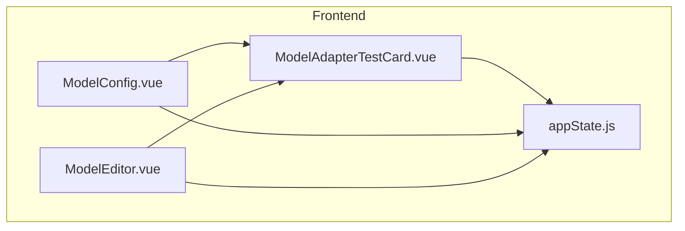
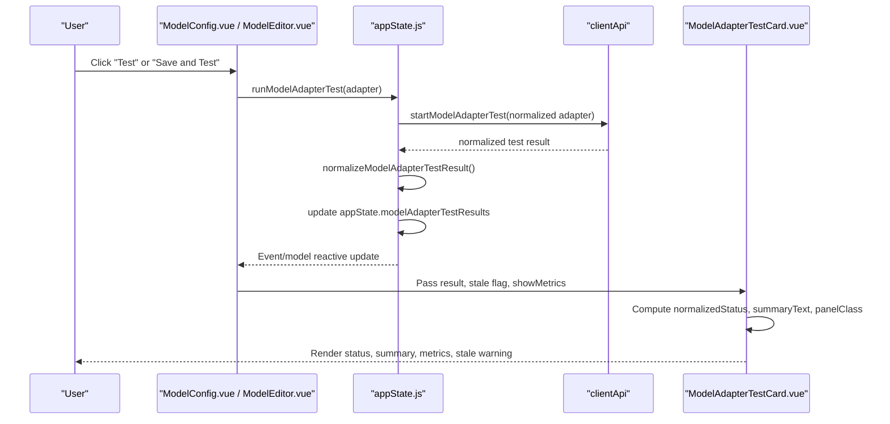
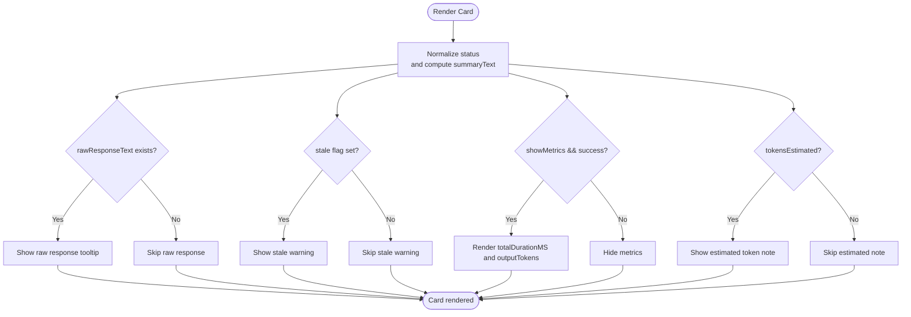
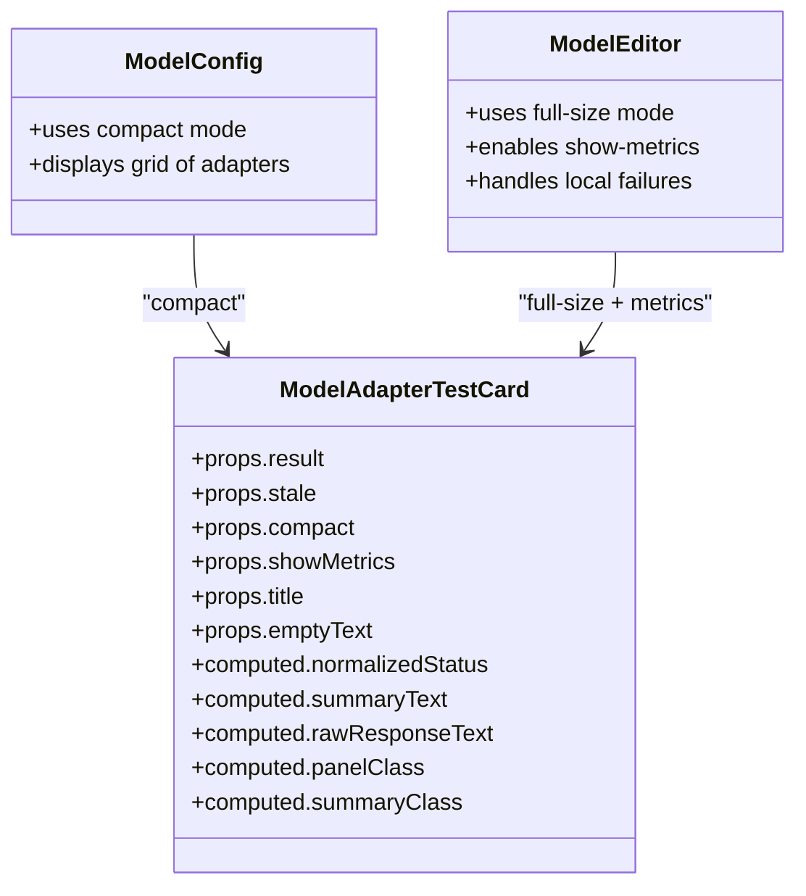
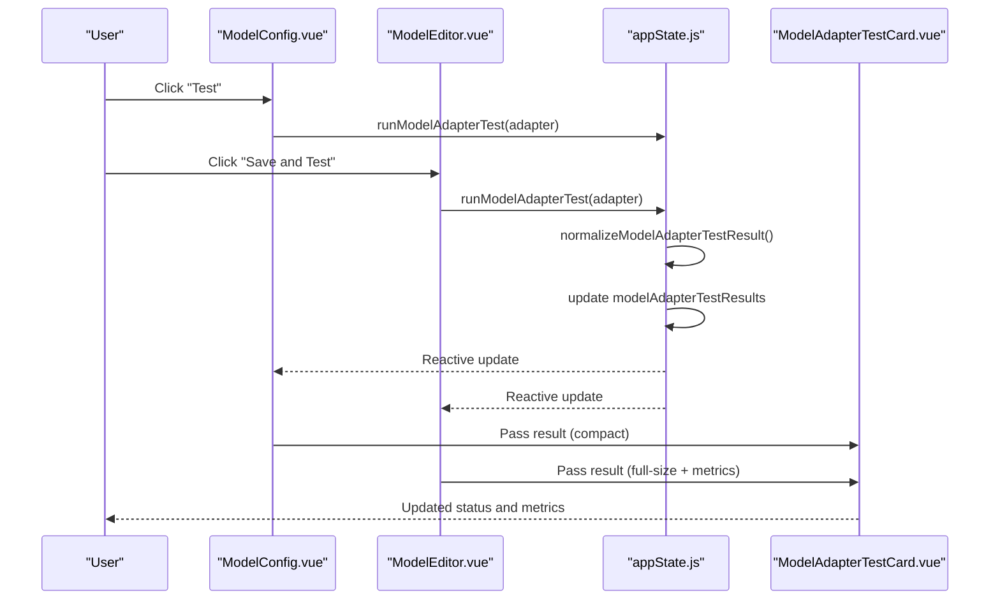
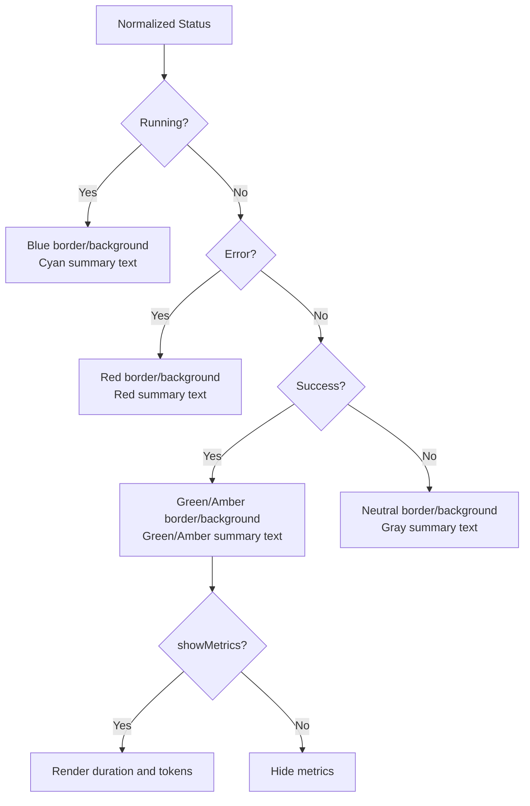
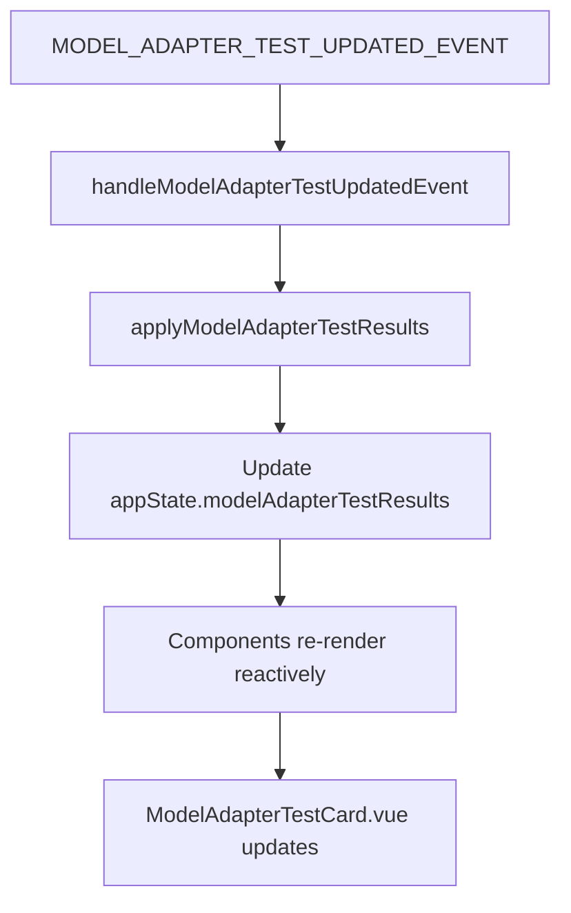
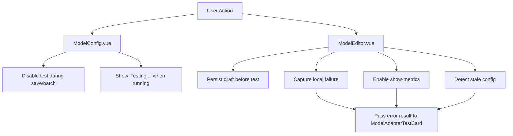
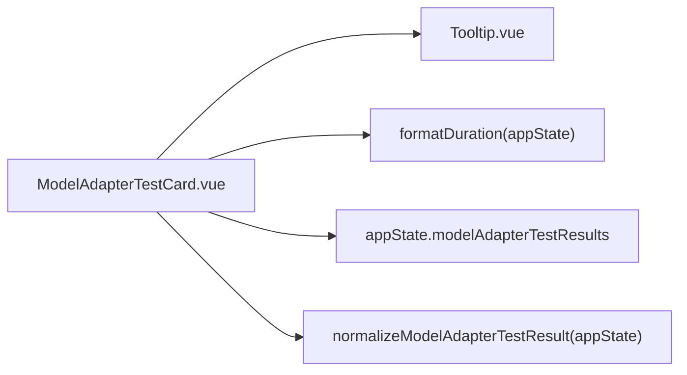

# ModelAdapterTestCard Component

<cite>
**Referenced Files in This Document**
- [ModelAdapterTestCard.vue](file://frontend/src/components/ModelAdapterTestCard.vue)
- [ModelConfig.vue](file://frontend/src/views/ModelConfig.vue)
- [ModelEditor.vue](file://frontend/src/components/ModelEditor.vue)
- [appState.js](file://frontend/src/state/appState.js)
</cite>

## Table of Contents
1. [Introduction](#introduction)
2. [Project Structure](#project-structure)
3. [Core Components](#core-components)
4. [Architecture Overview](#architecture-overview)
5. [Detailed Component Analysis](#detailed-component-analysis)
6. [Dependency Analysis](#dependency-analysis)
7. [Performance Considerations](#performance-considerations)
8. [Troubleshooting Guide](#troubleshooting-guide)
9. [Conclusion](#conclusion)

## Introduction
The ModelAdapterTestCard component is a focused UI card that displays the test result for a single model adapter and supports both compact display inside a grid layout and full-size display inside a dedicated testing interface. It normalizes test status, renders summary text, optional raw response preview, stale configuration warnings, and success metrics such as total duration and output tokens. The component does not directly execute tests; instead, it reads normalized test results from global state and reacts to real-time updates during batch or individual testing operations.

## Project Structure
The component lives under the frontend Vue application and is consumed by two main views:
- ModelConfig.vue uses it in compact mode within a grid of model adapters.
- ModelEditor.vue uses it in full-size mode with metrics enabled inside the editor modal.

**Diagram sources**
- [ModelConfig.vue:1-25](file://frontend/src/views/ModelConfig.vue#L1-L25)
- [ModelEditor.vue:1-30](file://frontend/src/components/ModelEditor.vue#L1-L30)
- [ModelAdapterTestCard.vue:1-31](file://frontend/src/components/ModelAdapterTestCard.vue#L1-L31)
- [appState.js:1-52](file://frontend/src/state/appState.js#L1-L52)

**Section sources**
- [ModelAdapterTestCard.vue:1-31](file://frontend/src/components/ModelAdapterTestCard.vue#L1-L31)
- [ModelConfig.vue:1-25](file://frontend/src/views/ModelConfig.vue#L1-L25)
- [ModelEditor.vue:1-30](file://frontend/src/components/ModelEditor.vue#L1-L30)

## Core Components
- ModelAdapterTestCard.vue: Renders a single test result card with status-aware styling, summary text, raw response tooltip, stale warning, and optional metrics panel.
- appState.js: Provides normalized test results, helper functions for formatting duration and summaries, and event-driven updates for test progress.
- ModelConfig.vue: Uses ModelAdapterTestCard in compact mode for each adapter in the model list.
- ModelEditor.vue: Uses ModelAdapterTestCard in full-size mode with show-metrics enabled and stale detection.

Key responsibilities:
- Display normalized test status: idle, running, success, error.
- Show user-friendly summary text based on status and available fields.
- Provide visual feedback through border/background color changes.
- Optionally render performance metrics when successful.
- Warn users when configuration has changed since the last test.

**Section sources**
- [ModelAdapterTestCard.vue:33-99](file://frontend/src/components/ModelAdapterTestCard.vue#L33-L99)
- [appState.js:188-240](file://frontend/src/state/appState.js#L188-L240)
- [ModelConfig.vue:469-474](file://frontend/src/views/ModelConfig.vue#L469-L474)
- [ModelEditor.vue:400-406](file://frontend/src/components/ModelEditor.vue#L400-L406)

## Architecture Overview
The test result flow connects the UI components to global state and backend events:

**Diagram sources**
- [ModelConfig.vue:477-484](file://frontend/src/views/ModelConfig.vue#L477-L484)
- [ModelEditor.vue:308-327](file://frontend/src/components/ModelEditor.vue#L308-L327)
- [appState.js:1093-1113](file://frontend/src/state/appState.js#L1093-L1113)
- [appState.js:217-240](file://frontend/src/state/appState.js#L217-L240)
- [ModelAdapterTestCard.vue:33-99](file://frontend/src/components/ModelAdapterTestCard.vue#L33-L99)

## Detailed Component Analysis

### ModelAdapterTestCard.vue
This component accepts props for the test result, stale configuration flag, compact mode, metrics visibility, title, and empty text. It computes:
- normalizedStatus: maps incoming status to one of idle, running, success, error.
- summaryText: prioritizes explicit summaryText, then fallback messages for running/error, otherwise empty text.
- rawResponseText: shows rawResponse if present, else error field when status is error.
- panelClass and summaryClass: apply status-specific colors and backgrounds.

When showMetrics is true and status is success, it renders totalDurationMS and outputTokens using formatDuration from appState. If tokensEstimated is true, it shows an estimated token note.

**Diagram sources**
- [ModelAdapterTestCard.vue:33-99](file://frontend/src/components/ModelAdapterTestCard.vue#L33-L99)
- [ModelAdapterTestCard.vue:124-147](file://frontend/src/components/ModelAdapterTestCard.vue#L124-L147)

**Section sources**
- [ModelAdapterTestCard.vue:6-31](file://frontend/src/components/ModelAdapterTestCard.vue#L6-L31)
- [ModelAdapterTestCard.vue:33-99](file://frontend/src/components/ModelAdapterTestCard.vue#L33-L99)
- [ModelAdapterTestCard.vue:102-149](file://frontend/src/components/ModelAdapterTestCard.vue#L102-L149)

### Compact Mode vs Full-Size Mode
- Compact mode (grid layout):
  - Used in ModelConfig.vue.
  - Displays a small card with title, summary text, and optional raw response tooltip.
  - Does not show metrics by default.
  - Designed for scanning many adapters quickly.

- Full-size mode (dedicated interface):
  - Used in ModelEditor.vue.
  - Shows the same card but with show-metrics enabled.
  - Includes stale detection and local failure overlay.
  - Designed for detailed inspection and editing.

**Diagram sources**
- [ModelConfig.vue:469-474](file://frontend/src/views/ModelConfig.vue#L469-L474)
- [ModelEditor.vue:400-406](file://frontend/src/components/ModelEditor.vue#L400-L406)
- [ModelAdapterTestCard.vue:6-31](file://frontend/src/components/ModelAdapterTestCard.vue#L6-L31)

**Section sources**
- [ModelConfig.vue:469-474](file://frontend/src/views/ModelConfig.vue#L469-L474)
- [ModelEditor.vue:400-406](file://frontend/src/components/ModelEditor.vue#L400-L406)

### Test Execution Workflow
The workflow begins in the view layer and flows through global state to the backend via clientApi:
- User clicks “Test” in ModelConfig.vue or “Save and Test” in ModelEditor.vue.
- The view calls runModelAdapterTest(adapter).
- appState.startModelAdapterTest validates and invokes testModelAdapter.
- A normalized result is computed and stored in appState.modelAdapterTestResults.
- Events propagate updates so components re-render reactively.
- ModelAdapterTestCard reflects the latest status, summary, and metrics.

**Diagram sources**
- [ModelConfig.vue:477-484](file://frontend/src/views/ModelConfig.vue#L477-L484)
- [ModelEditor.vue:308-327](file://frontend/src/components/ModelEditor.vue#L308-L327)
- [appState.js:1093-1113](file://frontend/src/state/appState.js#L1093-L1113)
- [appState.js:217-240](file://frontend/src/state/appState.js#L217-L240)

**Section sources**
- [ModelConfig.vue:477-484](file://frontend/src/views/ModelConfig.vue#L477-L484)
- [ModelEditor.vue:308-327](file://frontend/src/components/ModelEditor.vue#L308-L327)
- [appState.js:1093-1113](file://frontend/src/state/appState.js#L1093-L1113)

### Status Indicators and Result Visualization
- Running:
  - Summary indicates testing in progress.
  - Panel border and background use a blue-ish theme.
  - Summary text color uses a cyan-like tone.
- Success:
  - Summary includes throughput and first-token latency when available.
  - Optional metrics panel shows total duration and output tokens.
  - Estimated token note appears when tokensEstimated is true.
  - Panel border/background shifts to green or amber depending on estimation.
- Error:
  - Summary falls back to error message or generic failure text.
  - Raw response may be shown via tooltip.
  - Panel border/background uses red tones.
- Idle:
  - Empty text is displayed when no result is available.
  - Neutral panel styling.

**Diagram sources**
- [ModelAdapterTestCard.vue:33-99](file://frontend/src/components/ModelAdapterTestCard.vue#L33-L99)
- [ModelAdapterTestCard.vue:128-147](file://frontend/src/components/ModelAdapterTestCard.vue#L128-L147)

**Section sources**
- [ModelAdapterTestCard.vue:33-99](file://frontend/src/components/ModelAdapterTestCard.vue#L33-L99)
- [ModelAdapterTestCard.vue:128-147](file://frontend/src/components/ModelAdapterTestCard.vue#L128-L147)

### Global Test State Management and Real-Time Updates
- Normalization:
  - normalizeModelAdapterTestResult ensures consistent fields and types.
  - For running/success, summaryText is generated automatically.
  - For error without summaryText, error or generic failure text is used.
- Storage:
  - Results are keyed by adapterID and requestHash.
  - getModelAdapterTestResult resolves by ID or hash.
- Events:
  - MODEL_ADAPTER_TEST_UPDATED_EVENT triggers handleModelAdapterTestUpdatedEvent.
  - applyModelAdapterTestResults updates appState.modelAdapterTestResults.
- Bootstrap:
  - bootstrapAppState refreshes test results on startup.

**Diagram sources**
- [appState.js:679-694](file://frontend/src/state/appState.js#L679-L694)
- [appState.js:1059-1085](file://frontend/src/state/appState.js#L1059-L1085)
- [appState.js:1439-1453](file://frontend/src/state/appState.js#L1439-L1453)

**Section sources**
- [appState.js:217-240](file://frontend/src/state/appState.js#L217-L240)
- [appState.js:679-694](file://frontend/src/state/appState.js#L679-L694)
- [appState.js:1059-1085](file://frontend/src/state/appState.js#L1059-L1085)
- [appState.js:1439-1453](file://frontend/src/state/appState.js#L1439-L1453)

### User Interaction Patterns, Loading States, and Error Presentation
- ModelConfig.vue:
  - Disables test button while saving or during batch testing.
  - Shows “Testing...” label when an adapter is currently running.
  - Passes compact mode and empty text to ModelAdapterTestCard.
- ModelEditor.vue:
  - Persists draft before testing.
  - Captures local failures and presents them via a temporary error result object.
  - Enables show-metrics and stale detection for full-size presentation.
  - Disables “Save and Test” while current config is running or saving.

**Diagram sources**
- [ModelConfig.vue:477-484](file://frontend/src/views/ModelConfig.vue#L477-L484)
- [ModelEditor.vue:308-327](file://frontend/src/components/ModelEditor.vue#L308-L327)
- [ModelEditor.vue:688-696](file://frontend/src/components/ModelEditor.vue#L688-L696)

**Section sources**
- [ModelConfig.vue:477-484](file://frontend/src/views/ModelConfig.vue#L477-L484)
- [ModelEditor.vue:308-327](file://frontend/src/components/ModelEditor.vue#L308-L327)
- [ModelEditor.vue:688-696](file://frontend/src/components/ModelEditor.vue#L688-L696)

### Examples of Different Test Result States
- Running:
  - Summary indicates testing in progress.
  - Blue-themed panel and cyan summary text.
- Success:
  - Summary includes throughput and first-token latency.
  - Optional metrics panel shows totalDurationMS and outputTokens.
  - Green or amber-themed panel depending on estimation.
- Error:
  - Summary shows error message or generic failure text.
  - Red-themed panel and red summary text.
  - Raw response tooltip available if present.
- Idle:
  - Empty text displayed when no result is available.
  - Neutral panel styling.

These states are driven by normalizedStatus and computed classes in ModelAdapterTestCard.vue.

**Section sources**
- [ModelAdapterTestCard.vue:33-99](file://frontend/src/components/ModelAdapterTestCard.vue#L33-L99)
- [ModelAdapterTestCard.vue:128-147](file://frontend/src/components/ModelAdapterTestCard.vue#L128-L147)

## Dependency Analysis
The component depends on:
- Tooltip for raw response preview.
- formatDuration from appState for time formatting.
- Global state for test results and normalization helpers.

**Diagram sources**
- [ModelAdapterTestCard.vue:1-4](file://frontend/src/components/ModelAdapterTestCard.vue#L1-L4)
- [appState.js:188-240](file://frontend/src/state/appState.js#L188-L240)

**Section sources**
- [ModelAdapterTestCard.vue:1-4](file://frontend/src/components/ModelAdapterTestCard.vue#L1-L4)
- [appState.js:188-240](file://frontend/src/state/appState.js#L188-L240)

## Performance Considerations
- Computed properties minimize unnecessary recalculations for status, summary, and styling.
- Metrics rendering is conditional on success and show-metrics flag to avoid unnecessary DOM work.
- Duration formatting uses simple arithmetic and rounding for efficient display.
- Event-driven updates ensure only affected components re-render.

[No sources needed since this section provides general guidance]

## Troubleshooting Guide
Common issues and resolutions:
- No result displayed:
  - Ensure runModelAdapterTest was called and appState.modelAdapterTestResults contains a result for the adapter.
  - Check bootstrapAppState to confirm initial refresh occurred.
- Stale warning shown:
  - Indicates configuration changed since last test; re-run the test to refresh the result.
- Error summary missing details:
  - rawResponse tooltip can provide additional context; inspect it for underlying errors.
- Metrics not visible:
  - Metrics require success status and show-metrics prop enabled; verify usage in ModelEditor.vue.

**Section sources**
- [ModelAdapterTestCard.vue:124-147](file://frontend/src/components/ModelAdapterTestCard.vue#L124-L147)
- [appState.js:1439-1453](file://frontend/src/state/appState.js#L1439-L1453)

## Conclusion
ModelAdapterTestCard provides a clear, status-aware visualization for individual model adapter test results. It integrates tightly with global state management to reflect real-time updates during batch and individual testing. The component supports compact mode for grid layouts and full-size mode with metrics for dedicated interfaces. Its design emphasizes clarity, responsiveness, and actionable feedback through summary text, raw response previews, stale warnings, and optional performance metrics.

[No sources needed since this section summarizes without analyzing specific files]