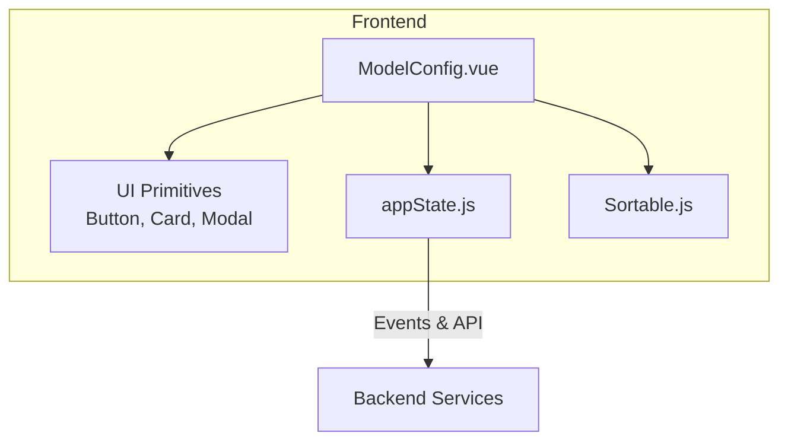
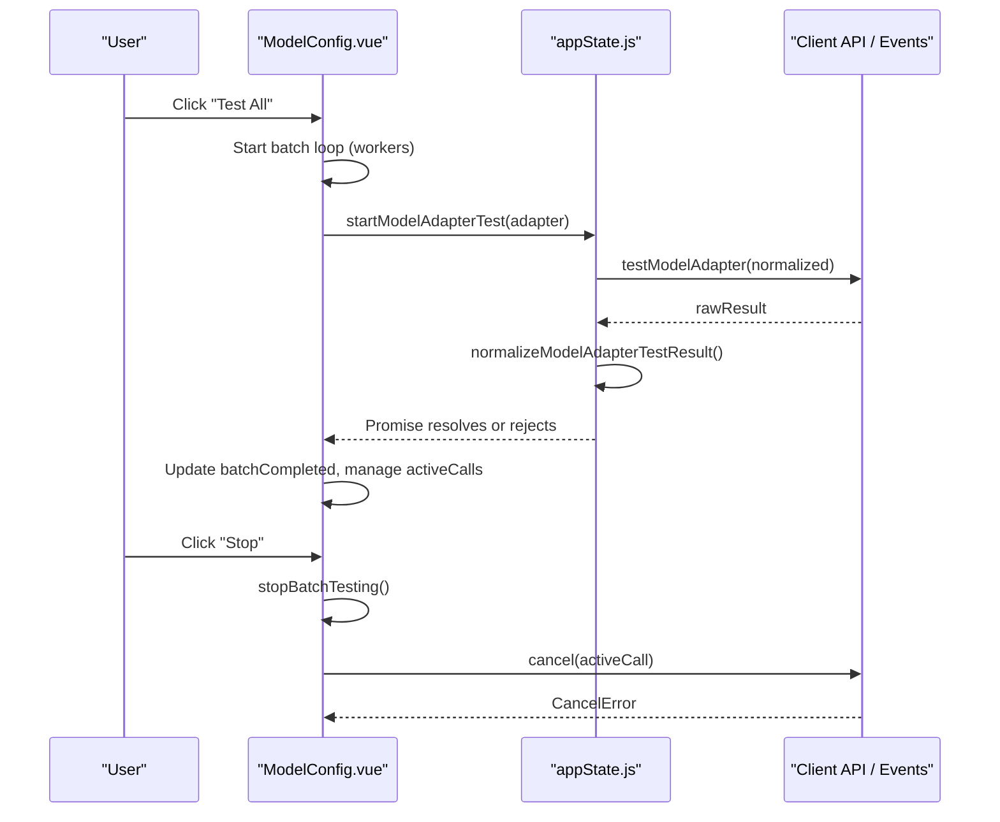
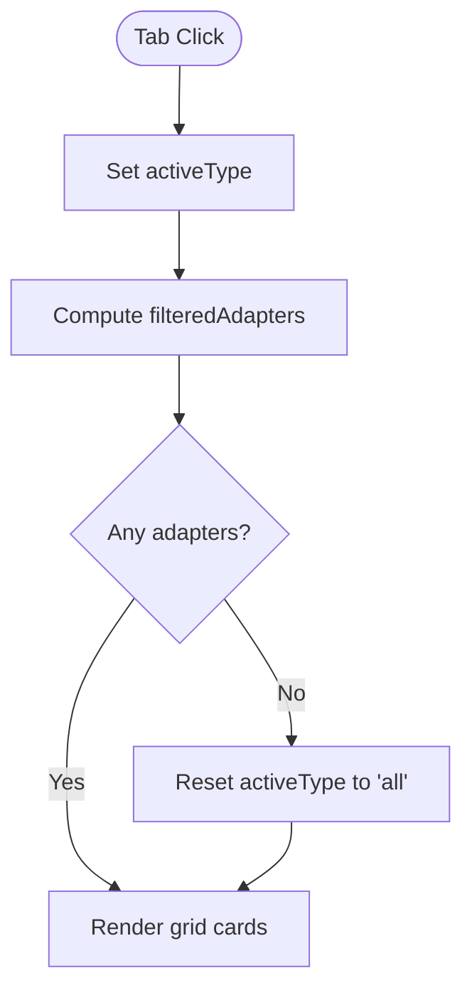
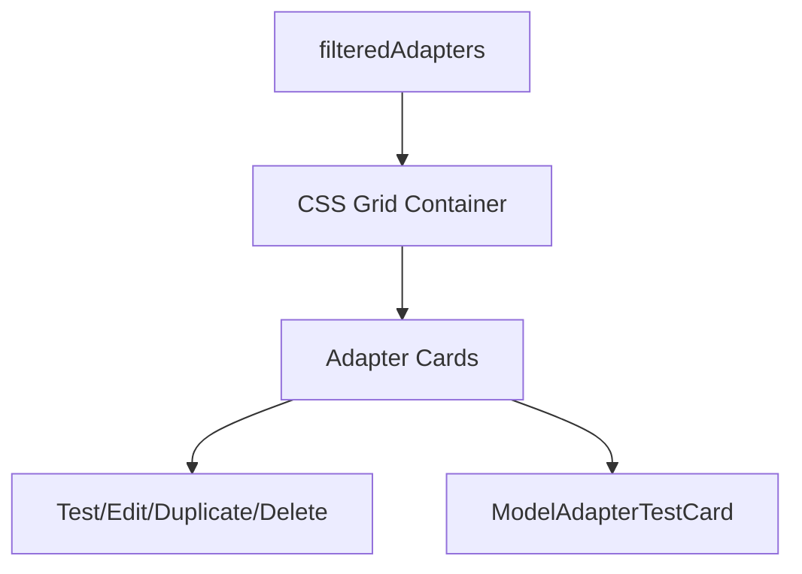
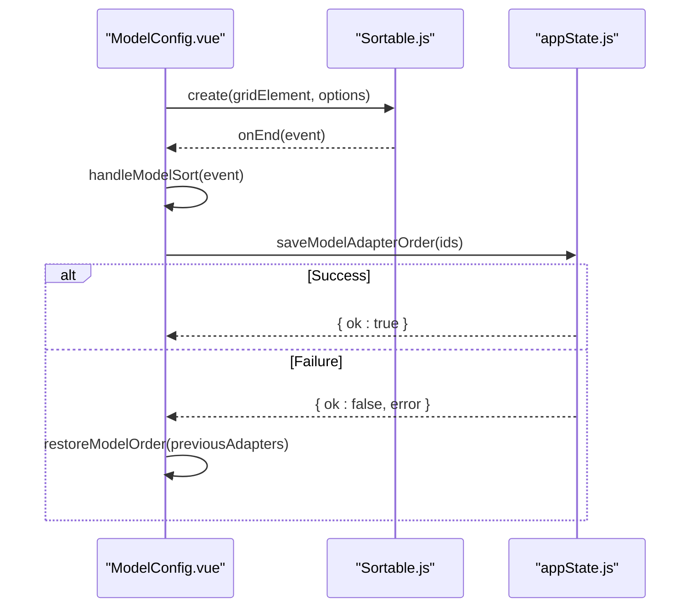
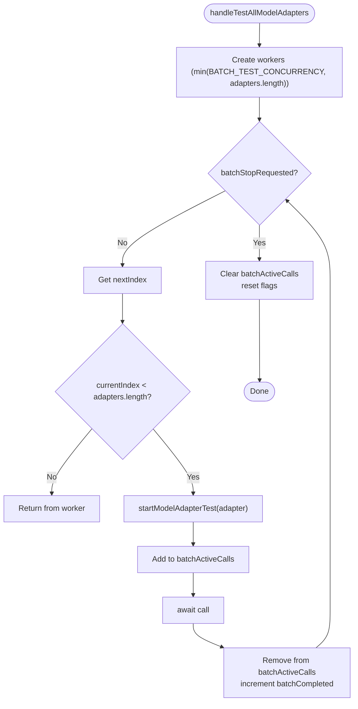
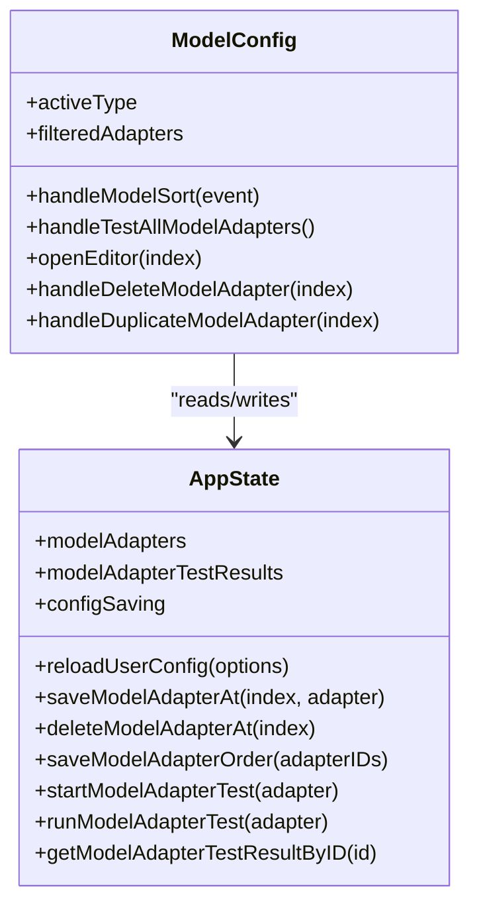
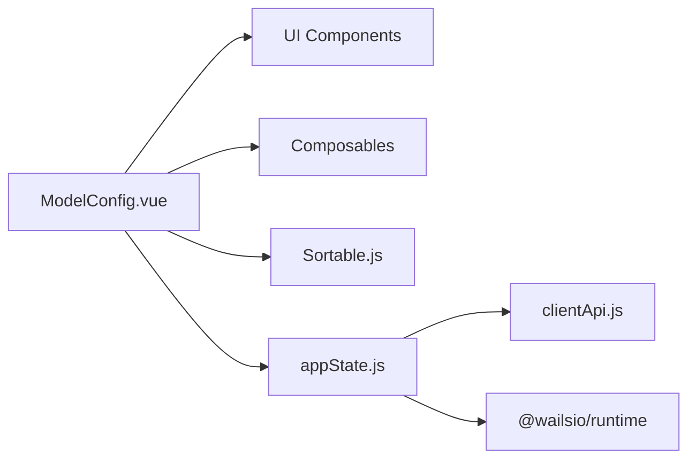

# ModelConfig View Component

<cite>
**Referenced Files in This Document**
- [ModelConfig.vue](file://frontend/src/views/ModelConfig.vue)
- [appState.js](file://frontend/src/state/appState.js)
</cite>

## Table of Contents
1. [Introduction](#introduction)
2. [Project Structure](#project-structure)
3. [Core Components](#core-components)
4. [Architecture Overview](#architecture-overview)
5. [Detailed Component Analysis](#detailed-component-analysis)
6. [Dependency Analysis](#dependency-analysis)
7. [Performance Considerations](#performance-considerations)
8. [Troubleshooting Guide](#troubleshooting-guide)
9. [Conclusion](#conclusion)

## Introduction
The ModelConfig view component is the primary interface for managing model adapters. It provides:
- A tabbed filtering system for adapter types: all, openai, and anthropic.
- A responsive grid layout using CSS Grid with auto-fill columns.
- Drag-and-drop reordering powered by Sortable.js.
- Batch testing with concurrency control, worker management, and cancellation.
- Integration with appState for CRUD operations, test result management, and configuration persistence.
- Error handling patterns, user feedback mechanisms, and accessibility considerations.

## Project Structure
The ModelConfig view is implemented as a Vue single-file component that composes UI primitives, state helpers, and third-party drag-and-drop behavior. The core logic lives in the view file, while shared state, validation, persistence, and API integration are centralized in appState.

**Diagram sources**
- [ModelConfig.vue:1-22](file://frontend/src/views/ModelConfig.vue#L1-L22)
- [appState.js:820-900](file://frontend/src/state/appState.js#L820-L900)

**Section sources**
- [ModelConfig.vue:1-22](file://frontend/src/views/ModelConfig.vue#L1-L22)
- [appState.js:820-900](file://frontend/src/state/appState.js#L820-L900)

## Core Components
- Tabbed Filtering System: Renders type tabs with icons and labels, filters adapters by selected type, and resets to all when necessary.
- Responsive Grid Layout: Uses CSS Grid with repeat(auto-fill, minmax(250px, 1fr)) to adapt to screen sizes.
- Drag-and-Drop Reordering: Initializes Sortable.js on mount, syncs order on changes, persists ordering, and restores on failure.
- Batch Testing System: Starts multiple workers up to BATCH_TEST_CONCURRENCY, tracks active calls, supports stop/cancel, and updates progress.
- State Integration: Reads/writes modelAdapters, manages test results, and persists configuration through appState.

**Section sources**
- [ModelConfig.vue:24-55](file://frontend/src/views/ModelConfig.vue#L24-L55)
- [ModelConfig.vue:380-495](file://frontend/src/views/ModelConfig.vue#L380-L495)
- [ModelConfig.vue:150-249](file://frontend/src/views/ModelConfig.vue#L150-L249)
- [ModelConfig.vue:309-366](file://frontend/src/views/ModelConfig.vue#L309-L366)
- [appState.js:1059-1113](file://frontend/src/state/appState.js#L1059-L1113)
- [appState.js:1166-1261](file://frontend/src/state/appState.js#L1166-L1261)

## Architecture Overview
The ModelConfig view orchestrates UI interactions and delegates data operations to appState. Test execution flows through appState into backend services via events and API calls.

**Diagram sources**
- [ModelConfig.vue:321-366](file://frontend/src/views/ModelConfig.vue#L321-L366)
- [ModelConfig.vue:309-319](file://frontend/src/views/ModelConfig.vue#L309-L319)
- [appState.js:1093-1113](file://frontend/src/state/appState.js#L1093-L1113)

## Detailed Component Analysis

### Tabbed Filtering System
- Tabs define three values: all, openai, anthropic, each with an icon class and label.
- activeType controls filteredAdapters computed property.
- When no adapters match the current filter, activeType resets to all automatically.

**Diagram sources**
- [ModelConfig.vue:27-33](file://frontend/src/views/ModelConfig.vue#L27-L33)
- [ModelConfig.vue:48-55](file://frontend/src/views/ModelConfig.vue#L48-L55)
- [ModelConfig.vue:72-84](file://frontend/src/views/ModelConfig.vue#L72-L84)

**Section sources**
- [ModelConfig.vue:27-33](file://frontend/src/views/ModelConfig.vue#L27-L33)
- [ModelConfig.vue:48-55](file://frontend/src/views/ModelConfig.vue#L48-L55)
- [ModelConfig.vue:72-84](file://frontend/src/views/ModelConfig.vue#L72-L84)

### Responsive Grid Layout
- The grid container uses CSS Grid with repeat(auto-fill, minmax(250px, 1fr)).
- Each adapter card includes metadata, provider badge, test status, and action buttons.
- Empty state displays contextual text based on activeType.

**Diagram sources**
- [ModelConfig.vue:432-495](file://frontend/src/views/ModelConfig.vue#L432-L495)

**Section sources**
- [ModelConfig.vue:432-495](file://frontend/src/views/ModelConfig.vue#L432-L495)

### Drag-and-Drop Reordering with Sortable.js
- Initialization: On mount, reloads config and initializes Sortable.js on the grid element.
- Syncing: Watches DOM reference, activeType, filtered order key, saving states, and batch testing state to keep Sortable aligned.
- Event Handling: OnEnd triggers handleModelSort which computes new order, updates appState.modelAdapters, and persists via saveModelAdapterOrder.
- Failure Recovery: restoreModelOrder attempts reload; if it fails, falls back to previousAdapters snapshot.

**Diagram sources**
- [ModelConfig.vue:150-184](file://frontend/src/views/ModelConfig.vue#L150-L184)
- [ModelConfig.vue:194-249](file://frontend/src/views/ModelConfig.vue#L194-L249)
- [appState.js:1230-1261](file://frontend/src/state/appState.js#L1230-L1261)

**Section sources**
- [ModelConfig.vue:150-184](file://frontend/src/views/ModelConfig.vue#L150-L184)
- [ModelConfig.vue:194-249](file://frontend/src/views/ModelConfig.vue#L194-L249)
- [appState.js:1230-1261](file://frontend/src/state/appState.js#L1230-L1261)

### Batch Testing System
- Concurrency Control: BATCH_TEST_CONCURRENCY = 10 limits concurrent workers.
- Worker Management: Creates N workers pulling from a queue index; each worker starts tests until queue exhaustion or stop requested.
- Cancellation: stopBatchTesting sets batchStopRequested, marks batchStopping, and cancels active calls via call.cancel("batch-stop").
- Progress Tracking: batchTotal and batchCompleted reflect overall progress; button text updates accordingly.

**Diagram sources**
- [ModelConfig.vue:321-366](file://frontend/src/views/ModelConfig.vue#L321-L366)
- [ModelConfig.vue:309-319](file://frontend/src/views/ModelConfig.vue#L309-L319)

**Section sources**
- [ModelConfig.vue:321-366](file://frontend/src/views/ModelConfig.vue#L321-L366)
- [ModelConfig.vue:309-319](file://frontend/src/views/ModelConfig.vue#L309-L319)

### State Integration and Persistence
- CRUD Operations:
  - Create: openEditor creates empty adapter with default type based on activeType.
  - Read: filteredAdapters derived from appState.modelAdapters.
  - Update: saveModelAdapterAt persists normalized adapter and refreshes state.
  - Delete: deleteModelAdapterAt removes adapter and persists.
- Test Results:
  - getModelAdapterTestResultByID retrieves per-adapter test result.
  - startModelAdapterTest normalizes adapter, validates, invokes backend, and updates appState.modelAdapterTestResults.
- Configuration Persistence:
  - persistConfigPayload validates, saves, reloads, and applies config to state.
  - reloadUserConfig loads persisted config and applies to state.

**Diagram sources**
- [appState.js:1059-1113](file://frontend/src/state/appState.js#L1059-L1113)
- [appState.js:1166-1261](file://frontend/src/state/appState.js#L1166-L1261)
- [ModelConfig.vue:125-148](file://frontend/src/views/ModelConfig.vue#L125-L148)
- [ModelConfig.vue:265-287](file://frontend/src/views/ModelConfig.vue#L265-L287)

**Section sources**
- [appState.js:1059-1113](file://frontend/src/state/appState.js#L1059-L1113)
- [appState.js:1166-1261](file://frontend/src/state/appState.js#L1166-L1261)
- [ModelConfig.vue:125-148](file://frontend/src/views/ModelConfig.vue#L125-L148)
- [ModelConfig.vue:265-287](file://frontend/src/views/ModelConfig.vue#L265-L287)

## Dependency Analysis
- ModelConfig.vue depends on:
  - UI components: Button, Card, ContentModal.
  - Composables: useMessage, useConfigTransfer.
  - Third-party library: Sortable.js.
  - State module: appState.js for all data operations.
- appState.js depends on:
  - Client API functions for loading/saving config, testing adapters, fetching models, and service state.
  - Wails runtime Events for proxy state, user config changes, update state, and model adapter test updates.

**Diagram sources**
- [ModelConfig.vue:1-22](file://frontend/src/views/ModelConfig.vue#L1-L22)
- [appState.js:1-26](file://frontend/src/state/appState.js#L1-L26)

**Section sources**
- [ModelConfig.vue:1-22](file://frontend/src/views/ModelConfig.vue#L1-L22)
- [appState.js:1-26](file://frontend/src/state/appState.js#L1-L26)

## Performance Considerations
- Batch Testing Concurrency: BATCH_TEST_CONCURRENCY = 10 balances throughput and resource usage. Adjust based on backend capacity and network conditions.
- Sorting Performance: Sortable.js is initialized once and synced only when relevant state changes; disabled during saving or batch testing to avoid conflicts.
- Reactive Updates: Computed properties minimize unnecessary re-renders by deriving filtered lists from appState.
- Local Storage: appState persists to localStorage via watchSyncEffect; failures are ignored to prevent blocking UI.

[No sources needed since this section provides general guidance]

## Troubleshooting Guide
- Sorting Failures:
  - If saveModelAdapterOrder returns not ok, previousAdapters snapshot is restored and user sees an error message.
  - Ensure adapter IDs are consistent and unique; otherwise, server-side validation will reject the order change.
- Batch Testing Issues:
  - Stop requests set batchStopRequested and cancel active calls; CancelError is expected and suppressed at the worker level.
  - If tests do not complete, verify that startModelAdapterTest promises resolve/reject correctly and that event listeners update test results.
- Configuration Persistence:
  - persistConfigPayload validates adapters before saving; validation errors surface immediately.
  - reloadUserConfig fallbacks preserve cached state if loading fails.

**Section sources**
- [ModelConfig.vue:186-249](file://frontend/src/views/ModelConfig.vue#L186-L249)
- [ModelConfig.vue:309-366](file://frontend/src/views/ModelConfig.vue#L309-L366)
- [appState.js:611-641](file://frontend/src/state/appState.js#L611-L641)
- [appState.js:1166-1170](file://frontend/src/state/appState.js#L1166-L1170)

## Conclusion
The ModelConfig view component provides a robust, user-friendly interface for managing model adapters. It combines a clear tabbed filtering system, responsive grid layout, intuitive drag-and-drop reordering, and a scalable batch testing mechanism. Through tight integration with appState, it ensures reliable CRUD operations, test result management, and persistent configuration storage. Error handling and user feedback are consistently applied across actions, and accessibility features such as aria-labels and focus-visible styles enhance usability.

[No sources needed since this section summarizes without analyzing specific files]