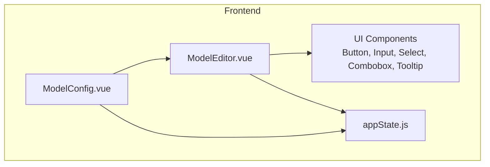
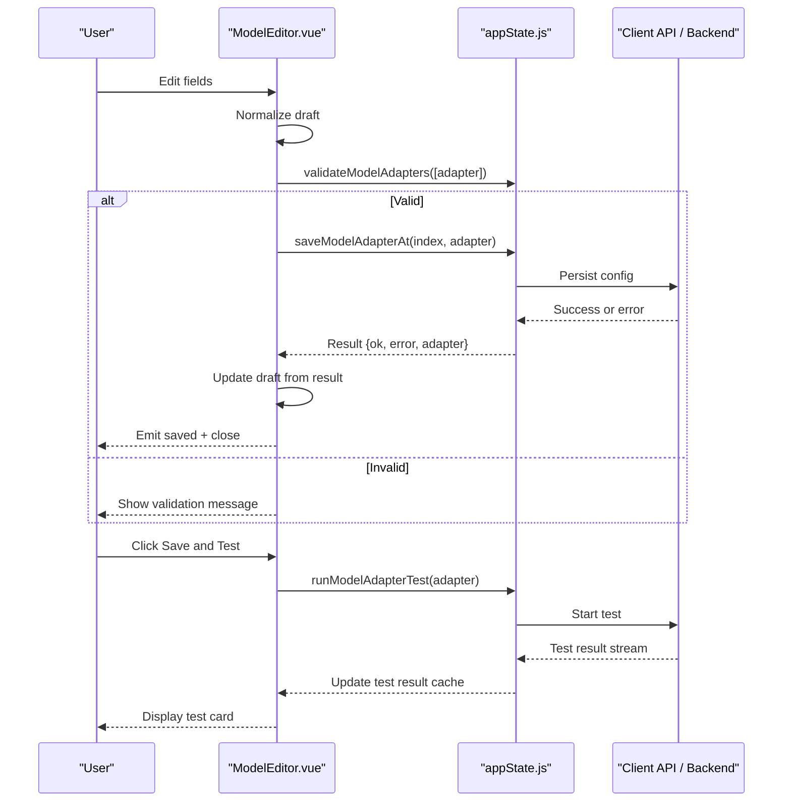
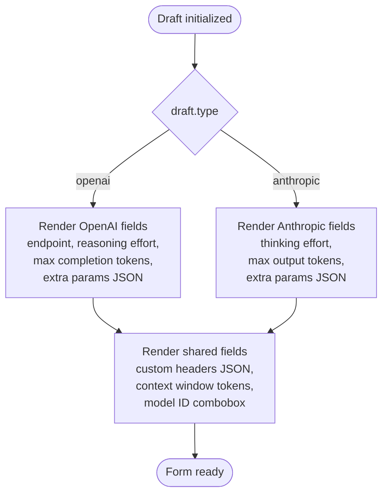
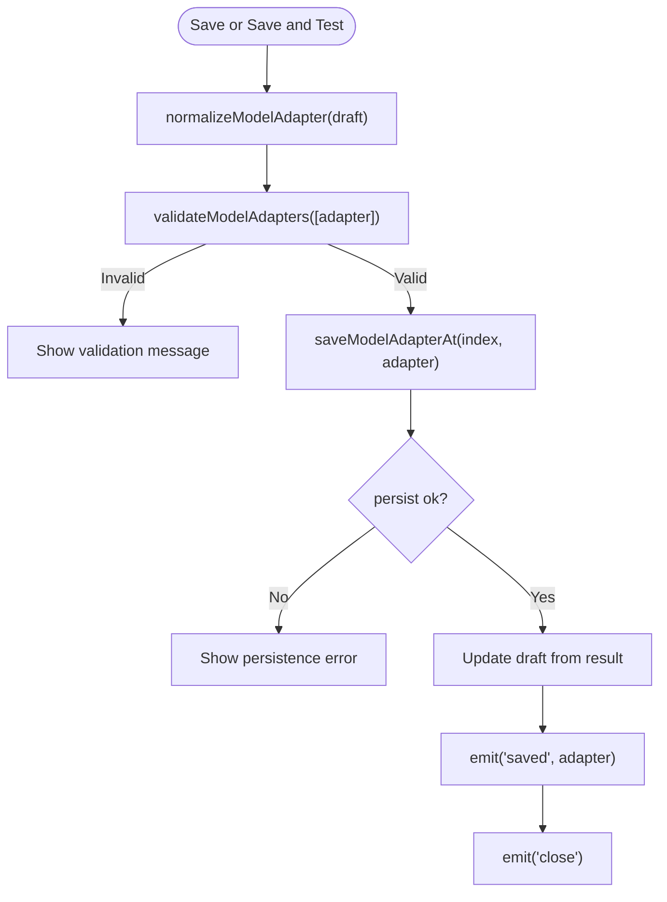
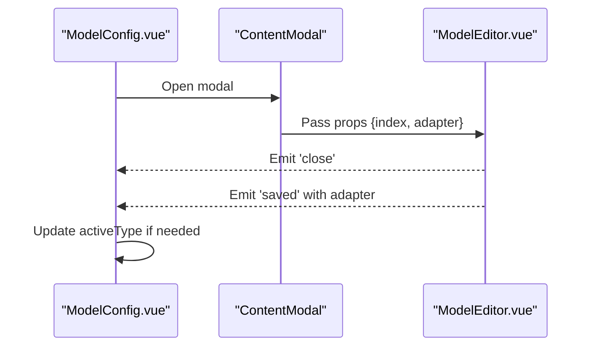
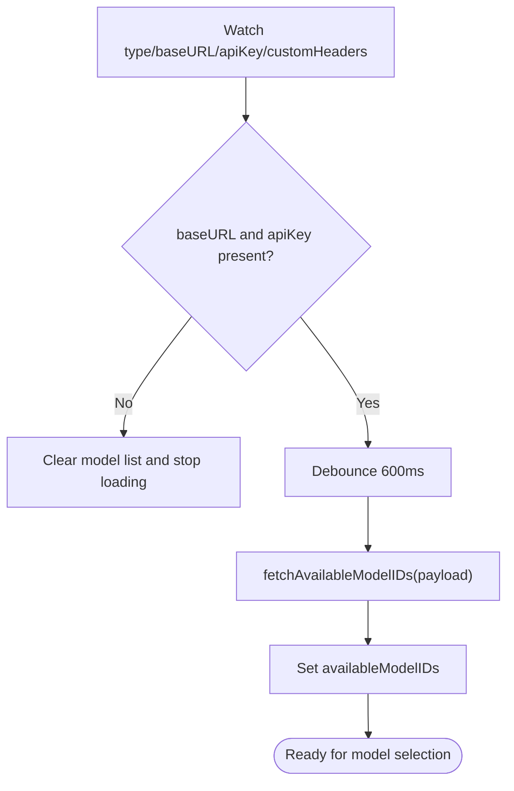
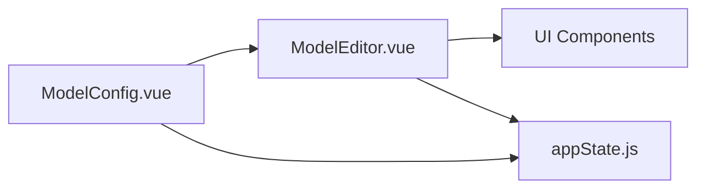

# ModelEditor Component

<cite>
**Referenced Files in This Document**
- [ModelEditor.vue](file://frontend/src/components/ModelEditor.vue)
- [ModelConfig.vue](file://frontend/src/views/ModelConfig.vue)
- [appState.js](file://frontend/src/state/appState.js)
</cite>

## Table of Contents
1. [Introduction](#introduction)
2. [Project Structure](#project-structure)
3. [Core Components](#core-components)
4. [Architecture Overview](#architecture-overview)
5. [Detailed Component Analysis](#detailed-component-analysis)
6. [Dependency Analysis](#dependency-analysis)
7. [Performance Considerations](#performance-considerations)
8. [Troubleshooting Guide](#troubleshooting-guide)
9. [Conclusion](#conclusion)

## Introduction
The ModelEditor component is the primary form for creating and editing model adapter configurations. It supports two provider modes: OpenAI and Anthropic. The component renders provider-specific fields, validates user input, provides real-time feedback through a test card, and integrates with the parent ModelConfig view through props and events. It also coordinates with shared application state to normalize data, validate adapters, persist configuration, fetch available models, and run live tests.

## Project Structure
The ModelEditor lives under the frontend components directory and is used by the ModelConfig view inside a modal. Shared logic such as normalization, validation, persistence, and testing is centralized in the application state module.

**Diagram sources**
- [ModelConfig.vue:6-21](file://frontend/src/views/ModelConfig.vue#L6-L21)
- [ModelEditor.vue:2-29](file://frontend/src/components/ModelEditor.vue#L2-L29)
- [appState.js:1-26](file://frontend/src/state/appState.js#L1-L26)

**Section sources**
- [ModelEditor.vue:1-30](file://frontend/src/components/ModelEditor.vue#L1-L30)
- [ModelConfig.vue:1-22](file://frontend/src/views/ModelConfig.vue#L1-L22)
- [appState.js:1-52](file://frontend/src/state/appState.js#L1-L52)

## Core Components
- ModelEditor: A Vue component that manages a reactive draft of a model adapter configuration, switches between OpenAI and Anthropic providers, renders dynamic fields, performs local validation, persists changes, and triggers live tests.
- ModelConfig: The parent view that opens the editor in a modal, passes adapter data and index, listens for save/close events, and manages list-level operations like batch testing and sorting.
- appState: Centralized state and utilities for normalizing adapter objects, validating adapters, saving adapters, fetching model lists, running tests, and managing test result caching.

Key responsibilities:
- Form state management and provider switching.
- Real-time model list fetching with debouncing.
- Provider-specific field rendering and defaults.
- Validation against backend-compatible rules.
- Submission workflow with error handling and event emission.
- Test execution and result display.

**Section sources**
- [ModelEditor.vue:60-78](file://frontend/src/components/ModelEditor.vue#L60-L78)
- [ModelConfig.vue:125-148](file://frontend/src/views/ModelConfig.vue#L125-L148)
- [appState.js:252-396](file://frontend/src/state/appState.js#L252-L396)

## Architecture Overview
The ModelEditor operates as a controlled form bound to a normalized draft object. When the provider type changes, it updates default values and clears cached model lists. Saving triggers normalization and validation before calling the persistence layer. Testing uses the same normalized adapter to compute a request hash, start a test, and update the test result cache.

**Diagram sources**
- [ModelEditor.vue:252-327](file://frontend/src/components/ModelEditor.vue#L252-L327)
- [appState.js:424-493](file://frontend/src/state/appState.js#L424-L493)
- [appState.js:1093-1113](file://frontend/src/state/appState.js#L1093-L1113)
- [appState.js:1172-1199](file://frontend/src/state/appState.js#L1172-L1199)

## Detailed Component Analysis

### Form Structure and Provider-Specific Fields
The form includes common fields and provider-specific sections:
- Common fields:
  - Base URL (API root address).
  - API Key (password input with visibility toggle).
  - Display Name.
  - Model ID (combobox with optional server-fetched list).
  - Context Window Tokens (numeric input with presets and formatting).
  - Tooltip Data (notes).
- OpenAI-specific fields:
  - Reasoning Effort (select with “not set” and supported levels).
  - Max Completion Tokens (optional positive integer).
  - Endpoint (responses, chat completions, or custom path).
  - Extra Parameters JSON (toggleable, validated when enabled).
- Anthropic-specific fields:
  - Max Output Tokens (optional positive integer).
  - Thinking Effort (select with supported levels; default applied).
  - Extra Parameters JSON (toggleable, validated when enabled).
- Shared advanced options:
  - Custom Headers JSON (toggleable, validated when enabled).

Provider switching behavior:
- Switching to OpenAI sets default endpoint to responses if not already set.
- Switching to Anthropic ensures thinking effort has a default value.
- Changing provider resets model list and selected model ID.

Real-time feedback:
- Model list loading indicator and disabled state while fetching.
- Token inputs accept numeric values and human-friendly units (K/M), parsed into integers.
- Preset buttons for context window tokens provide quick selection.
- Field tooltips explain each field’s purpose and constraints.

Validation rules enforced by the shared validator:
- Required fields: base URL, API key, display name, model ID, tooltip data.
- Type must be openai or anthropic.
- Positive integer checks for context window tokens, max completion tokens, anthropic max tokens, and thinking budget tokens.
- Supported reasoning effort values for OpenAI.
- Supported anthropic thinking effort values.
- OpenAI endpoint must be one of the supported values or a valid custom path.
- JSON blocks must be valid objects; custom headers require string values.
- Duplicate adapter identity detection based on URL, model ID, API key, display name, and endpoint.

**Section sources**
- [ModelEditor.vue:32-58](file://frontend/src/components/ModelEditor.vue#L32-L58)
- [ModelEditor.vue:80-145](file://frontend/src/components/ModelEditor.vue#L80-L145)
- [ModelEditor.vue:196-211](file://frontend/src/components/ModelEditor.vue#L196-L211)
- [ModelEditor.vue:536-671](file://frontend/src/components/ModelEditor.vue#L536-L671)
- [appState.js:424-493](file://frontend/src/state/appState.js#L424-L493)

### Dual-Mode Operation and Dynamic Rendering
The component maintains a draft object with a type field. Based on this type, it conditionally renders:
- OpenAI section with endpoint selector and extra parameters JSON.
- Anthropic section with thinking effort and extra parameters JSON.
- Shared custom headers JSON section always available.

Default initialization:
- If no type is provided, defaults to OpenAI.
- Default endpoint for OpenAI is responses.
- Default thinking effort for Anthropic is applied via helper.

Dynamic field rendering flow:

**Diagram sources**
- [ModelEditor.vue:68-72](file://frontend/src/components/ModelEditor.vue#L68-L72)
- [ModelEditor.vue:295-306](file://frontend/src/components/ModelEditor.vue#L295-L306)
- [ModelEditor.vue:536-671](file://frontend/src/components/ModelEditor.vue#L536-L671)

**Section sources**
- [ModelEditor.vue:68-72](file://frontend/src/components/ModelEditor.vue#L68-L72)
- [ModelEditor.vue:295-306](file://frontend/src/components/ModelEditor.vue#L295-L306)
- [ModelEditor.vue:536-671](file://frontend/src/components/ModelEditor.vue#L536-L671)

### Form Submission Workflow and Data Transformation
Submission steps:
1. Normalize the draft adapter using the shared normalizer.
2. Validate the single adapter against all rules.
3. If invalid, show a user-facing message and abort.
4. Call persistence function to save at the current index.
5. On success, update the local draft with persisted data and emit saved event.
6. Close the editor after successful save.

Data transformation:
- Normalization maps various legacy field names to canonical fields and enforces types.
- Persistence returns either the updated adapter or the normalized version.
- The component synchronizes its reactive draft with the persisted adapter to keep UI consistent.

Error handling:
- Validation errors are surfaced immediately via the message utility.
- Persistence errors are displayed to the user.
- Test failures are captured locally and shown in the test card without interrupting the user flow.

**Diagram sources**
- [ModelEditor.vue:252-289](file://frontend/src/components/ModelEditor.vue#L252-L289)
- [appState.js:334-396](file://frontend/src/state/appState.js#L334-L396)
- [appState.js:1172-1199](file://frontend/src/state/appState.js#L1172-L1199)

**Section sources**
- [ModelEditor.vue:252-289](file://frontend/src/components/ModelEditor.vue#L252-L289)
- [appState.js:334-396](file://frontend/src/state/appState.js#L334-L396)
- [appState.js:1172-1199](file://frontend/src/state/appState.js#L1172-L1199)

### Integration with Parent ModelConfig View
Parent-child communication:
- Props:
  - index: Indicates whether editing an existing adapter or creating a new one.
  - adapter: The initial adapter object passed from the parent.
- Events:
  - close: Closes the modal.
  - saved: Notifies the parent that a save occurred; the parent can adjust filter tabs accordingly.

Parent responsibilities:
- Opens the editor with a fresh empty adapter or the selected adapter.
- Manages modal lifecycle and disables actions during saving/testing.
- Handles saved event to switch active filter tab to the saved adapter’s type.

**Diagram sources**
- [ModelConfig.vue:125-148](file://frontend/src/views/ModelConfig.vue#L125-L148)
- [ModelConfig.vue:497-511](file://frontend/src/views/ModelConfig.vue#L497-L511)
- [ModelEditor.vue:65-66](file://frontend/src/components/ModelEditor.vue#L65-L66)

**Section sources**
- [ModelConfig.vue:125-148](file://frontend/src/views/ModelConfig.vue#L125-L148)
- [ModelConfig.vue:497-511](file://frontend/src/views/ModelConfig.vue#L497-L511)
- [ModelEditor.vue:65-66](file://frontend/src/components/ModelEditor.vue#L65-L66)

### Real-Time Feedback and Model List Fetching
Model list fetching:
- Debounced watcher triggers refresh when baseURL, apiKey, type, or custom headers change.
- Loading state prevents redundant requests and shows spinner in the combobox.
- Available models populate the model ID dropdown; users can also manually enter a model ID.

Test integration:
- The test card displays status, metrics, and summary text.
- Local failure messages override remote results when present.
- Stale test results are detected by comparing request hashes.

**Diagram sources**
- [ModelEditor.vue:374-391](file://frontend/src/components/ModelEditor.vue#L374-L391)
- [ModelEditor.vue:213-250](file://frontend/src/components/ModelEditor.vue#L213-L250)
- [appState.js:1201-1206](file://frontend/src/state/appState.js#L1201-L1206)

**Section sources**
- [ModelEditor.vue:374-391](file://frontend/src/components/ModelEditor.vue#L374-L391)
- [ModelEditor.vue:213-250](file://frontend/src/components/ModelEditor.vue#L213-L250)
- [appState.js:1201-1206](file://frontend/src/state/appState.js#L1201-L1206)

### Error Handling Strategies
- Validation errors: Immediate user-facing messages for missing required fields, invalid types, unsupported values, malformed JSON, and duplicate adapters.
- Persistence errors: Displayed via message utility; do not crash the UI.
- Test errors: Captured and shown in the test card; local failure takes precedence when present.
- Cancelation handling: Batch testing recognizes cancelation errors and continues gracefully.

Common validation error messages:
- Type only supports OpenAI or Anthropic.
- Base URL cannot be empty.
- API Key cannot be empty.
- Display Name cannot be empty.
- Model ID cannot be empty.
- Context Window must be a positive integer.
- Reasoning Effort only supports specific values.
- Max Output Tokens must be a positive integer.
- Anthropic Thinking Effort only supports specific values.
- OpenAI Endpoint only supports predefined endpoints or a valid custom path.
- Extra Parameters JSON must be a valid object.
- Custom Headers JSON must be a valid object with string values.
- Tooltip Data cannot be empty.
- Duplicate channel detected; check URL, model ID, API key, display name, and endpoint combination.

**Section sources**
- [appState.js:424-493](file://frontend/src/state/appState.js#L424-L493)
- [ModelEditor.vue:252-289](file://frontend/src/components/ModelEditor.vue#L252-L289)
- [ModelEditor.vue:308-327](file://frontend/src/components/ModelEditor.vue#L308-L327)

### Examples of Common Configuration Patterns
- OpenAI Responses endpoint:
  - Type: OpenAI
  - Endpoint: responses
  - Optional: Reasoning effort, Max completion tokens, Extra parameters JSON
- OpenAI Chat Completions endpoint:
  - Type: OpenAI
  - Endpoint: chat completions
  - Optional: Reasoning effort, Max completion tokens, Extra parameters JSON
- Anthropic Adaptive Thinking:
  - Type: Anthropic
  - Thinking effort: low/medium/high/xhigh/max
  - Optional: Max output tokens, Extra parameters JSON
- Custom Headers:
  - Enable custom headers JSON with string-only key-value pairs.
- Context Window Presets:
  - Use preset buttons for 200K, 356K, 500K, 800K, 1M or enter custom token count.

These patterns are reflected in the form fields and validation rules.

**Section sources**
- [ModelEditor.vue:37-58](file://frontend/src/components/ModelEditor.vue#L37-L58)
- [ModelEditor.vue:112-145](file://frontend/src/components/ModelEditor.vue#L112-L145)
- [ModelEditor.vue:536-671](file://frontend/src/components/ModelEditor.vue#L536-L671)
- [appState.js:424-493](file://frontend/src/state/appState.js#L424-L493)

## Dependency Analysis
The ModelEditor depends on:
- UI primitives for inputs, selects, comboboxes, tooltips, and buttons.
- Application state for normalization, validation, persistence, model list fetching, and testing.
- Parent view for modal lifecycle and event coordination.

**Diagram sources**
- [ModelEditor.vue:2-29](file://frontend/src/components/ModelEditor.vue#L2-L29)
- [ModelConfig.vue:6-21](file://frontend/src/views/ModelConfig.vue#L6-L21)
- [appState.js:1-26](file://frontend/src/state/appState.js#L1-L26)

**Section sources**
- [ModelEditor.vue:2-29](file://frontend/src/components/ModelEditor.vue#L2-L29)
- [ModelConfig.vue:6-21](file://frontend/src/views/ModelConfig.vue#L6-L21)
- [appState.js:1-26](file://frontend/src/state/appState.js#L1-L26)

## Performance Considerations
- Debounced model list fetching reduces unnecessary network calls while typing.
- Request sequence counters prevent stale responses from overwriting newer results.
- Test result caching avoids repeated computations for identical adapter configurations.
- Reactive computed properties minimize re-renders by deriving values efficiently.
- Avoid heavy parsing in watchers; token parsing is optimized for simple numeric and K/M formats.

[No sources needed since this section provides general guidance]

## Troubleshooting Guide
Common issues and resolutions:
- Validation fails due to missing required fields: Ensure base URL, API Key, Display Name, Model ID, and Tooltip Data are filled.
- JSON blocks are invalid: Verify Extra Parameters JSON and Custom Headers JSON are valid objects; ensure header values are strings.
- Duplicate adapter detected: Change URL, model ID, API Key, Display Name, or endpoint to make the adapter unique.
- Model list not updating: Confirm baseURL and apiKey are non-empty; wait for debounce; check network connectivity.
- Test fails: Review error summary in the test card; verify credentials and endpoint correctness; consider enabling extra parameters or custom headers if required by your service.

**Section sources**
- [appState.js:424-493](file://frontend/src/state/appState.js#L424-L493)
- [ModelEditor.vue:308-327](file://frontend/src/components/ModelEditor.vue#L308-L327)

## Conclusion
The ModelEditor component provides a robust, provider-aware form for configuring model adapters. It combines dynamic field rendering, comprehensive validation, real-time feedback, and seamless integration with the parent view and shared state. By following the documented workflows and validation rules, users can reliably create and edit OpenAI and Anthropic configurations, test them interactively, and maintain consistent state across the application.

[No sources needed since this section summarizes without analyzing specific files]