# UI State Management Patterns

<cite>
**Referenced Files in This Document**
- [appState.js](file://frontend/src/state/appState.js)
- [useMessage.js](file://frontend/src/composables/useMessage.js)
- [useConfigTransfer.js](file://frontend/src/composables/useConfigTransfer.js)
- [ModelAdapterModal.vue](file://frontend/src/components/ModelAdapterModal.vue)
- [ModelEditor.vue](file://frontend/src/components/ModelEditor.vue)
- [ModelAdapterTestCard.vue](file://frontend/src/components/ModelAdapterTestCard.vue)
- [Home.vue](file://frontend/src/views/Home.vue)
- [ModelConfig.vue](file://frontend/src/views/ModelConfig.vue)
- [clientApi.js](file://frontend/src/services/clientApi.js)
</cite>

## Table of Contents
1. [Introduction](#introduction)
2. [Project Structure](#project-structure)
3. [Core Components](#core-components)
4. [Architecture Overview](#architecture-overview)
5. [Detailed Component Analysis](#detailed-component-analysis)
6. [Dependency Analysis](#dependency-analysis)
7. [Performance Considerations](#performance-considerations)
8. [Troubleshooting Guide](#troubleshooting-guide)
9. [Conclusion](#conclusion)

## Introduction
This document explains the state management architecture used by the model management UI workflow. The frontend uses a centralized `appState` reactive store to manage model adapters, test results, service state, application configuration, and update progress. User notifications are provided through a composable message system, while import/export functionality is encapsulated in a dedicated composable. Reactive data binding, computed views, event-driven updates from the native backend, optimistic UI updates, loading states, and error handling form the core patterns across components such as Home, ModelConfig, ModelEditor, and ModelAdapterModal.

## Project Structure
The relevant frontend code is organized into:
- Centralized state and domain logic under `src/state`.
- Reusable composables for cross-cutting concerns like messages and configuration transfer under `src/composables`.
- View-level pages under `src/views`.
- Presentational and interactive components under `src/components`.
- A thin API layer that calls native services under `src/services`.

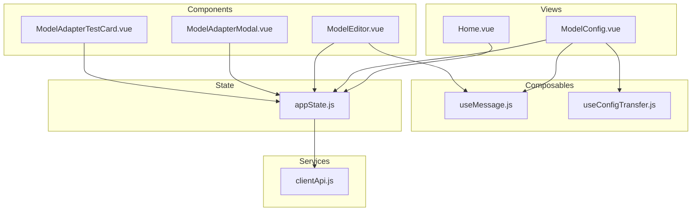

**Diagram sources**
- [Home.vue:1-193](file://frontend/src/views/Home.vue#L1-L193)
- [ModelConfig.vue:1-514](file://frontend/src/views/ModelConfig.vue#L1-L514)
- [ModelEditor.vue:1-699](file://frontend/src/components/ModelEditor.vue#L1-L699)
- [ModelAdapterModal.vue:1-400](file://frontend/src/components/ModelAdapterModal.vue#L1-L400)
- [ModelAdapterTestCard.vue:1-150](file://frontend/src/components/ModelAdapterTestCard.vue#L1-L150)
- [useMessage.js:1-90](file://frontend/src/composables/useMessage.js#L1-L90)
- [useConfigTransfer.js:1-93](file://frontend/src/composables/useConfigTransfer.js#L1-L93)
- [appState.js:1-1454](file://frontend/src/state/appState.js#L1-L1454)
- [clientApi.js:1-180](file://frontend/src/services/clientApi.js#L1-L180)

**Section sources**
- [Home.vue:1-193](file://frontend/src/views/Home.vue#L1-L193)
- [ModelConfig.vue:1-514](file://frontend/src/views/ModelConfig.vue#L1-L514)
- [appState.js:1-1454](file://frontend/src/state/appState.js#L1-L1454)
- [clientApi.js:1-180](file://frontend/src/services/clientApi.js#L1-L180)

## Core Components
- Centralized app state: `appState` holds model adapters, test results, service status, proxy settings, home metrics, and update state. It also exposes normalized helpers, validation, persistence, and event handlers.
- Message composable: `useMessage` provides a global notification API with minimum visibility time, auto-dismiss timers, and Vue provide/inject integration.
- Configuration transfer composable: `useConfigTransfer` orchestrates export/import flows, file dialogs, confirmation modals, busy state, and error reporting.
- Views and components: `Home.vue` manages service lifecycle and metrics; `ModelConfig.vue` manages adapter CRUD, ordering, batch testing, and import/export; `ModelEditor.vue` and `ModelAdapterModal.vue` handle editor UX and validation; `ModelAdapterTestCard.vue` renders test result states.

Key responsibilities:
- Normalization and validation of model adapters.
- Reactive persistence via local storage and native config APIs.
- Event-driven synchronization of service state, user config changes, and test results.
- Computed views for filtered adapter lists and UI labels.
- Optimistic UI updates with rollback on failure.

**Section sources**
- [appState.js:28-52](file://frontend/src/state/appState.js#L28-L52)
- [appState.js:252-493](file://frontend/src/state/appState.js#L252-L493)
- [appState.js:820-900](file://frontend/src/state/appState.js#L820-L900)
- [appState.js:972-1057](file://frontend/src/state/appState.js#L972-L1057)
- [appState.js:1059-1113](file://frontend/src/state/appState.js#L1059-L1113)
- [appState.js:1166-1261](file://frontend/src/state/appState.js#L1166-L1261)
- [appState.js:1318-1454](file://frontend/src/state/appState.js#L1318-L1454)
- [useMessage.js:1-90](file://frontend/src/composables/useMessage.js#L1-L90)
- [useConfigTransfer.js:1-93](file://frontend/src/composables/useConfigTransfer.js#L1-L93)
- [Home.vue:1-193](file://frontend/src/views/Home.vue#L1-L193)
- [ModelConfig.vue:1-514](file://frontend/src/views/ModelConfig.vue#L1-L514)
- [ModelEditor.vue:1-699](file://frontend/src/components/ModelEditor.vue#L1-L699)
- [ModelAdapterModal.vue:1-400](file://frontend/src/components/ModelAdapterModal.vue#L1-L400)
- [ModelAdapterTestCard.vue:1-150](file://frontend/src/components/ModelAdapterTestCard.vue#L1-L150)

## Architecture Overview
The UI follows a unidirectional data flow centered around `appState`:
- Components read from `appState` and call exported functions to mutate it.
- Mutations go through normalization, validation, and persistence layers.
- Native events update `appState` reactively, keeping the UI consistent.
- Composables encapsulate cross-cutting behaviors (notifications, file I/O).
- The API layer abstracts native bindings and logging.

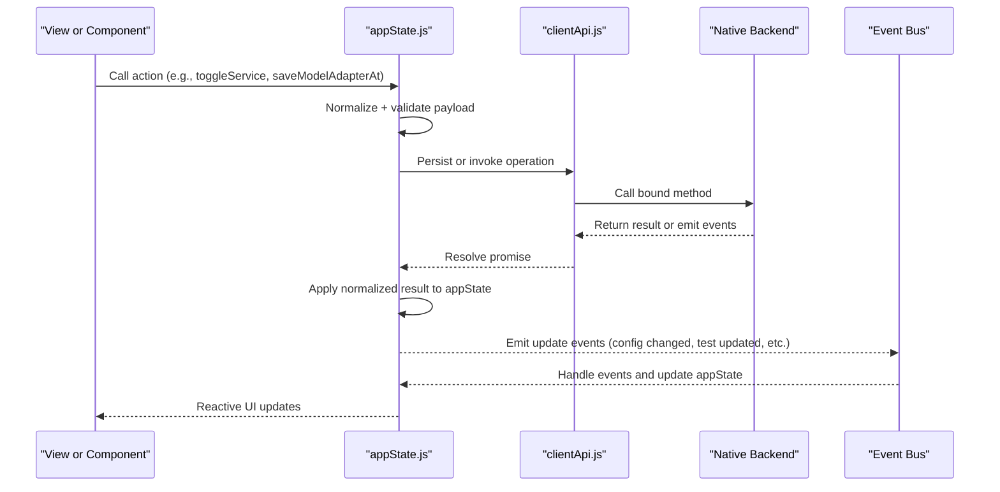

**Diagram sources**
- [appState.js:594-641](file://frontend/src/state/appState.js#L594-L641)
- [appState.js:663-694](file://frontend/src/state/appState.js#L663-L694)
- [appState.js:1318-1392](file://frontend/src/state/appState.js#L1318-L1392)
- [clientApi.js:58-86](file://frontend/src/services/clientApi.js#L58-L86)
- [clientApi.js:100-180](file://frontend/src/services/clientApi.js#L100-L180)

## Detailed Component Analysis

### Centralized App State Pattern
`appState` is a single reactive object that owns:
- Model adapters list and their normalized structure.
- Test results keyed by adapter ID and request hash.
- Service lifecycle flags and last errors.
- Proxy and backend listen addresses.
- Home metrics and loading/error states.
- Update state, prompts, and progress.

It also provides:
- Normalizers for adapters, test results, and config payloads.
- Validators for required fields, JSON structures, and endpoint options.
- Persistence helpers that serialize to local storage and persist to native config.
- Event subscriptions for proxy state, user config changes, test updates, and update progress.
- Actions for starting/stopping services, saving adapters, duplicating/deleting adapters, ordering adapters, refreshing metrics, and managing updates.

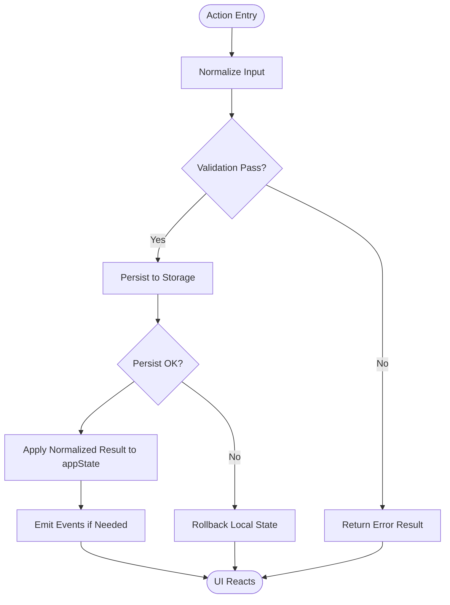

**Diagram sources**
- [appState.js:594-641](file://frontend/src/state/appState.js#L594-L641)
- [appState.js:1172-1261](file://frontend/src/state/appState.js#L1172-L1261)
- [appState.js:1318-1392](file://frontend/src/state/appState.js#L1318-L1392)

**Section sources**
- [appState.js:28-52](file://frontend/src/state/appState.js#L28-L52)
- [appState.js:252-493](file://frontend/src/state/appState.js#L252-L493)
- [appState.js:820-900](file://frontend/src/state/appState.js#L820-L900)
- [appState.js:972-1057](file://frontend/src/state/appState.js#L972-L1057)
- [appState.js:1059-1113](file://frontend/src/state/appState.js#L1059-L1113)
- [appState.js:1166-1261](file://frontend/src/state/appState.js#L1166-L1261)
- [appState.js:1318-1454](file://frontend/src/state/appState.js#L1318-L1454)

### useMessage: User Notifications
`useMessage` provides:
- A global message API exposed via Vue’s provide/inject.
- Minimum visible duration to avoid flicker.
- Auto-dismiss timers with safe cleanup.
- Clear/remove operations for programmatic control.

Components inject the message API and show success or error notifications after async operations.

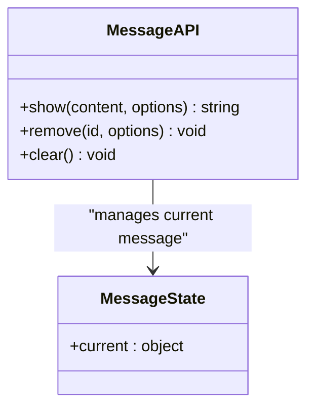

**Diagram sources**
- [useMessage.js:1-90](file://frontend/src/composables/useMessage.js#L1-L90)

**Section sources**
- [useMessage.js:1-90](file://frontend/src/composables/useMessage.js#L1-L90)
- [Home.vue:6-23](file://frontend/src/views/Home.vue#L6-L23)
- [ModelConfig.vue:7-25](file://frontend/src/views/ModelConfig.vue#L7-L25)
- [ModelEditor.vue:8-30](file://frontend/src/components/ModelEditor.vue#L8-L30)

### useConfigTransfer: Import/Export Flow
`useConfigTransfer` wraps:
- Confirmation dialogs before destructive actions.
- File dialog interactions for YAML files.
- Busy state during long-running operations.
- Error handling using shared error formatting.
- Integration with `appState` to prevent import while services are running.

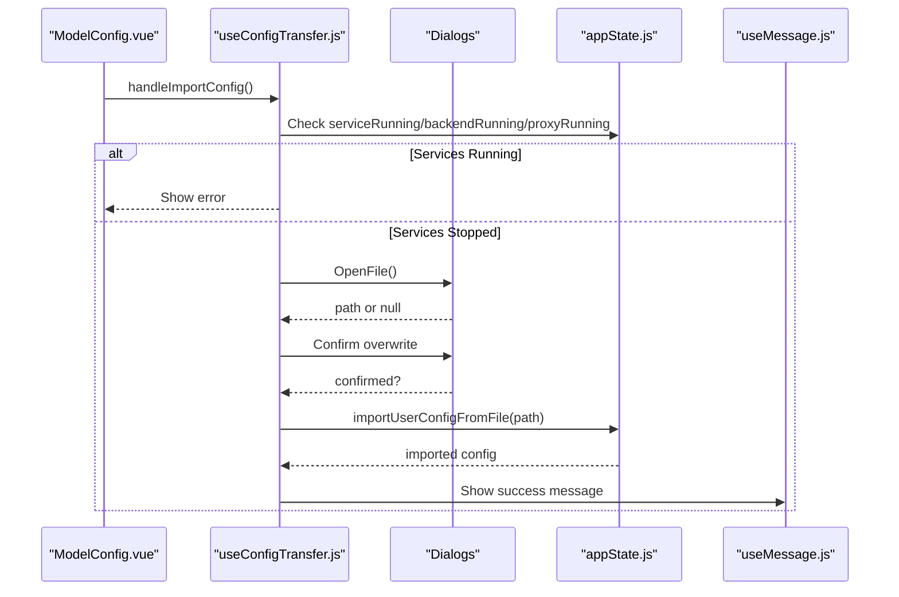

**Diagram sources**
- [useConfigTransfer.js:13-91](file://frontend/src/composables/useConfigTransfer.js#L13-L91)
- [appState.js:1131-1146](file://frontend/src/state/appState.js#L1131-L1146)

**Section sources**
- [useConfigTransfer.js:1-93](file://frontend/src/composables/useConfigTransfer.js#L1-L93)
- [ModelConfig.vue:91-95](file://frontend/src/views/ModelConfig.vue#L91-L95)

### Reactive Data Binding and Computed Views
- `ModelEditor.vue` and `ModelAdapterModal.vue` bind form inputs directly to a reactive draft object.
- Computed properties normalize optional positive integers, token presets, and default values for provider-specific fields.
- `ModelConfig.vue` computes filtered adapter lists based on active type tabs and derives UI text for buttons and empty states.
- `appViewState` computes service status text, classes, and button labels based on `appState.serviceRunning`, `serviceBusy`, and related flags.

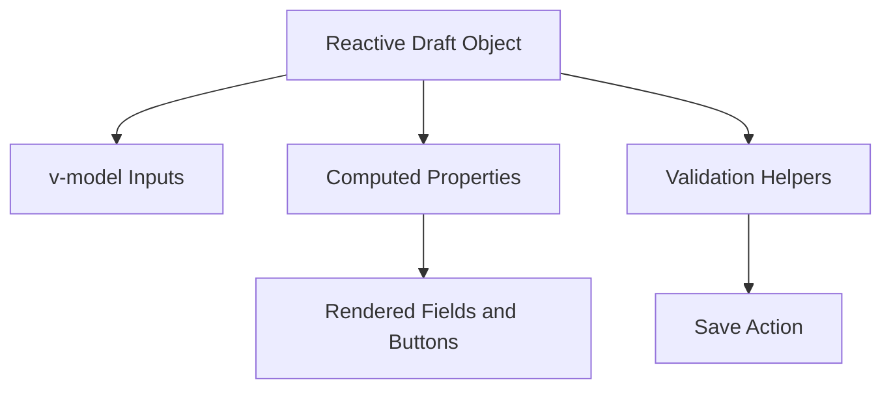

**Diagram sources**
- [ModelEditor.vue:68-170](file://frontend/src/components/ModelEditor.vue#L68-L170)
- [ModelAdapterModal.vue:59-176](file://frontend/src/components/ModelAdapterModal.vue#L59-L176)
- [ModelConfig.vue:48-70](file://frontend/src/views/ModelConfig.vue#L48-L70)
- [appState.js:972-991](file://frontend/src/state/appState.js#L972-L991)

**Section sources**
- [ModelEditor.vue:68-170](file://frontend/src/components/ModelEditor.vue#L68-L170)
- [ModelAdapterModal.vue:59-176](file://frontend/src/components/ModelAdapterModal.vue#L59-L176)
- [ModelConfig.vue:48-70](file://frontend/src/views/ModelConfig.vue#L48-L70)
- [appState.js:972-991](file://frontend/src/state/appState.js#L972-L991)

### Event-Driven Communication Between Components
The backend emits events that update `appState`:
- Proxy state changes update service flags and listen addresses.
- User config changes apply normalized config to the store.
- Model adapter test updates replace the test results map.
- Update state, progress, ready, and error events drive the update prompt and footer progress.

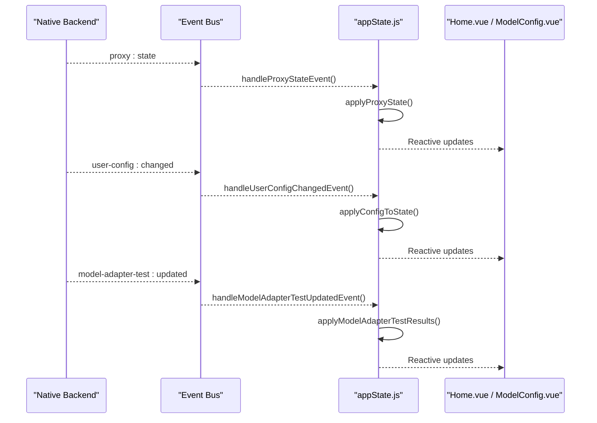

**Diagram sources**
- [appState.js:663-694](file://frontend/src/state/appState.js#L663-L694)
- [appState.js:902-970](file://frontend/src/state/appState.js#L902-L970)

**Section sources**
- [appState.js:663-694](file://frontend/src/state/appState.js#L663-L694)
- [appState.js:902-970](file://frontend/src/state/appState.js#L902-L970)
- [Home.vue:130-139](file://frontend/src/views/Home.vue#L130-L139)

### Error Handling Strategies
- Errors are normalized via `toUserError`, which extracts messages from strings or objects and falls back to a generic service error.
- Async operations return structured results (`{ ok, error }`) where appropriate, allowing callers to display user-friendly messages.
- Loading and busy flags guard against concurrent operations (e.g., service busy, config saving).
- Metrics loading enforces a minimum visible duration to avoid UI flicker.

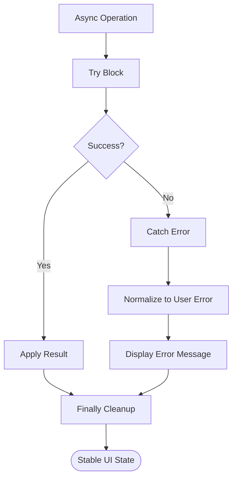

**Diagram sources**
- [appState.js:810-818](file://frontend/src/state/appState.js#L810-L818)
- [appState.js:1324-1347](file://frontend/src/state/appState.js#L1324-L1347)
- [appState.js:1349-1392](file://frontend/src/state/appState.js#L1349-L1392)

**Section sources**
- [appState.js:810-818](file://frontend/src/state/appState.js#L810-L818)
- [appState.js:1324-1347](file://frontend/src/state/appState.js#L1324-L1347)
- [appState.js:1349-1392](file://frontend/src/state/appState.js#L1349-L1392)
- [Home.vue:83-112](file://frontend/src/views/Home.vue#L83-L112)
- [ModelConfig.vue:86-89](file://frontend/src/views/ModelConfig.vue#L86-L89)
- [ModelEditor.vue:252-289](file://frontend/src/components/ModelEditor.vue#L252-L289)

### Loading State Management
- `homeMetricsLoading` indicates metrics fetch status.
- `serviceBusy` prevents overlapping start/stop operations.
- `configSaving` disables editor close and other mutating actions during persistence.
- Batch testing uses `batchTesting`, `batchStopping`, `batchTotal`, and `batchCompleted` to reflect ongoing work.

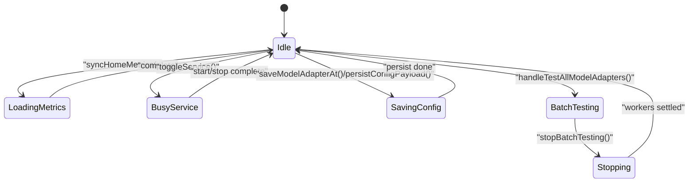

**Diagram sources**
- [appState.js:849-866](file://frontend/src/state/appState.js#L849-L866)
- [appState.js:1324-1392](file://frontend/src/state/appState.js#L1324-L1392)
- [ModelConfig.vue:321-366](file://frontend/src/views/ModelConfig.vue#L321-L366)

**Section sources**
- [appState.js:849-866](file://frontend/src/state/appState.js#L849-L866)
- [appState.js:1324-1392](file://frontend/src/state/appState.js#L1324-L1392)
- [ModelConfig.vue:321-366](file://frontend/src/views/ModelConfig.vue#L321-L366)

### Optimistic UI Updates
- Adapter ordering is applied locally before saving; on failure, the previous order is restored.
- Toggle cache write inclusion updates the flag immediately and rolls back on persistence failure.
- Batch testing updates completion counters per worker settlement, even when individual tests fail.

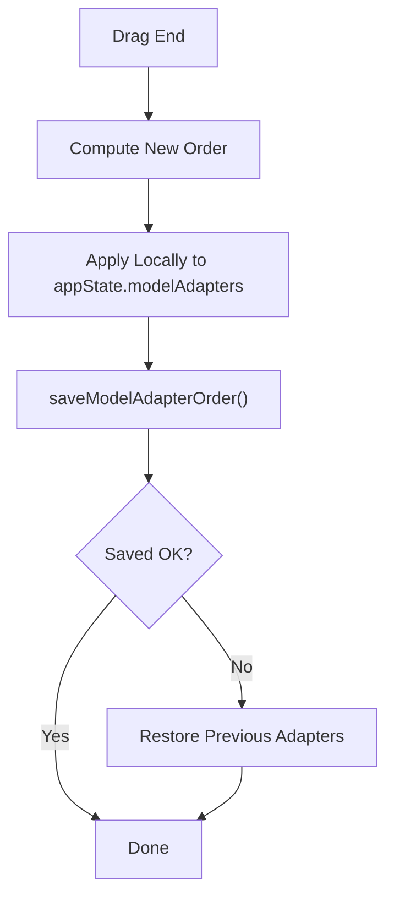

**Diagram sources**
- [ModelConfig.vue:194-249](file://frontend/src/views/ModelConfig.vue#L194-L249)
- [appState.js:1230-1261](file://frontend/src/state/appState.js#L1230-L1261)
- [appState.js:1148-1164](file://frontend/src/state/appState.js#L1148-L1164)

**Section sources**
- [ModelConfig.vue:194-249](file://frontend/src/views/ModelConfig.vue#L194-L249)
- [appState.js:1230-1261](file://frontend/src/state/appState.js#L1230-L1261)
- [appState.js:1148-1164](file://frontend/src/state/appState.js#L1148-L1164)

### State Transitions and Async Operation Handling
- Service lifecycle transitions are guarded by `serviceBusy` and synchronized with backend state events.
- Model adapter tests transition through idle, running, success, and error states, with summaries formatted for user readability.
- Update state transitions include checking, downloading, ready, installing, and error, with progress percentage clamped between 0 and 100.

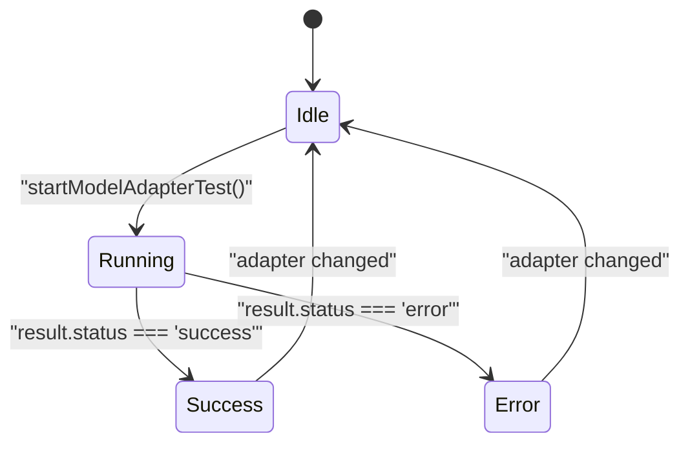

**Diagram sources**
- [appState.js:196-241](file://frontend/src/state/appState.js#L196-L241)
- [appState.js:1093-1113](file://frontend/src/state/appState.js#L1093-L1113)
- [ModelAdapterTestCard.vue:33-80](file://frontend/src/components/ModelAdapterTestCard.vue#L33-L80)

**Section sources**
- [appState.js:196-241](file://frontend/src/state/appState.js#L196-L241)
- [appState.js:1093-1113](file://frontend/src/state/appState.js#L1093-L1113)
- [ModelAdapterTestCard.vue:33-80](file://frontend/src/components/ModelAdapterTestCard.vue#L33-L80)

### Component Lifecycle Management
- `Home.vue` subscribes to AD runtime events on mount and unsubscribes on beforeUnmount.
- `ModelConfig.vue` initializes sortable instance on mount and destroys it on beforeUnmount; it also stops batch testing on teardown.
- `ModelEditor.vue` debounces model list fetching and clears timers on unmount.

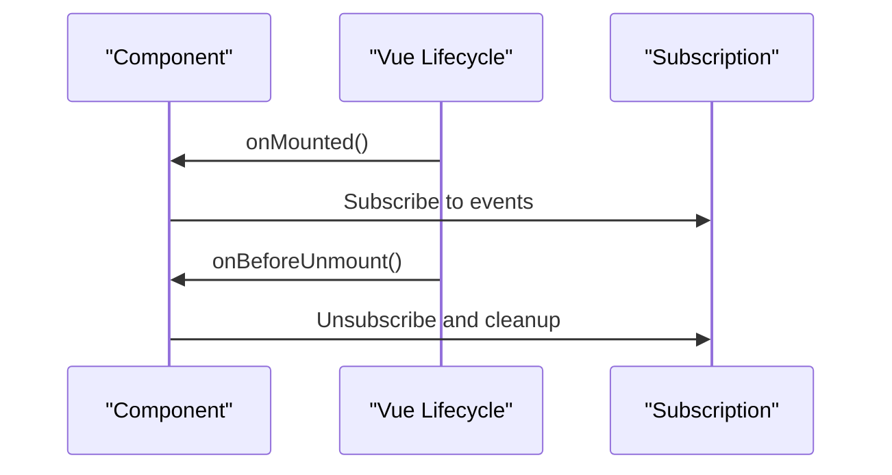

**Diagram sources**
- [Home.vue:130-139](file://frontend/src/views/Home.vue#L130-L139)
- [ModelConfig.vue:368-377](file://frontend/src/views/ModelConfig.vue#L368-L377)
- [ModelEditor.vue:393-395](file://frontend/src/components/ModelEditor.vue#L393-L395)

**Section sources**
- [Home.vue:130-139](file://frontend/src/views/Home.vue#L130-L139)
- [ModelConfig.vue:368-377](file://frontend/src/views/ModelConfig.vue#L368-L377)
- [ModelEditor.vue:393-395](file://frontend/src/components/ModelEditor.vue#L393-L395)

## Dependency Analysis
The following diagram shows how views and components depend on the central state and composables, and how the state depends on the API layer.

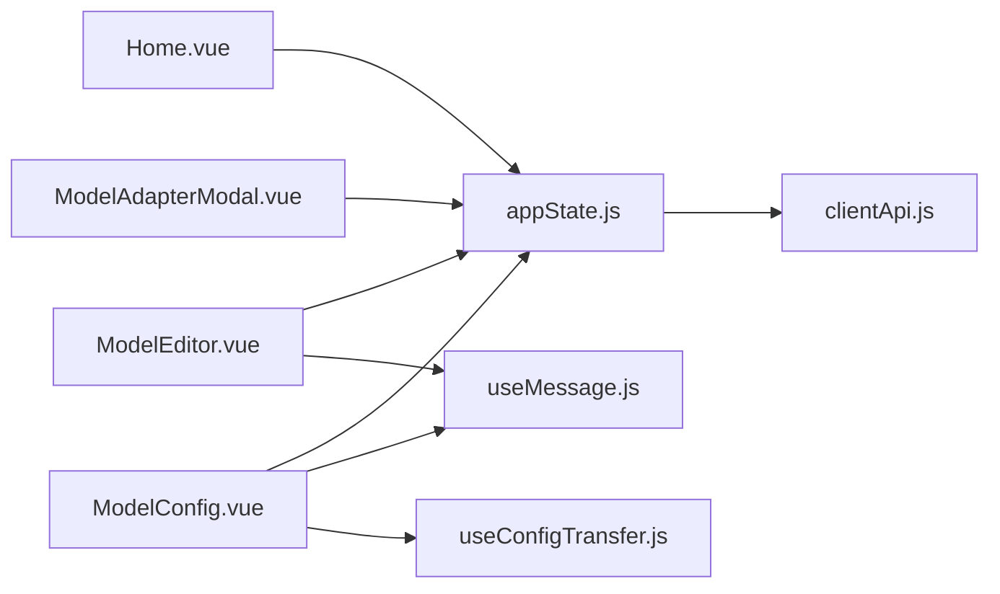

**Diagram sources**
- [Home.vue:1-193](file://frontend/src/views/Home.vue#L1-L193)
- [ModelConfig.vue:1-514](file://frontend/src/views/ModelConfig.vue#L1-L514)
- [ModelEditor.vue:1-699](file://frontend/src/components/ModelEditor.vue#L1-L699)
- [ModelAdapterModal.vue:1-400](file://frontend/src/components/ModelAdapterModal.vue#L1-L400)
- [useMessage.js:1-90](file://frontend/src/composables/useMessage.js#L1-L90)
- [useConfigTransfer.js:1-93](file://frontend/src/composables/useConfigTransfer.js#L1-L93)
- [appState.js:1-1454](file://frontend/src/state/appState.js#L1-L1454)
- [clientApi.js:1-180](file://frontend/src/services/clientApi.js#L1-L180)

**Section sources**
- [Home.vue:1-193](file://frontend/src/views/Home.vue#L1-L193)
- [ModelConfig.vue:1-514](file://frontend/src/views/ModelConfig.vue#L1-L514)
- [ModelEditor.vue:1-699](file://frontend/src/components/ModelEditor.vue#L1-L699)
- [ModelAdapterModal.vue:1-400](file://frontend/src/components/ModelAdapterModal.vue#L1-L400)
- [useMessage.js:1-90](file://frontend/src/composables/useMessage.js#L1-L90)
- [useConfigTransfer.js:1-93](file://frontend/src/composables/useConfigTransfer.js#L1-L93)
- [appState.js:1-1454](file://frontend/src/state/appState.js#L1-L1454)
- [clientApi.js:1-180](file://frontend/src/services/clientApi.js#L1-L180)

## Performance Considerations
- Debounced model list fetching avoids excessive network requests while typing.
- Batch testing uses a fixed concurrency limit to balance throughput and responsiveness.
- Minimum loading durations prevent UI flicker for quick operations.
- Local storage persistence is wrapped in try/catch to avoid blocking UI on storage failures.
- Normalization and validation are centralized to reduce duplicated logic and improve consistency.

[No sources needed since this section provides general guidance]

## Troubleshooting Guide
Common issues and strategies:
- Service toggling fails: check `serviceBusy` and `serviceLastError`; retry after state sync.
- Import blocked: ensure services are stopped before importing full configuration.
- Export failed: verify file dialog selection and permissions; check message output.
- Adapter validation errors: inspect required fields, JSON formats, endpoint options, and duplicate identity keys.
- Test results stale: re-run tests when adapter configuration changes; the card displays staleness hints.

**Section sources**
- [appState.js:611-641](file://frontend/src/state/appState.js#L611-L641)
- [appState.js:1131-1146](file://frontend/src/state/appState.js#L1131-L1146)
- [appState.js:424-493](file://frontend/src/state/appState.js#L424-L493)
- [ModelAdapterTestCard.vue:33-80](file://frontend/src/components/ModelAdapterTestCard.vue#L33-L80)
- [ModelConfig.vue:49-55](file://frontend/src/views/ModelConfig.vue#L49-L55)

## Conclusion
The model management UI relies on a robust, centralized state pattern that normalizes, validates, persists, and synchronizes data across components. Reactive bindings and computed views keep the interface responsive, while event-driven updates ensure consistency with the backend. Composables encapsulate cross-cutting concerns like notifications and configuration transfer, and careful error handling plus optimistic updates deliver a smooth user experience. This architecture scales well as new features are added, because most mutations and side effects flow through `appState` and its associated helpers.