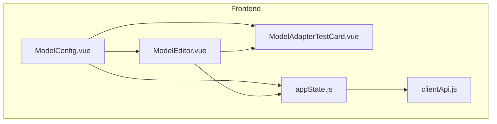
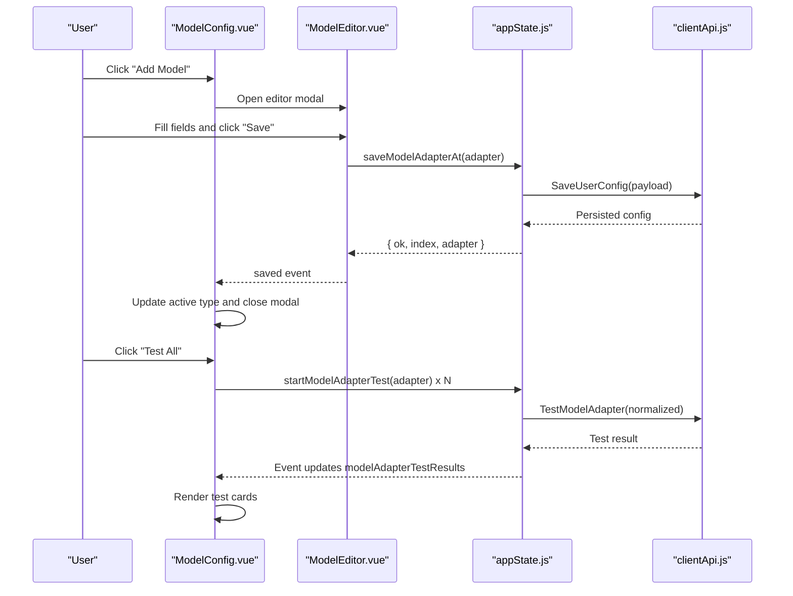
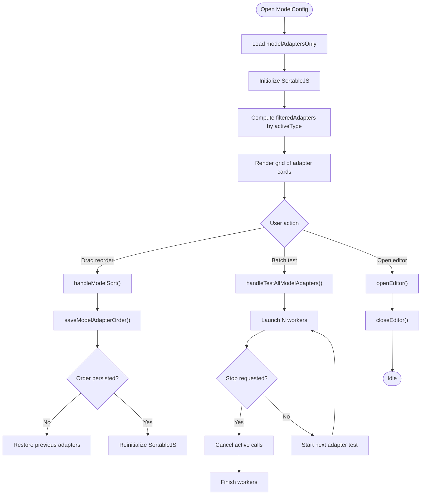
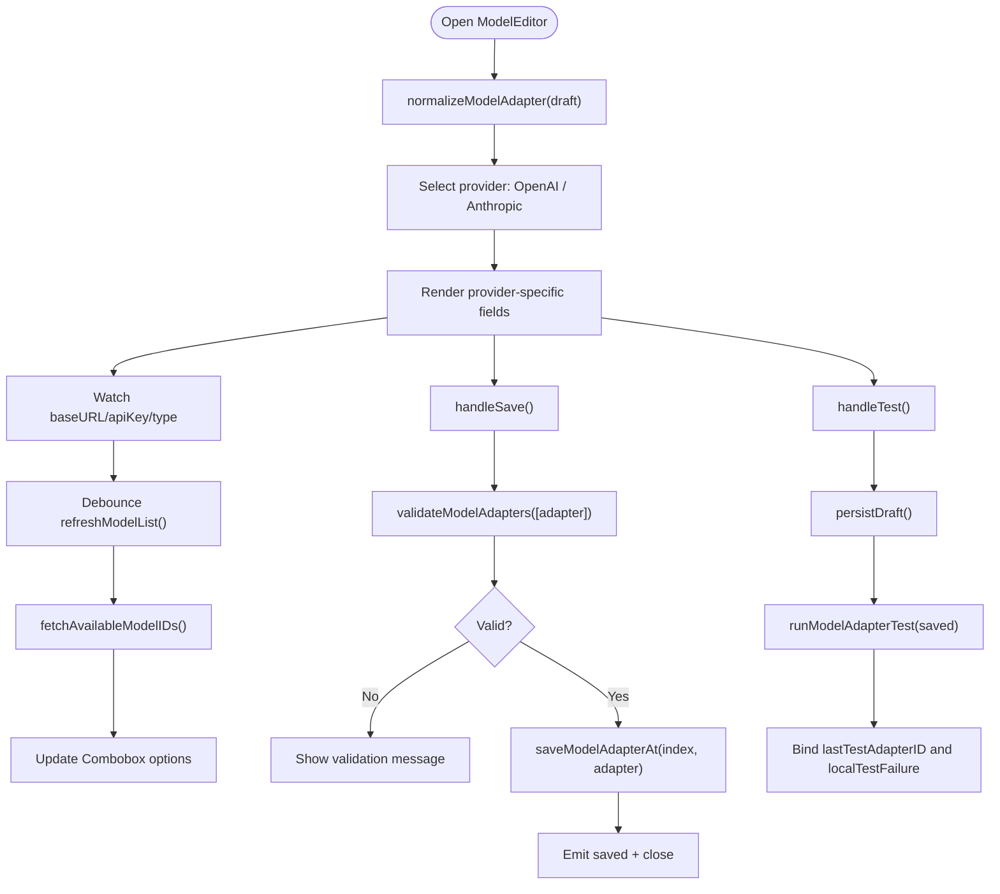
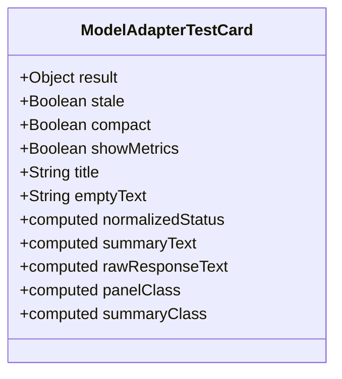
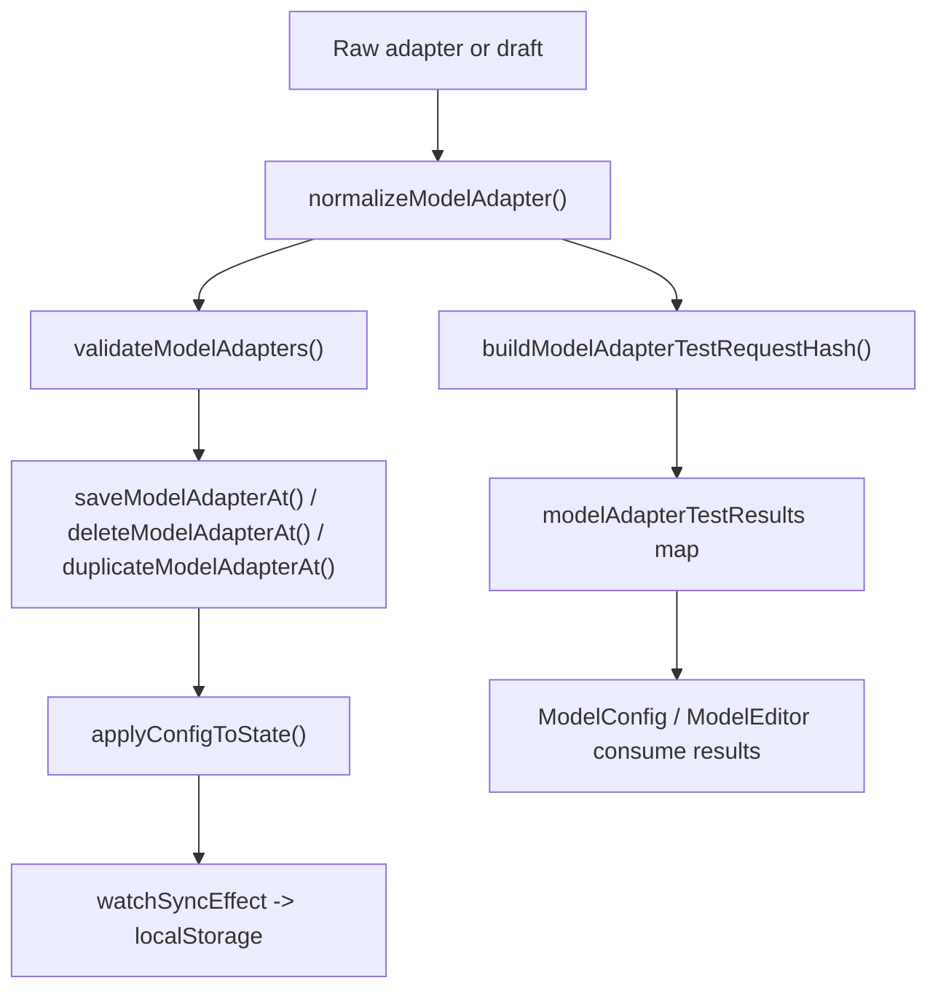
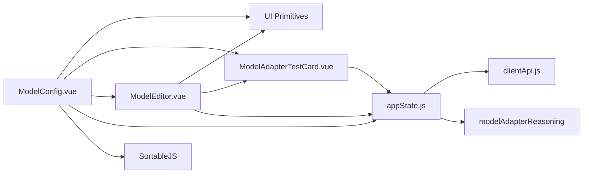

# UI Workflow and Components

<cite>
**Referenced Files in This Document**   
- [ModelConfig.vue](file://frontend/src/views/ModelConfig.vue)
- [ModelEditor.vue](file://frontend/src/components/ModelEditor.vue)
- [ModelAdapterTestCard.vue](file://frontend/src/components/ModelAdapterTestCard.vue)
- [appState.js](file://frontend/src/state/appState.js)
- [clientApi.js](file://frontend/src/services/clientApi.js)
</cite>

## Table of Contents
1. [Introduction](#introduction)
2. [Project Structure](#project-structure)
3. [Core Components](#core-components)
4. [Architecture Overview](#architecture-overview)
5. [Detailed Component Analysis](#detailed-component-analysis)
6. [Dependency Analysis](#dependency-analysis)
7. [Performance Considerations](#performance-considerations)
8. [Troubleshooting Guide](#troubleshooting-guide)
9. [Conclusion](#conclusion)

## Introduction
This document explains the model management user interface workflow and components used to configure, test, and organize OpenAI and Anthropic model adapters. It focuses on:

- The main ModelConfig view with a tabbed filter for All, OpenAI, and Anthropic.
- The grid layout system and drag-and-drop reordering powered by SortableJS.
- Batch testing capabilities that run multiple adapter tests concurrently.
- The ModelEditor component for creating and editing configurations, including form validation, real-time model discovery, and live test feedback.
- The ModelAdapterTestCard component for displaying individual and batch test results.
- State management patterns, error handling, and user feedback mechanisms across the UI flow.

## Project Structure
The relevant frontend code is organized under `frontend/src`:

- Views: top-level page components such as ModelConfig.
- Components: reusable UI pieces like ModelEditor and ModelAdapterTestCard.
- State: centralized reactive state, normalization, validation, persistence, and API orchestration.
- Services: thin wrappers around native bridge calls.

**Diagram sources**
- [ModelConfig.vue:1-22](file://frontend/src/views/ModelConfig.vue#L1-L22)
- [ModelEditor.vue:1-30](file://frontend/src/components/ModelEditor.vue#L1-L30)
- [ModelAdapterTestCard.vue:1-31](file://frontend/src/components/ModelAdapterTestCard.vue#L1-L31)
- [appState.js:1-26](file://frontend/src/state/appState.js#L1-L26)
- [clientApi.js:1-26](file://frontend/src/services/clientApi.js#L1-L26)

**Section sources**
- [ModelConfig.vue:1-22](file://frontend/src/views/ModelConfig.vue#L1-L22)
- [ModelEditor.vue:1-30](file://frontend/src/components/ModelEditor.vue#L1-L30)
- [ModelAdapterTestCard.vue:1-31](file://frontend/src/components/ModelAdapterTestCard.vue#L1-L31)
- [appState.js:1-26](file://frontend/src/state/appState.js#L1-L26)
- [clientApi.js:1-26](file://frontend/src/services/clientApi.js#L1-L26)

## Core Components
- ModelConfig: orchestrates filtering, grid rendering, sorting, batch testing, and editor modal control.
- ModelEditor: provides a typed form for OpenAI and Anthropic adapters, with validation, model list discovery, and inline testing.
- ModelAdapterTestCard: renders test status, summary text, raw response preview, and optional metrics.
- appState: centralizes configuration loading, normalization, validation, persistence, test result state, and service integration.
- clientApi: wraps native bridge methods for config I/O, proxy state, model listing, and adapter testing.

**Section sources**
- [ModelConfig.vue:24-55](file://frontend/src/views/ModelConfig.vue#L24-L55)
- [ModelEditor.vue:60-79](file://frontend/src/components/ModelEditor.vue#L60-L79)
- [ModelAdapterTestCard.vue:6-31](file://frontend/src/components/ModelAdapterTestCard.vue#L6-L31)
- [appState.js:252-276](file://frontend/src/state/appState.js#L252-L276)
- [clientApi.js:156-179](file://frontend/src/services/clientApi.js#L156-L179)

## Architecture Overview
The UI follows a unidirectional data flow:

- User interactions occur in ModelConfig and ModelEditor.
- Business logic, normalization, validation, and persistence are handled by appState.
- Native backend operations are invoked through clientApi.
- Test results are emitted via events and updated centrally in appState, then consumed by both ModelConfig and ModelEditor.

**Diagram sources**
- [ModelConfig.vue:125-148](file://frontend/src/views/ModelConfig.vue#L125-L148)
- [ModelConfig.vue:321-366](file://frontend/src/views/ModelConfig.vue#L321-L366)
- [ModelEditor.vue:252-289](file://frontend/src/components/ModelEditor.vue#L252-L289)
- [appState.js:1172-1199](file://frontend/src/state/appState.js#L1172-L1199)
- [appState.js:1093-1113](file://frontend/src/state/appState.js#L1093-L1113)
- [clientApi.js:62-64](file://frontend/src/services/clientApi.js#L62-L64)
- [clientApi.js:156-167](file://frontend/src/services/clientApi.js#L156-L167)

## Detailed Component Analysis

### ModelConfig View
Responsibilities:
- Tabbed filtering by provider type: All, OpenAI, Anthropic.
- Grid rendering of adapter cards with display name, model ID, provider badge, and compact test card.
- Drag-and-drop reordering using SortableJS with safe server-side order persistence and rollback on failure.
- Batch testing with concurrency control, progress tracking, and cancellation.
- Opening the ModelEditor modal for create/edit operations.

Key behaviors:
- Filtering uses a computed array based on the active tab.
- Sorting computes reordered adapters, assigns sort indices, persists order, and restores previous state on error.
- Batch testing launches up to a fixed number of concurrent workers, tracks active calls, and supports stop requests.
- Error messages are surfaced through a message helper.

**Diagram sources**
- [ModelConfig.vue:48-55](file://frontend/src/views/ModelConfig.vue#L48-L55)
- [ModelConfig.vue:158-184](file://frontend/src/views/ModelConfig.vue#L158-L184)
- [ModelConfig.vue:194-249](file://frontend/src/views/ModelConfig.vue#L194-L249)
- [ModelConfig.vue:321-366](file://frontend/src/views/ModelConfig.vue#L321-L366)
- [ModelConfig.vue:368-377](file://frontend/src/views/ModelConfig.vue#L368-L377)

**Section sources**
- [ModelConfig.vue:24-55](file://frontend/src/views/ModelConfig.vue#L24-L55)
- [ModelConfig.vue:150-184](file://frontend/src/views/ModelConfig.vue#L150-L184)
- [ModelConfig.vue:194-249](file://frontend/src/views/ModelConfig.vue#L194-L249)
- [ModelConfig.vue:321-366](file://frontend/src/views/ModelConfig.vue#L321-L366)
- [ModelConfig.vue:368-377](file://frontend/src/views/ModelConfig.vue#L368-L377)

### ModelEditor Component
Responsibilities:
- Create or edit a model adapter configuration for OpenAI or Anthropic.
- Provide provider-specific fields, presets, and tooltips.
- Validate inputs before saving and testing.
- Discover available model IDs from the backend when base URL and API key are present.
- Run an inline test and show real-time feedback.

Validation highlights:
- Required fields: type, baseURL, apiKey, displayName, modelID.
- Provider-specific constraints: reasoning effort, endpoint selection, token limits, thinking effort.
- JSON object validation for extra parameters and custom headers.
- Duplicate identity detection across adapters.

Real-time features:
- Debounced model list fetching after typing base URL or API key.
- Live test result binding with stale result detection.
- Local test failure capture and fallback to remembered adapter test result.

**Diagram sources**
- [ModelEditor.vue:60-79](file://frontend/src/components/ModelEditor.vue#L60-L79)
- [ModelEditor.vue:172-194](file://frontend/src/components/ModelEditor.vue#L172-L194)
- [ModelEditor.vue:213-250](file://frontend/src/components/ModelEditor.vue#L213-L250)
- [ModelEditor.vue:252-289](file://frontend/src/components/ModelEditor.vue#L252-L289)
- [ModelEditor.vue:308-345](file://frontend/src/components/ModelEditor.vue#L308-L345)
- [ModelEditor.vue:347-391](file://frontend/src/components/ModelEditor.vue#L347-L391)

**Section sources**
- [ModelEditor.vue:60-79](file://frontend/src/components/ModelEditor.vue#L60-L79)
- [ModelEditor.vue:172-194](file://frontend/src/components/ModelEditor.vue#L172-L194)
- [ModelEditor.vue:213-250](file://frontend/src/components/ModelEditor.vue#L213-L250)
- [ModelEditor.vue:252-289](file://frontend/src/components/ModelEditor.vue#L252-L289)
- [ModelEditor.vue:308-345](file://frontend/src/components/ModelEditor.vue#L308-L345)
- [ModelEditor.vue:347-391](file://frontend/src/components/ModelEditor.vue#L347-L391)

### ModelAdapterTestCard Component
Responsibilities:
- Display normalized test status: idle, running, success, error.
- Show summary text, raw response preview, and optional metrics (duration, output tokens).
- Indicate stale results when the current configuration differs from the cached test request hash.

Behavior:
- Normalizes input result and maps unknown statuses to idle.
- Derives styling and summary text based on status and presence of metrics.
- Supports compact mode for use inside adapter cards.

**Diagram sources**
- [ModelAdapterTestCard.vue:6-31](file://frontend/src/components/ModelAdapterTestCard.vue#L6-L31)
- [ModelAdapterTestCard.vue:33-99](file://frontend/src/components/ModelAdapterTestCard.vue#L33-L99)

**Section sources**
- [ModelAdapterTestCard.vue:6-31](file://frontend/src/components/ModelAdapterTestCard.vue#L6-L31)
- [ModelAdapterTestCard.vue:33-99](file://frontend/src/components/ModelAdapterTestCard.vue#L33-L99)

### State Management Patterns
Centralized reactive state in appState includes:

- Configuration normalization and validation helpers.
- Adapter identity hashing for deduplication and test result caching.
- Test result state map keyed by adapter ID, with fallback lookup by request hash.
- Persistence functions for saving, reloading, deleting, duplicating, and reordering adapters.
- Event-driven updates for proxy state, user config changes, and test result updates.

Key patterns:
- normalizeModelAdapter ensures consistent field names and types across providers.
- validateModelAdapters enforces required fields, provider constraints, JSON validity, and uniqueness.
- buildModelAdapterTestRequestHash enables stale result detection and result reuse.
- startModelAdapterTest normalizes, validates, invokes the backend test, and updates the global test results map.

**Diagram sources**
- [appState.js:334-396](file://frontend/src/state/appState.js#L334-L396)
- [appState.js:424-493](file://frontend/src/state/appState.js#L424-L493)
- [appState.js:1059-1085](file://frontend/src/state/appState.js#L1059-L1085)
- [appState.js:1093-1113](file://frontend/src/state/appState.js#L1093-L1113)
- [appState.js:1172-1261](file://frontend/src/state/appState.js#L1172-L1261)
- [appState.js:868-900](file://frontend/src/state/appState.js#L868-L900)

**Section sources**
- [appState.js:334-396](file://frontend/src/state/appState.js#L334-L396)
- [appState.js:424-493](file://frontend/src/state/appState.js#L424-L493)
- [appState.js:1059-1085](file://frontend/src/state/appState.js#L1059-L1085)
- [appState.js:1093-1113](file://frontend/src/state/appState.js#L1093-L1113)
- [appState.js:1172-1261](file://frontend/src/state/appState.js#L1172-L1261)
- [appState.js:868-900](file://frontend/src/state/appState.js#L868-L900)

### Error Handling and User Feedback
- Message helper surfaces errors from actions like import/export, deletion, duplication, and sorting.
- Sorting failures restore previous adapter order and notify the user.
- Batch testing ignores per-card failures but continues processing other adapters; cancellation stops active calls.
- ModelEditor captures local test failures and falls back to remembered adapter test results when possible.
- Global error conversion function normalizes backend errors into user-friendly messages.

**Section sources**
- [ModelConfig.vue:86-89](file://frontend/src/views/ModelConfig.vue#L86-L89)
- [ModelConfig.vue:194-249](file://frontend/src/views/ModelConfig.vue#L194-L249)
- [ModelConfig.vue:305-318](file://frontend/src/views/ModelConfig.vue#L305-L318)
- [ModelEditor.vue:308-345](file://frontend/src/components/ModelEditor.vue#L308-L345)
- [appState.js:1434-1437](file://frontend/src/state/appState.js#L1434-L1437)

## Dependency Analysis
Component and module dependencies:

- ModelConfig depends on:
  - UI primitives (Button, Card, ContentModal).
  - ModelAdapterTestCard for compact test display.
  - ModelEditor for create/edit modal.
  - appState for configuration and test operations.
  - SortableJS for drag-and-drop.

- ModelEditor depends on:
  - UI primitives (Button, Combobox, Input, Select, Tooltip).
  - ModelAdapterTestCard for inline test results.
  - appState for normalization, validation, persistence, model listing, and testing.

- ModelAdapterTestCard depends on:
  - Tooltip and formatDuration utility from appState.

- appState depends on:
  - clientApi for all native bridge calls.
  - modelAdapterReasoning for supported reasoning effort values.

**Diagram sources**
- [ModelConfig.vue:1-22](file://frontend/src/views/ModelConfig.vue#L1-L22)
- [ModelEditor.vue:1-30](file://frontend/src/components/ModelEditor.vue#L1-L30)
- [ModelAdapterTestCard.vue:1-5](file://frontend/src/components/ModelAdapterTestCard.vue#L1-L5)
- [appState.js:1-26](file://frontend/src/state/appState.js#L1-L26)
- [clientApi.js:1-26](file://frontend/src/services/clientApi.js#L1-L26)

**Section sources**
- [ModelConfig.vue:1-22](file://frontend/src/views/ModelConfig.vue#L1-L22)
- [ModelEditor.vue:1-30](file://frontend/src/components/ModelEditor.vue#L1-L30)
- [ModelAdapterTestCard.vue:1-5](file://frontend/src/components/ModelAdapterTestCard.vue#L1-L5)
- [appState.js:1-26](file://frontend/src/state/appState.js#L1-L26)
- [clientApi.js:1-26](file://frontend/src/services/clientApi.js#L1-L26)

## Performance Considerations
- Batch testing concurrency is capped at a fixed constant to avoid overwhelming the backend.
- Model list fetching is debounced to reduce unnecessary network calls while typing.
- Test results are cached by adapter ID and request hash to avoid redundant computations and enable stale detection.
- SortableJS is reinitialized only when necessary and disabled during saving or batch testing to prevent conflicting state mutations.

[No sources needed since this section provides general guidance]

## Troubleshooting Guide
Common issues and resolutions:

- Sorting fails:
  - The view restores the previous adapter order and shows an error message.
  - Ensure no concurrent config saves or batch testing are in progress.

- Batch testing does not stop immediately:
  - Active calls are canceled; completion counters update after each worker finishes.
  - Check for cancel errors and ensure stop flag is set.

- Model list not updating:
  - Verify base URL and API key are provided.
  - Confirm debounce timer is cleared on component unmount.

- Test result appears stale:
  - The card indicates configuration has changed; rerun the test to refresh the result.

- Validation errors:
  - Required fields must be filled.
  - JSON objects must be valid and match expected structure.
  - Provider-specific fields must satisfy allowed values.

**Section sources**
- [ModelConfig.vue:194-249](file://frontend/src/views/ModelConfig.vue#L194-L249)
- [ModelConfig.vue:305-318](file://frontend/src/views/ModelConfig.vue#L305-L318)
- [ModelEditor.vue:213-250](file://frontend/src/components/ModelEditor.vue#L213-L250)
- [ModelEditor.vue:393-395](file://frontend/src/components/ModelEditor.vue#L393-L395)
- [ModelAdapterTestCard.vue:63-99](file://frontend/src/components/ModelAdapterTestCard.vue#L63-L99)
- [appState.js:424-493](file://frontend/src/state/appState.js#L424-L493)

## Conclusion
The model management UI centers on a clear separation of concerns:

- ModelConfig manages filtering, ordering, and batch operations.
- ModelEditor handles detailed configuration with robust validation and live feedback.
- ModelAdapterTestCard presents consistent test outcomes across contexts.
- appState provides normalization, validation, persistence, and event-driven updates.
- clientApi abstracts native bridge calls for reliable communication with the backend.

Together, these components deliver a responsive, validated, and observable workflow for managing OpenAI and Anthropic model adapters.