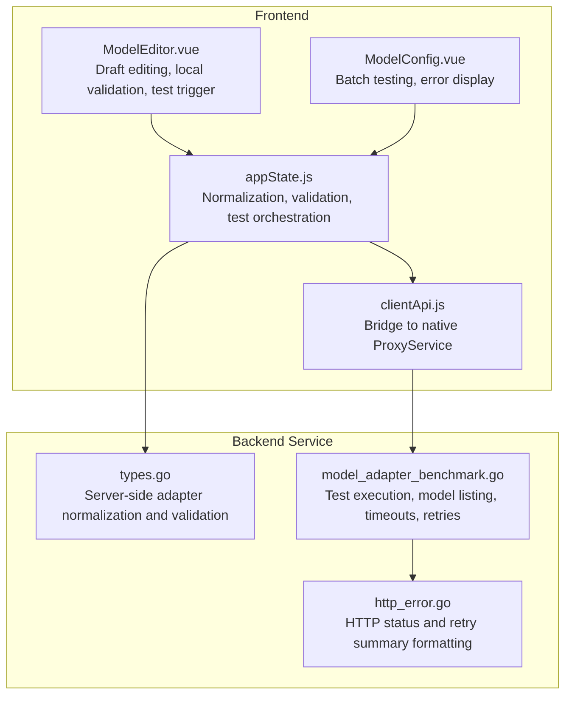
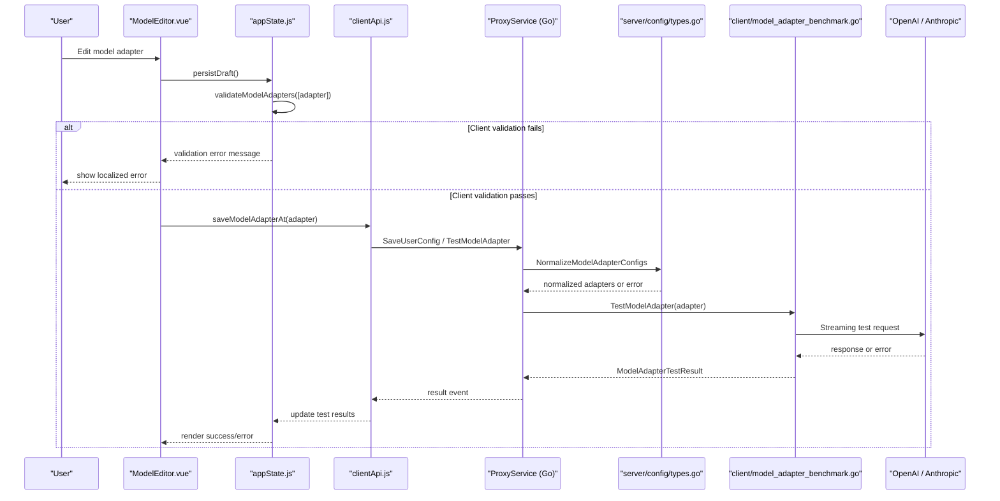
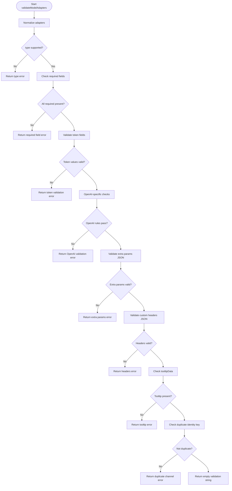
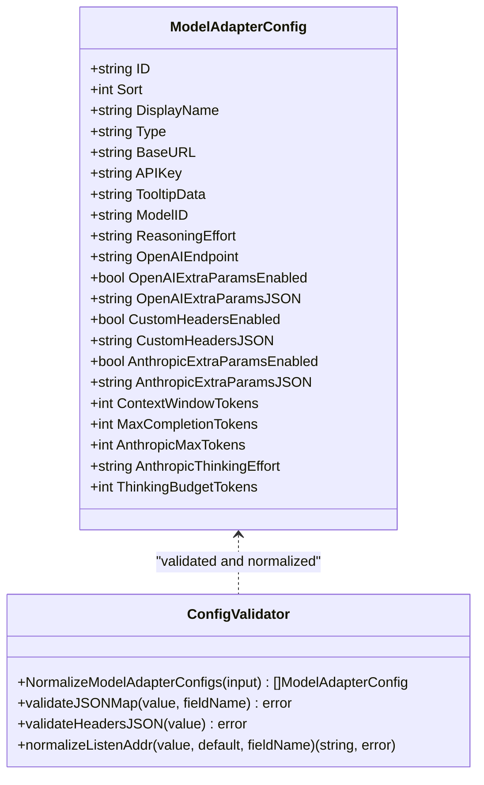
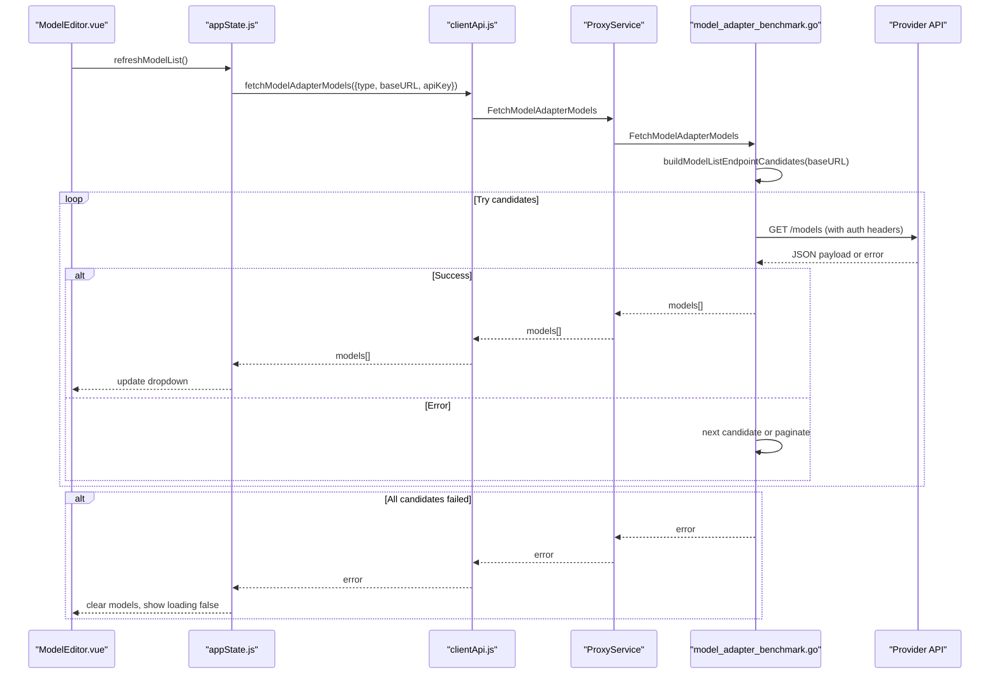
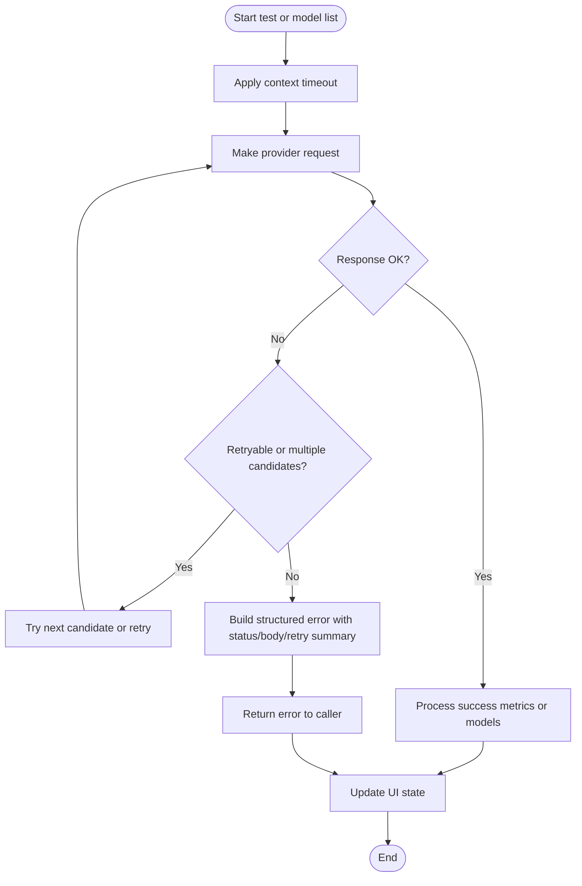
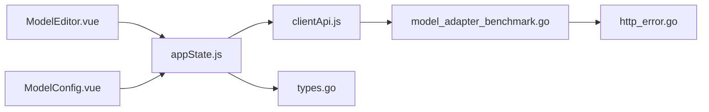

# Validation and Error Handling

<cite>
**Referenced Files in This Document**
- [appState.js](file://frontend/src/state/appState.js)
- [ModelEditor.vue](file://frontend/src/components/ModelEditor.vue)
- [ModelConfig.vue](file://frontend/src/views/ModelConfig.vue)
- [clientApi.js](file://frontend/src/services/clientApi.js)
- [types.go](file://internal/backend/server/config/types.go)
- [model_adapter_benchmark.go](file://internal/client/model_adapter_benchmark.go)
- [http_error.go](file://internal/backend/agent/model/http_error.go)
- [en-US.json](file://frontend/src/i18n/locales/en-US.json)
</cite>

## Table of Contents
1. [Introduction](#introduction)
2. [Project Structure](#project-structure)
3. [Core Components](#core-components)
4. [Architecture Overview](#architecture-overview)
5. [Detailed Component Analysis](#detailed-component-analysis)
6. [Dependency Analysis](#dependency-analysis)
7. [Performance Considerations](#performance-considerations)
8. [Troubleshooting Guide](#troubleshooting-guide)
9. [Conclusion](#conclusion)

## Introduction
This document explains how model configuration validation and error handling work across the client UI, the backend service, and the provider integration layer. It covers:
- Client-side validation rules for model adapters
- Server-side normalization and validation
- Error message localization through i18n
- Network connectivity validation, API key verification, and endpoint reachability checks
- How errors are detected, reported, and resolved in the UI
- Retry mechanisms, timeout handling, and graceful degradation when connections fail

The system is designed so that most user-facing validation happens early in the frontend, while server-side normalization ensures safe defaults and consistent behavior before network calls are made.

## Project Structure
The validation and error handling flow spans three main layers:
- Frontend state and UI components handle input normalization, field-level validation, test orchestration, and localized error display
- Backend config types normalize and validate adapter configurations before they are used
- The client benchmarking layer performs provider tests, model listing, timeouts, retries, and structured error reporting

**Diagram sources**
- [appState.js:424-493](file://frontend/src/state/appState.js#L424-L493)
- [ModelEditor.vue:252-280](file://frontend/src/components/ModelEditor.vue#L252-L280)
- [ModelConfig.vue:297-366](file://frontend/src/views/ModelConfig.vue#L297-L366)
- [clientApi.js:156-179](file://frontend/src/services/clientApi.js#L156-L179)
- [types.go:95-172](file://internal/backend/server/config/types.go#L95-L172)
- [model_adapter_benchmark.go:165-196](file://internal/client/model_adapter_benchmark.go#L165-L196)
- [http_error.go:16-41](file://internal/backend/agent/model/http_error.go#L16-L41)

**Section sources**
- [appState.js:424-493](file://frontend/src/state/appState.js#L424-L493)
- [ModelEditor.vue:252-280](file://frontend/src/components/ModelEditor.vue#L252-L280)
- [ModelConfig.vue:297-366](file://frontend/src/views/ModelConfig.vue#L297-L366)
- [clientApi.js:156-179](file://frontend/src/services/clientApi.js#L156-L179)
- [types.go:95-172](file://internal/backend/server/config/types.go#L95-L172)
- [model_adapter_benchmark.go:165-196](file://internal/client/model_adapter_benchmark.go#L165-L196)
- [http_error.go:16-41](file://internal/backend/agent/model/http_error.go#L16-L41)

## Core Components
- **Client-side validation**: `validateModelAdapters` enforces required fields, supported types, token limits, OpenAI endpoints, extra parameters JSON, custom headers JSON, tooltip text, thinking budget tokens, and duplicate channel detection.
- **Server-side validation**: `NormalizeModelAdapterConfigs` normalizes base URLs, types, token values, reasoning effort, Anthropic thinking effort, extra parameters, custom headers, and rejects invalid or duplicate adapters.
- **Test execution and error reporting**: `TestModelAdapter`, `runModelAdapterTest`, and `executeOpenAIStreamingTest` / `executeAnthropicStreamingTest` perform streaming tests with timeouts, metrics collection, and structured error results.
- **Model list fetching**: `FetchModelAdapterModels` validates inputs, builds candidate endpoints, paginates where needed, and returns normalized model IDs.
- **Error formatting**: `buildModelAdapterHTTPStatusError` and `buildHTTPStatusError` produce readable HTTP error messages including retry attempt summaries.
- **Localization**: English messages are defined in `en-US.json`; Chinese messages are embedded directly in frontend validation logic.

**Section sources**
- [appState.js:424-493](file://frontend/src/state/appState.js#L424-L493)
- [types.go:95-172](file://internal/backend/server/config/types.go#L95-L172)
- [model_adapter_benchmark.go:413-518](file://internal/client/model_adapter_benchmark.go#L413-L518)
- [model_adapter_benchmark.go:165-196](file://internal/client/model_adapter_benchmark.go#L165-L196)
- [http_error.go:16-41](file://internal/backend/agent/model/http_error.go#L16-L41)
- [en-US.json:1-249](file://frontend/src/i18n/locales/en-US.json#L1-L249)

## Architecture Overview
The validation and error handling architecture follows a layered approach:

**Diagram sources**
- [ModelEditor.vue:252-280](file://frontend/src/components/ModelEditor.vue#L252-L280)
- [appState.js:424-493](file://frontend/src/state/appState.js#L424-L493)
- [clientApi.js:156-179](file://frontend/src/services/clientApi.js#L156-L179)
- [types.go:95-172](file://internal/backend/server/config/types.go#L95-L172)
- [model_adapter_benchmark.go:413-518](file://internal/client/model_adapter_benchmark.go#L413-L518)

## Detailed Component Analysis

### Client-Side Validation Rules
The frontend validates model adapters before saving or testing. Key rules include:
- Required fields: type, baseURL, apiKey, displayName, modelID, tooltipData
- Supported types: openai, anthropic
- Token constraints: contextWindowTokens, maxCompletionTokens, anthropicMaxTokens, thinkingBudgetTokens must be positive integers when provided
- OpenAI-specific: reasoningEffort must be one of the supported values; openAIEndpoint must be `/v1/responses`, `/v1/chat/completions`, or a custom path starting with `/`
- Extra parameters: openAIExtraParamsJSON and anthropicExtraParamsJSON must be valid JSON objects when enabled
- Custom headers: customHeadersJSON must be a JSON object with string values and non-empty header names
- Duplicate detection: identity key based on baseURL, modelID, apiKey, displayName, and openAIEndpoint prevents duplicate channels

These validations return user-friendly messages in Chinese, which are shown via the message composable.

**Diagram sources**
- [appState.js:424-493](file://frontend/src/state/appState.js#L424-L493)

**Section sources**
- [appState.js:424-493](file://frontend/src/state/appState.js#L424-L493)

### Server-Side Normalization and Validation
The backend normalizes and validates adapter configurations:
- Base URL normalization using `modelchannel.NormalizeBaseURL`
- Type normalization to lowercase and restricted set
- Token value normalization to positive integers or zero
- Reasoning effort normalization and validation
- OpenAI endpoint normalization and validation
- Extra parameters JSON validation
- Custom headers JSON validation with string value enforcement
- Duplicate channel ID detection using `modelchannel.BuildChannelID`

Errors returned by the server are descriptive and help users correct their configuration.

**Diagram sources**
- [types.go:23-45](file://internal/backend/server/config/types.go#L23-L45)
- [types.go:95-172](file://internal/backend/server/config/types.go#L95-L172)
- [types.go:194-224](file://internal/backend/server/config/types.go#L194-L224)
- [types.go:250-267](file://internal/backend/server/config/types.go#L250-L267)

**Section sources**
- [types.go:95-172](file://internal/backend/server/config/types.go#L95-L172)
- [types.go:194-224](file://internal/backend/server/config/types.go#L194-L224)
- [types.go:250-267](file://internal/backend/server/config/types.go#L250-L267)

### Network Connectivity Validation, API Key Verification, and Endpoint Reachability
The system performs several network-related validations:
- **Base URL validation**: Both frontend and backend ensure baseURL is a valid HTTP/HTTPS URL
- **API key presence**: Required for both client-side validation and server-side normalization
- **Endpoint reachability**: `FetchModelAdapterModels` tries multiple candidate endpoints for model listing, handling pagination and provider-specific headers
- **Streaming test reachability**: `TestModelAdapter` sends a streaming request to verify the endpoint responds with expected output

Timeouts and limits:
- Model listing timeout: 20 seconds
- Test timeout: 45 seconds
- Maximum body size for model listing: 8 MB
- Maximum error body bytes: 8 KB

Retry mechanisms:
- HTTP status errors include retry attempt summaries from the provider layer
- Provider retry information is extracted and included in error messages

Graceful degradation:
- If model listing fails, the UI clears available models and allows manual entry
- If streaming test fails, the UI shows error status without blocking other operations

**Diagram sources**
- [model_adapter_benchmark.go:165-196](file://internal/client/model_adapter_benchmark.go#L165-L196)
- [model_adapter_benchmark.go:198-236](file://internal/client/model_adapter_benchmark.go#L198-L236)
- [model_adapter_benchmark.go:246-321](file://internal/client/model_adapter_benchmark.go#L246-L321)
- [ModelEditor.vue:213-250](file://frontend/src/components/ModelEditor.vue#L213-L250)

**Section sources**
- [model_adapter_benchmark.go:165-196](file://internal/client/model_adapter_benchmark.go#L165-L196)
- [model_adapter_benchmark.go:198-236](file://internal/client/model_adapter_benchmark.go#L198-L236)
- [model_adapter_benchmark.go:246-321](file://internal/client/model_adapter_benchmark.go#L246-L321)
- [ModelEditor.vue:213-250](file://frontend/src/components/ModelEditor.vue#L213-L250)

### Error Message Localization
English messages are centralized in `en-US.json`. Examples include:
- `{0} type only supports OpenAI or Anthropic`
- `{0} base URL cannot be empty`
- `{0} API key cannot be empty`
- `{0} model ID cannot be empty`
- `{0} display name cannot be empty`
- `{0} OpenAI endpoint only supports /v1/responses, /v1/chat/completions, or a custom path starting with /`
- `{0} must be a valid JSON object`
- `Duplicate model channel detected. Please check the combination of url, modelID, apiKey, displayName, and endpoint`

Chinese messages are embedded directly in the frontend validation logic for immediate feedback during editing.

**Section sources**
- [en-US.json:1-249](file://frontend/src/i18n/locales/en-US.json#L1-L249)
- [appState.js:424-493](file://frontend/src/state/appState.js#L424-L493)

### Common Validation Errors, Causes, and Resolution Steps

| Error Category | Example Cause | Resolution Step |
|---|---|---|
| Missing required fields | baseURL, apiKey, displayName, modelID, or tooltipData not filled | Fill all required fields before saving or testing |
| Unsupported type | type is not openai or anthropic | Set type to openai or anthropic |
| Invalid token values | contextWindowTokens, maxCompletionTokens, anthropicMaxTokens, or thinkingBudgetTokens are not positive integers | Enter positive integers or leave blank to use defaults |
| Invalid OpenAI endpoint | openAIEndpoint is not `/v1/responses`, `/v1/chat/completions`, or a custom path starting with `/` | Select a supported endpoint or enter a full custom URL |
| Invalid extra parameters JSON | openAIExtraParamsJSON or anthropicExtraParamsJSON is not a valid JSON object | Fix JSON syntax and ensure it is an object |
| Invalid custom headers JSON | customHeadersJSON has non-string values or empty header names | Ensure all header values are strings and names are non-empty |
| Duplicate channel | Same baseURL, modelID, apiKey, displayName, and openAIEndpoint combination exists | Change one of the identifying fields to make the channel unique |
| Model listing failure | Provider endpoint unreachable or authentication failed | Verify baseURL and apiKey, then try again; manual model entry is still possible |
| Streaming test failure | Provider returned error, no text output, or timeout occurred | Check raw response details, verify credentials and endpoint, then retest |

**Section sources**
- [appState.js:424-493](file://frontend/src/state/appState.js#L424-L493)
- [model_adapter_benchmark.go:413-518](file://internal/client/model_adapter_benchmark.go#L413-L518)

### Retry Mechanisms, Timeout Handling, and Graceful Degradation
- **Timeouts**:
  - Model listing: 20 seconds
  - Streaming test: 45 seconds
- **Retries**:
  - HTTP status errors include retry attempt summaries from the provider layer
  - Multiple candidate endpoints are tried for model listing
- **Graceful degradation**:
  - If model listing fails, the UI clears the dropdown and allows manual model ID entry
  - If streaming test fails, the UI shows error status without blocking batch testing or other operations
  - Batch testing continues even if individual adapters fail

**Diagram sources**
- [model_adapter_benchmark.go:165-196](file://internal/client/model_adapter_benchmark.go#L165-L196)
- [model_adapter_benchmark.go:413-518](file://internal/client/model_adapter_benchmark.go#L413-L518)
- [http_error.go:16-41](file://internal/backend/agent/model/http_error.go#L16-L41)

**Section sources**
- [model_adapter_benchmark.go:165-196](file://internal/client/model_adapter_benchmark.go#L165-L196)
- [model_adapter_benchmark.go:413-518](file://internal/client/model_adapter_benchmark.go#L413-L518)
- [http_error.go:16-41](file://internal/backend/agent/model/http_error.go#L16-L41)

## Dependency Analysis
The validation and error handling system depends on:
- Frontend state management for normalization and validation
- Vue components for user interaction and error display
- Native bridge functions for calling backend services
- Go backend for configuration normalization and provider integration
- Provider APIs for actual model listing and streaming responses

**Diagram sources**
- [ModelEditor.vue:252-280](file://frontend/src/components/ModelEditor.vue#L252-L280)
- [ModelConfig.vue:297-366](file://frontend/src/views/ModelConfig.vue#L297-L366)
- [appState.js:424-493](file://frontend/src/state/appState.js#L424-L493)
- [clientApi.js:156-179](file://frontend/src/services/clientApi.js#L156-L179)
- [model_adapter_benchmark.go:165-196](file://internal/client/model_adapter_benchmark.go#L165-L196)
- [http_error.go:16-41](file://internal/backend/agent/model/http_error.go#L16-L41)
- [types.go:95-172](file://internal/backend/server/config/types.go#L95-L172)

**Section sources**
- [ModelEditor.vue:252-280](file://frontend/src/components/ModelEditor.vue#L252-L280)
- [ModelConfig.vue:297-366](file://frontend/src/views/ModelConfig.vue#L297-L366)
- [appState.js:424-493](file://frontend/src/state/appState.js#L424-L493)
- [clientApi.js:156-179](file://frontend/src/services/clientApi.js#L156-L179)
- [model_adapter_benchmark.go:165-196](file://internal/client/model_adapter_benchmark.go#L165-L196)
- [http_error.go:16-41](file://internal/backend/agent/model/http_error.go#L16-L41)
- [types.go:95-172](file://internal/backend/server/config/types.go#L95-L172)

## Performance Considerations
- Client-side validation runs synchronously and avoids unnecessary network calls
- Model listing uses debounced requests to prevent excessive API calls while typing
- Batch testing limits concurrency to avoid overwhelming the provider or UI
- Streaming tests collect minimal metrics to compute tokens per second and first token latency
- Error bodies are limited to prevent large payloads from impacting performance

[No sources needed since this section provides general guidance]

## Troubleshooting Guide
Common issues and resolutions:
- **Configuration save fails**: Check client-side validation messages; ensure all required fields are filled and JSON fields are valid
- **Model dropdown empty**: Verify baseURL and apiKey; click "Fetch Models" again; if it fails, manually enter a model ID
- **Test shows error**: Review raw response details; check provider credentials and endpoint; retest after fixing configuration
- **Batch testing stops unexpectedly**: Individual failures do not stop the batch; check each adapter's test result card
- **Network errors**: Verify proxy settings and outbound connectivity; check system proxy indicators in the UI

**Section sources**
- [ModelConfig.vue:297-366](file://frontend/src/views/ModelConfig.vue#L297-L366)
- [ModelEditor.vue:213-250](file://frontend/src/components/ModelEditor.vue#L213-L250)
- [appState.js:424-493](file://frontend/src/state/appState.js#L424-L493)

## Conclusion
The validation and error handling system combines robust client-side checks, server-side normalization, and resilient network operations. Users receive immediate feedback through localized messages, while the backend ensures safe defaults and consistent behavior. Timeouts, retries, and graceful degradation provide a reliable experience even when provider endpoints are unavailable or misconfigured.

[No sources needed since this section summarizes without analyzing specific files]